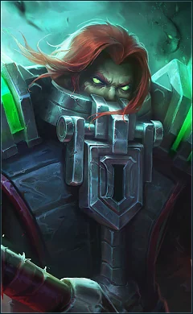

[Tier list](https://boostmlbb.ru/en/heroes/)

# Phoveus

B

FighterEXP Lane

Win rate

48.6%

Pick rate

0.3%

Ban rate

0.5%

[Overview](https://boostmlbb.ru/#overview)[Build](https://boostmlbb.ru/#build)[How to play](https://boostmlbb.ru/#howto)[Skills](https://boostmlbb.ru/#skills)[Counters](https://boostmlbb.ru/#draft)[Skins](https://boostmlbb.ru/#skins)[Lore](https://boostmlbb.ru/#lore)

## Overview

### Attributes

-   Durability**60**
-   Offense**80**
-   Control**50**
-   Difficulty**40**

-   Regen
-   Damage

### More fighters on this lane

[Freya](https://boostmlbb.ru/en/heroes/freya.html)[Aulus](https://boostmlbb.ru/en/heroes/aulus.html)[Paquito](https://boostmlbb.ru/en/heroes/paquito.html)[Sun](https://boostmlbb.ru/en/heroes/sun.html)[Lukas](https://boostmlbb.ru/en/heroes/lukas.html)[Cici](https://boostmlbb.ru/en/heroes/cici.html)[Sora](https://boostmlbb.ru/en/heroes/sora.html)[Yu Zhong](https://boostmlbb.ru/en/heroes/yu-zhong.html)

### Places in the rankings

-   [Best MLBB fighters**19 of 44**](https://boostmlbb.ru/en/heroes/best-fighter.html)

## Build

Build 1Build 2Build 3

Win rate

57.1%

Pick rate

5.1%

#### Core items

-   [

    

    War Axe

    ](https://boostmlbb.ru/en/items/war-axe.html)
-   [

    

    Oracle

    ](https://boostmlbb.ru/en/items/oracle.html)
-   [

    

    Queen's Wings

    ](https://boostmlbb.ru/en/items/queens-wings.html)

#### Spell

Vengeance

#### Emblem and talents

Fighter

-   

    Thrill

-   

    Festival of Blood

-   

    Brave Smite

Win rate

56.1%

Pick rate

2.5%

#### Core items

-   [

    

    Thunder Belt

    ](https://boostmlbb.ru/en/items/thunder-belt.html)
-   [

    

    Dominance Ice

    ](https://boostmlbb.ru/en/items/dominance-ice.html)
-   [

    

    Antique Cuirass

    ](https://boostmlbb.ru/en/items/antique-cuirass.html)

#### Spell

Vengeance

#### Emblem and talents

Fighter

-   

    Thrill

-   

    Festival of Blood

-   

    Brave Smite

Win rate

57.4%

Pick rate

2.4%

#### Core items

-   [

    

    War Axe

    ](https://boostmlbb.ru/en/items/war-axe.html)
-   [

    

    Queen's Wings

    ](https://boostmlbb.ru/en/items/queens-wings.html)
-   [

    

    Oracle

    ](https://boostmlbb.ru/en/items/oracle.html)

#### Spell

Vengeance

#### Emblem and talents

Fighter

-   

    Thrill

-   

    Festival of Blood

-   

    Brave Smite

## How to play Phoveus

### Phoveus combos

#### Teamfight

1.  Attack
2.  Ult
3.  1
4.  2

In teamfights, Phoveus should use his enhanced Basic Attack to charge at the enemy while knocking them back and marking them. Then immediately follow up with his Ultimate. Next, hit the target with his 1st Skill, then use his 2nd skill and his Ultimate again. Finally, use the enhanced 1st Skill to mark the enemy once more, and use his Ultimate.

#### Laning

1.  1
2.  1
3.  Attack
4.  2

In the laning phase, Phoveus should first use his enhanced Basic Attack to hit the enemy hero and gain a shield. Follow up with his 1st Skill to chip away their HP, then use his enhanced 1st Skill for additional damage and to slow the target, and end with his 2nd Skill for more damage.

### When strongest

Even through the game, from 45.7% to 50.7%. Pick fights by your items rather than the clock.

1.  **45.7**10–12
2.  **49.2**12–14
3.  **50.7**14–16
4.  **49.5**16–18
5.  **48.9**18–20
6.  **48.1**20+

Win rate % by match length in minutes, all ranks. Dashed line: 50%

### Level-up priority

1.  Infernal Pursuit
2.  Demonic Impact
3.  Dark Wave

## Skills

Passive**Demonic Force**Skill 1**Demonic Impact**Skill 2**Dark Wave**Ultimate**Infernal Pursuit**

Passive

### Demonic Force

Phoveus's next Basic Attack charges at the enemy, knocking them back, dealing extra Magic Damage equal to 4% - 6% of the enemy's (scales with level), and gaining a 8% - 12% shield. Cooldown: 26s-14s (based on Infernal Pursuit's level).

**Astaros' Gaze:** Whenever an enemy hero blinks, dashes, or is displaced within 8 units, reduces the cooldown of Demonic Force by 20% and other skills by 0.5s.

Skill 1

### Demonic Impact

Cooldown **6 s**

Phoveus slams his monolith into the ground, dealing 200 (+120% Total Physical Attack) Physical Damage to enemies in the area and slowing them by 70% for 0.5s. If this skill hits an enemy, Phoveus's next Demonic Impact will leave behind an Astaros Eye.

**Astaros Eye:** Implodes after a short delay, dealing 100 (+60% Total Physical Attack) Magic Damage to the enemies.

Skill 2

### Dark Wave

Cooldown **10 s**

Phoveus lowers his monolith and releases his demonic power in the target direction, knocking enemies airborne, dragging them along, and dealing 250 (+100% Extra Physical Attack) Magic Damage.

Ultimate

### Infernal Pursuit

**Passive:** Demonic Force, Astaros Eye, and Dark Wave apply Sinner's Mark to enemy heroes hit.

**Active:** Phoveus leaps into the air and smashes down with his monolith at the enemy hero with Sinner's Mark, dealing 250 (+100% Total Physical Attack) (+ 5% target's ) Physical Damage to enemies in the area and recovering 50 (+ 6% of his ).

Infernal Pursuit can only be used when there are enemies with Sinner's Mark nearby. HP recovered is reduced by 80% when multiple enemies are hit.

## Phoveus counters

### Who counters Phoveus

[Wanwan](https://boostmlbb.ru/en/heroes/wanwan.html)[Harith](https://boostmlbb.ru/en/heroes/harith.html)[Freya](https://boostmlbb.ru/en/heroes/freya.html)[Benedetta](https://boostmlbb.ru/en/heroes/benedetta.html)[Ruby](https://boostmlbb.ru/en/heroes/ruby.html)

### Who Phoveus counters

[Layla](https://boostmlbb.ru/en/heroes/layla.html)[Alpha](https://boostmlbb.ru/en/heroes/alpha.html)[Cecilion](https://boostmlbb.ru/en/heroes/cecilion.html)[Julian](https://boostmlbb.ru/en/heroes/julian.html)[Barats](https://boostmlbb.ru/en/heroes/barats.html)[Minsitthar](https://boostmlbb.ru/en/heroes/minsitthar.html)[Gord](https://boostmlbb.ru/en/heroes/gord.html)[X.Borg](https://boostmlbb.ru/en/heroes/x-borg.html)[Terizla](https://boostmlbb.ru/en/heroes/terizla.html)[Bane](https://boostmlbb.ru/en/heroes/bane.html)

## Phoveus skins

[Matrix MaverickExceptional · 2025](https://boostmlbb.ru/en/skins/phoveus/matrix-maverick.html)[Monolith WatcherCommon · 2021](https://boostmlbb.ru/en/skins/phoveus/monolith-watcher.html)

[All 2 Phoveus skins: prices and how to get them](https://boostmlbb.ru/en/skins/phoveus.html)

## Lore

> A former soldier from the border of the Empire who took on the chains of sin to defend his people.

[Read the full story ↗](https://play.mobilelegends.com/lore/hero/PhoveusRE)Official Mobile Legends site [Hero stats on the game site ↗](https://www.mobilelegends.com/hero/detail?heroid=106)

**Rank up on Phoveus**The calculator shows the price

[Calculate price](https://boostmlbb.ru/en/order.html?type=hero)

## Frequently asked questions

Who counters Phoveus in MLBB?

Over the last 30 days the toughest opponents are Wanwan, Harith, Freya, Benedetta and Ruby.

How do you play Phoveus?

Level "Demonic Impact" first and take the ultimate whenever it is available. Even through the game, from 45.7% to 50.7%. Pick fights by your items rather than the clock. Teamfight combo: In teamfights, Phoveus should use his enhanced Basic Attack to charge at the enemy while knocking them back and marking them. Then immediately follow up with his Ultimate. Next, hit the target with his 1st Skill, then use his 2nd skill and his Ultimate again. Finally, use the enhanced 1st Skill to mark the enemy once more, and use his Ultimate.

What is Phoveus’s win rate right now?

48.57% at Mythical Glory over the last 7 days and 48.23% across all ranks over 30 days, as of 27 November 2026.

What role and lane does Phoveus play?

Fighter, played in the EXP Lane.

Is Phoveus strong in the current meta?

Tier B, #65 of 133 heroes and #19 among fighters. The tier counts how often the hero is picked and banned and how well it wins at Mythical Glory over 7 days: banned in 0.5% of matches, 48.6% win rate. In professional games over the last month the hero is drafted in 18.3% of them.

What is the best build for Phoveus?

The most popular ranked build: War Axe, Oracle and Queen's Wings as core items, the Fighter emblem with Thrill, Festival of Blood and Brave Smite, and Vengeance. It wins 57.12% of matches.
