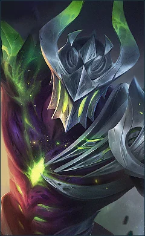

[Tier list](https://boostmlbb.ru/en/heroes/)[Items](https://boostmlbb.ru/en/items/)[News & guides](https://boostmlbb.ru/en/news/)

# Ruby

C

FighterEXP Lane

Win rate

49.0%

Pick rate

0.4%

Ban rate

0.1%

[Overview](https://boostmlbb.ru/#overview)[Build](https://boostmlbb.ru/#build)[Skills](https://boostmlbb.ru/#skills)[Counters](https://boostmlbb.ru/#draft)[Lore](https://boostmlbb.ru/#lore)

## Overview

### Attributes

-   Durability**90**
-   Offense**20**
-   Control**90**
-   Difficulty**40**

-   Crowd Control
-   Regen

### Win rate by rank, 30 days

1.  **49.5%**Epic
2.  **49.6%**Legend
3.  **49.5%**Mythic
4.  **49.4%**Honor
5.  **48.7%**Glory

Dashed line: 50% win rate

### More fighters on this lane

[Freya](https://boostmlbb.ru/en/heroes/freya.html)[Aulus](https://boostmlbb.ru/en/heroes/aulus.html)[Paquito](https://boostmlbb.ru/en/heroes/paquito.html)[Sun](https://boostmlbb.ru/en/heroes/sun.html)[Lukas](https://boostmlbb.ru/en/heroes/lukas.html)[Cici](https://boostmlbb.ru/en/heroes/cici.html)[Sora](https://boostmlbb.ru/en/heroes/sora.html)[Yu Zhong](https://boostmlbb.ru/en/heroes/yu-zhong.html)

### Places in the rankings

-   [Best MLBB fighters**35 of 44**](https://boostmlbb.ru/en/heroes/best-fighter.html)

## Build

Build 1Build 2Build 3

Win rate

58.7%

Pick rate

8.2%

#### Core items

-   [

    

    War Axe

    ](https://boostmlbb.ru/en/items/war-axe.html)
-   [

    

    Queen's Wings

    ](https://boostmlbb.ru/en/items/queens-wings.html)
-   [

    

    Endless Battle

    ](https://boostmlbb.ru/en/items/endless-battle.html)

#### Spell

Flicker

#### Emblem and talents

Fighter

-   

    Thrill

-   

    Festival of Blood

-   

    Brave Smite

Win rate

56.6%

Pick rate

5.9%

#### Core items

-   [

    

    War Axe

    ](https://boostmlbb.ru/en/items/war-axe.html)
-   [

    

    Queen's Wings

    ](https://boostmlbb.ru/en/items/queens-wings.html)
-   [

    

    Oracle

    ](https://boostmlbb.ru/en/items/oracle.html)

#### Spell

Flicker

#### Emblem and talents

Fighter

-   

    Thrill

-   

    Festival of Blood

-   

    Brave Smite

Win rate

58.3%

Pick rate

4.4%

#### Core items

-   [

    

    War Axe

    ](https://boostmlbb.ru/en/items/war-axe.html)
-   [

    

    Endless Battle

    ](https://boostmlbb.ru/en/items/endless-battle.html)
-   [

    

    Queen's Wings

    ](https://boostmlbb.ru/en/items/queens-wings.html)

#### Spell

Flicker

#### Emblem and talents

Fighter

-   

    Thrill

-   

    Festival of Blood

-   

    Brave Smite

## Skills

Level-up**I'm Offended!**_›_**Be Good!**_›_**Don't Run, Wolf King!**

Passive**Let's Dance!**Skill 1**Be Good!**Skill 2**Don't Run, Wolf King!**Ultimate**I'm Offended!**

Passive

### Let's Dance!

Ruby's skills have a 75% Spell Vamp Ratio (her Basic Attacks cannot trigger Lifesteal). For every 1% HP lost, her Spell Vamp Ratio increases by 1%, up to 150%.

After each skill cast, Ruby can dash to another location and gain 8-25 (scales with level) for 4s (stacks up to 3 times).

Skill 1

### Be Good!

Cooldown **4 Mana Cost: 25 s**

Ruby swings her scythe, dealing 280 (+110% Total Physical Attack) Physical Damage to enemies hit. She then unleashes a shockwave in the same direction, dealing 140 (+55% Total Physical Attack) Physical Damage to enemies hit and slowing them by 40% for 1s.

Skill 2

### Don't Run, Wolf King!

Cooldown **7 Mana Cost: 50 s**

Ruby swings her scythe around herself twice, each swing dealing 60 (+55% Total Physical Attack) Physical Damage to nearby enemies, stunning them for 0.5s, and slowly pulling them toward her.

Ultimate

### I'm Offended!

Cooldown **40 Mana Cost: 80 s**

Ruby sweeps her scythe in the target direction, dealing 600 (+200% Total Physical Attack) Physical Damage to enemies hit, pulling them toward her, and stunning them for 0.5s.

## Counters

### Counters

Beat this hero

[Sun](https://boostmlbb.ru/en/heroes/sun.html)[Gloo](https://boostmlbb.ru/en/heroes/gloo.html)[Argus](https://boostmlbb.ru/en/heroes/argus.html)[Karina](https://boostmlbb.ru/en/heroes/karina.html)[Lunox](https://boostmlbb.ru/en/heroes/lunox.html)

### Easy targets

This hero beats them

[Phoveus](https://boostmlbb.ru/en/heroes/phoveus.html)

## Lore

> A girl who grew up with Roger's help.

[Read the full story ↗](https://kazukiofficial.com/stories/ruby)Kazuki Official [Hero stats on the game site ↗](https://www.mobilelegends.com/hero/detail?heroid=29)

**Rank up on Ruby**The calculator shows the price

[Calculate price](https://boostmlbb.ru/en/order.html?type=hero)

## Frequently asked questions

Who counters Ruby in MLBB?

Over the last 30 days the toughest opponents are Sun, Gloo, Argus, Karina and Lunox.

What is Ruby’s win rate right now?

49.01% at Mythical Glory over the last 7 days and 49.10% across all ranks over 30 days, as of 25 November 2026.

What role and lane does Ruby play?

Fighter, played in the EXP Lane.

Is Ruby strong in the current meta?

Tier C, #109 of 133 heroes and #35 among fighters. The tier counts how often the hero is picked and banned and how well it wins at Mythical Glory over 7 days: banned in 0.1% of matches, 49.0% win rate. In professional games over the last month the hero is drafted in 0.8% of them.

What is the best build for Ruby?

The most popular ranked build: War Axe, Queen's Wings and Endless Battle as core items, the Fighter emblem with Thrill, Festival of Blood and Brave Smite, and Flicker. It wins 58.67% of matches.
