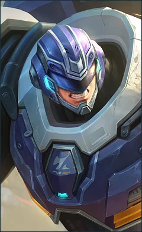
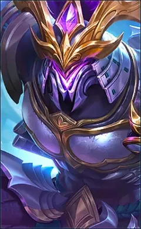

[Tier list](https://boostmlbb.ru/en/heroes/)[Items](https://boostmlbb.ru/en/items/)[Skins](https://boostmlbb.ru/en/skins/)[News & guides](https://boostmlbb.ru/en/news/)

[Tier list](https://boostmlbb.ru/en/heroes/)

# Saber

B

AssassinJungleRoam

Win rate

53.7%

Pick rate

0.9%

Ban rate

13.3%

[Overview](https://boostmlbb.ru/#overview)[Build](https://boostmlbb.ru/#build)[How to play](https://boostmlbb.ru/#howto)[Skills](https://boostmlbb.ru/#skills)[Counters](https://boostmlbb.ru/#draft)[Skins](https://boostmlbb.ru/#skins)[Lore](https://boostmlbb.ru/#lore)

## Overview

### Attributes

-   Durability**20**
-   Offense**60**
-   Control**60**
-   Difficulty**30**

-   Charge
-   Finisher

### Win rate by rank, 30 days

1.  **48.4%**Epic
2.  **50.0%**Legend
3.  **51.1%**Mythic
4.  **51.1%**Honor
5.  **53.5%**Glory

Dashed line: 50% win rate

### More assassins on this lane

[Nolan](https://boostmlbb.ru/en/heroes/nolan.html)[Hirara](https://boostmlbb.ru/en/heroes/hirara.html)[Harley](https://boostmlbb.ru/en/heroes/harley.html)[Fanny](https://boostmlbb.ru/en/heroes/fanny.html)[Ling](https://boostmlbb.ru/en/heroes/ling.html)[Karina](https://boostmlbb.ru/en/heroes/karina.html)[Yi Sun-shin](https://boostmlbb.ru/en/heroes/yi-sun-shin.html)[Gusion](https://boostmlbb.ru/en/heroes/gusion.html)

### Places in the rankings

-   [Best MLBB junglers**10 of 37**](https://boostmlbb.ru/en/heroes/best-jungle.html)
-   [Best MLBB assassins**6 of 29**](https://boostmlbb.ru/en/heroes/best-assassin.html)
-   [Best MLBB roamers**11 of 34**](https://boostmlbb.ru/en/heroes/best-roam.html)

## Build

Build 1Build 2Build 3

Win rate

59.7%

Pick rate

18.4%

#### Core items

-   [

    

    Hunter Strike

    ](https://boostmlbb.ru/en/items/hunter-strike.html)
-   [

    

    War Axe

    ](https://boostmlbb.ru/en/items/war-axe.html)
-   [

    

    Endless Battle

    ](https://boostmlbb.ru/en/items/endless-battle.html)

#### Spell

Retribution

#### Emblem and talents

Assassin

-   

    Thrill

-   

    Seasoned Hunter

-   

    Temporal Reign

Win rate

57.0%

Pick rate

4.7%

#### Core items

-   [

    

    Hunter Strike

    ](https://boostmlbb.ru/en/items/hunter-strike.html)
-   [

    

    War Axe

    ](https://boostmlbb.ru/en/items/war-axe.html)
-   [

    

    Brute Force Breastplate

    ](https://boostmlbb.ru/en/items/brute-force-breastplate.html)

#### Spell

Retribution

#### Emblem and talents

Fighter

-   

    Thrill

-   

    Seasoned Hunter

-   

    Temporal Reign

Win rate

60.4%

Pick rate

2.0%

#### Core items

-   [

    

    Hunter Strike

    ](https://boostmlbb.ru/en/items/hunter-strike.html)
-   [

    

    War Axe

    ](https://boostmlbb.ru/en/items/war-axe.html)
-   [

    

    Endless Battle

    ](https://boostmlbb.ru/en/items/endless-battle.html)

#### Spell

Retribution

#### Emblem and talents

Fighter

-   

    Thrill

-   

    Seasoned Hunter

-   

    Temporal Reign

## How to play Saber

### Saber combos

#### Teamfight

1.  1
2.  2
3.  Ult

Saber can use his 1st Skill to poke and weaken the enemy, follow with his 2nd Skill to close in, then use his Ultimate to finish them off.

#### Laning

1.  1
2.  2
3.  Ult

Saber can use his 1st Skill to poke and weaken the enemy, follow with his 2nd Skill to close in, then use his Ultimate to finish them off.

### When strongest

Stronger early: 59.6% at 10–12 minutes. Push your lane, take objectives and close the game before the lead fades.

1.  **59.6**10–12
2.  **55.7**12–14
3.  **53.3**14–16
4.  **52.1**16–18
5.  **51.4**18–20
6.  **50.9**20+

Win rate % by match length in minutes, all ranks. Dashed line: 50%

### Level-up priority

1.  Triple Sweep
2.  Orbiting Swords
3.  Charge

## Skills

Passive**Enemy's Bane**Skill 1**Orbiting Swords**Skill 2**Charge**Ultimate**Triple Sweep**

Passive

### Enemy's Bane

Each time Saber deals damage, he reduces the target's by 3-8 for 5s (up to 5 stacks).

Skill 1

### Orbiting Swords

Cooldown **10 Mana Cost: 60 s**

Saber releases 5 swords that orbit around him and deal 75 (+25% Extra Physical Attack) Physical Damage to nearby enemies on hit. The swords will retract back to him after the duration.

While active, Sword attacks deal 200 (+50% Extra Physical Attack) Physical Damage to the target and 50% damage to enemies along the path (damage reduced to 50% against minions). Each sword attack reduces the cooldowns of Orbiting Swords by 0.5s and Charge by 1s.

Skill 2

### Charge

Cooldown **7 Mana Cost: 40 s**

Saber dashes in the target direction, dealing 75 (+50% Extra Physical Attack) Physical Damage to enemies along the path.

After the dash, he gains an Enhanced Basic Attack that allows him to charge at the target, dealing 75 (+120% Total Physical Attack) Physical Damage and slowing them by 60% for 1s.

Ultimate

### Triple Sweep

Cooldown **44 Mana Cost: 100 s**

Saber charges at the target enemy hero, knocking them airborne for 1.2s (unaffected by Resilience). He strikes them 3 times over the duration, dealing 120 (+80% Extra Physical Attack) Physical Damage with the first 2 strikes and 240 (+160% Extra Physical Attack) Physical Damage with the third.

## Saber counters

### Who counters Saber

[Ling](https://boostmlbb.ru/en/heroes/ling.html)[Nolan](https://boostmlbb.ru/en/heroes/nolan.html)[Natalia](https://boostmlbb.ru/en/heroes/natalia.html)[Lunox](https://boostmlbb.ru/en/heroes/lunox.html)[Yve](https://boostmlbb.ru/en/heroes/yve.html)

### Who Saber counters

[Hanabi](https://boostmlbb.ru/en/heroes/hanabi.html)[Miya](https://boostmlbb.ru/en/heroes/miya.html)[Sun](https://boostmlbb.ru/en/heroes/sun.html)[Nana](https://boostmlbb.ru/en/heroes/nana.html)[Alpha](https://boostmlbb.ru/en/heroes/alpha.html)[Thamuz](https://boostmlbb.ru/en/heroes/thamuz.html)[Johnson](https://boostmlbb.ru/en/heroes/johnson.html)[Balmond](https://boostmlbb.ru/en/heroes/balmond.html)[Martis](https://boostmlbb.ru/en/heroes/martis.html)[Hilda](https://boostmlbb.ru/en/heroes/hilda.html)

## Saber skins

[Iron HoundExceptional · 2023](https://boostmlbb.ru/en/skins/saber/iron-hound.html)[Silver EdgeCommon · 2021](https://boostmlbb.ru/en/skins/saber/silver-edge.html)[OnimaruExquisite · 2019](https://boostmlbb.ru/en/skins/saber/onimaru.html)[S.A.B.E.R. RegulatorDeluxe · 2018](https://boostmlbb.ru/en/skins/saber/s-a-b-e-r-regulator.html)[Fullmetal RoninCommon · 2018](https://boostmlbb.ru/en/skins/saber/fullmetal-ronin.html)[Codename - StormSupreme · 2017](https://boostmlbb.ru/en/skins/saber/codename-storm.html)[Force WarriorExceptional · 2016](https://boostmlbb.ru/en/skins/saber/force-warrior.html)[Golden FlashCommon · 2016](https://boostmlbb.ru/en/skins/saber/golden-flash.html)

[All 8 Saber skins: prices and how to get them](https://boostmlbb.ru/en/skins/saber.html)

## Lore

> A swordsman in pursuit of invincibility, used by Laboratory 1718.

[Read the full story ↗](https://play.mobilelegends.com/lore/hero/Saber)Official Mobile Legends site [Hero stats on the game site ↗](https://www.mobilelegends.com/hero/detail?heroid=3)

**Rank up on Saber**The calculator shows the price

[Calculate price](https://boostmlbb.ru/en/order.html?type=hero)

## Frequently asked questions

Who counters Saber in MLBB?

Over the last 30 days the toughest opponents are Ling, Nolan, Natalia, Lunox and Yve.

How do you play Saber?

Level "Orbiting Swords" first and take the ultimate whenever it is available. Stronger early: 59.6% at 10–12 minutes. Push your lane, take objectives and close the game before the lead fades. Teamfight combo: Saber can use his 1st Skill to poke and weaken the enemy, follow with his 2nd Skill to close in, then use his Ultimate to finish them off.

What is Saber’s win rate right now?

53.73% at Mythical Glory over the last 7 days and 51.28% across all ranks over 30 days, as of 25 November 2026.

What role and lane does Saber play?

Assassin, played in the jungle or on roam.

Is Saber strong in the current meta?

Tier B, #32 of 133 heroes and #6 among assassins. The tier counts how often the hero is picked and banned and how well it wins at Mythical Glory over 7 days: banned in 13.3% of matches, 53.7% win rate. In professional games over the last month the hero is drafted in 5.2% of them.

What is the best build for Saber?

The most popular ranked build: Hunter Strike, War Axe and Endless Battle as core items, the Assassin emblem with Thrill, Seasoned Hunter and Temporal Reign, and Retribution. It wins 59.67% of matches.
