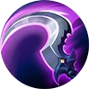
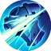
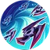

[Home](https://boostmlbb.ru/en/) / [Heroes](https://boostmlbb.ru/en/heroes/)

Tier A

# Saber in Mobile Legends: build, counters and stats

Assassin, Jungle or Roam. Wins 51.21% of matches over the last 30 days: #41 of 133 heroes.

[Boost on this hero](https://boostmlbb.ru/en/order.html?type=hero)[All heroes](https://boostmlbb.ru/en/heroes/)

Hero statsTier A

**Saber**Ban 25.07% · Pick 1.02%

Counters

Win rate, 30 days**51.21%**

**51.21%**win rate, 30 days

**1.02%**pick rate

**25.07%**ban rate

**53.51%**wins in Mythical Glory

## Saber build

The most picked setup for jungle Saber in ranked games across all ranks, from the in-game Academy. The win rate is for matches played with this exact build.

Core items

Hunter StrikeWar AxeEndless Battle

Emblem and talents

FighterThrillSeasoned HunterTemporal Reign

Battle spell

Retribution

Wins with this build **60.38%**Picked in **2.00%** of matches

### Other popular setups

-   RetributionFighterThrill · Seasoned Hunter · Temporal Reign**57.04%**
-   RetributionAssassinThrill · Seasoned Hunter · Temporal Reign**59.67%**

## Saber skills

Official skill descriptions from MOONTON with cooldowns and tags.

Level-up priority: **Triple Sweep** → **Orbiting Swords** → **Charge**

-   

    **Enemy's Bane**Passive

    Each time Saber deals damage, he reduces the target's by 3-8 for 5s (up to 5 stacks).

-   

    **Orbiting Swords**Skill 1CD 10 Mana Cost: 60 s

    Saber releases 5 swords that orbit around him and deal 75 (+25% Extra Physical Attack) Physical Damage to nearby enemies on hit. The swords will retract back to him after the duration.
    While active, Sword attacks deal 200 (+50% Extra Physical Attack) Physical Damage to the target and 50% damage to enemies along the path (damage reduced to 50% against minions). Each sword attack reduces the cooldowns of Orbiting Swords by 0.5s and Charge by 1s.

-   

    **Charge**Skill 2CD 7 Mana Cost: 40 s

    Saber dashes in the target direction, dealing 75 (+50% Extra Physical Attack) Physical Damage to enemies along the path.
    After the dash, he gains an Enhanced Basic Attack that allows him to charge at the target, dealing 75 (+120% Total Physical Attack) Physical Damage and slowing them by 60% for 1s.

-   

    **Triple Sweep**UltimateCD 44 Mana Cost: 100 s

    Saber charges at the target enemy hero, knocking them airborne for 1.2s (unaffected by Resilience). He strikes them 3 times over the duration, dealing 120 (+80% Extra Physical Attack) Physical Damage with the first 2 strikes and 240 (+160% Extra Physical Attack) Physical Damage with the third.

## Role and lane

Places are by win rate over the last 30 days among heroes of the same role or lane.

-   Role**Assassin**
-   Lane**Jungle or Roam**
-   Among assassins**#4 of 29**
-   In the jungle**#8 of 37**
-   On roam**#13 of 34**
-   Speciality**Charge, Finisher**
-   Difficulty**Easy (30/100)**

## Who counters Saber

Saber loses to these heroes most often. The number under each icon is that hero’s own win rate. 3 of the 5 counters are assassins.

[Ling52.54%](https://boostmlbb.ru/en/heroes/ling.html)[Nolan49.71%](https://boostmlbb.ru/en/heroes/nolan.html)[Natalia51.05%](https://boostmlbb.ru/en/heroes/natalia.html)[Lunox50.64%](https://boostmlbb.ru/en/heroes/lunox.html)[Yve52.26%](https://boostmlbb.ru/en/heroes/yve.html)

## Who Saber is strong against

Saber is one of the toughest opponents for these heroes.

[Hanabi52.66%](https://boostmlbb.ru/en/heroes/hanabi.html)[Miya49.71%](https://boostmlbb.ru/en/heroes/miya.html)[Sun53.72%](https://boostmlbb.ru/en/heroes/sun.html)[Nana47.27%](https://boostmlbb.ru/en/heroes/nana.html)[Alpha48.85%](https://boostmlbb.ru/en/heroes/alpha.html)[Thamuz48.91%](https://boostmlbb.ru/en/heroes/thamuz.html)[Johnson49.25%](https://boostmlbb.ru/en/heroes/johnson.html)[Balmond46.66%](https://boostmlbb.ru/en/heroes/balmond.html)[Martis47.23%](https://boostmlbb.ru/en/heroes/martis.html)[Hilda51.07%](https://boostmlbb.ru/en/heroes/hilda.html)

## Best teammates for Saber

With these heroes on the same team Saber wins more often. The number is the gain in win rate, in percentage points.

[Diggie+6.13 pts](https://boostmlbb.ru/en/heroes/diggie.html)[Marcel+4.45 pts](https://boostmlbb.ru/en/heroes/marcel.html)[Estes+3.46 pts](https://boostmlbb.ru/en/heroes/estes.html)[Minotaur+3.29 pts](https://boostmlbb.ru/en/heroes/minotaur.html)

## Win rate by rank

Best result in Mythical Glory (53.51%), weakest in Epic (48.42%). Last 30 days.

-   Epic**48.42%**
-   Legend**50.03%**
-   Mythic**51.12%**
-   Mythical Honor**51.13%**
-   Mythical Glory**53.51%**

## Place in the meta

Saber sits in tier A of our win-rate tier list and ranks 41 of 133 heroes. In Mythical Glory the win rate is higher: 53.51% against 51.21% across all ranks, a 2.30-point gap. See the full [tier list](https://boostmlbb.ru/en/news/mlbb-meta-tier-list/) and the [patch breakdown](https://boostmlbb.ru/en/news/mlbb-current-patch/).

## Other Jungle heroes

The strongest by win rate over the last 30 days.

[Sun53.72%](https://boostmlbb.ru/en/heroes/sun.html)[Aulus53.46%](https://boostmlbb.ru/en/heroes/aulus.html)[Ling52.54%](https://boostmlbb.ru/en/heroes/ling.html)[Popol and Kupa52.09%](https://boostmlbb.ru/en/heroes/popol-and-kupa.html)[Lukas51.97%](https://boostmlbb.ru/en/heroes/lukas.html)[Bane51.61%](https://boostmlbb.ru/en/heroes/bane.html)

## Lore

«A swordsman in pursuit of invincibility, used by Laboratory 1718.»

Saber’s full backstory is on MOONTON’s official lore site. The hero card with skills and the game’s own tips is on mobilelegends.com; voice lines, skins and patch history are collected by the MLBB Wiki.

[Read the lore](https://play.mobilelegends.com/lore/hero/Saber)[Official hero card](https://www.mobilelegends.com/hero/detail?heroid=3)[MLBB Wiki](https://mobile-legends.fandom.com/wiki/Saber)

## Boost on Saber

The booster plays only this hero, so the hero rating grows with your rank.

[Calculate the price](https://boostmlbb.ru/en/order.html?type=hero)

Statistics: official MOONTON hero ranking (mobilelegends.com/rank), last 30 days, updated 23 November 2026 and refreshed daily. Roles and lanes: the official hero page. Builds, skills and teammates: MOONTON in-game Academy data via the Rone Arena API (ridwaanhall / RoneAI).

## Frequently asked questions

Who counters Saber in MLBB?

Over the last 30 days the toughest opponents are Ling, Nolan, Natalia, Lunox and Yve.

What is Saber’s win rate right now?

51.21% over the last 30 days across all ranks and 53.51% in Mythical Glory, as of 23 November 2026.

What role and lane does Saber play?

Assassin, played in the jungle or on roam.

Is Saber strong in the current meta?

Tier A: #41 of 133 heroes by 30-day win rate and #4 among assassins.

What is the best build for Saber?

The most popular ranked build: Hunter Strike, War Axe and Endless Battle as core items, the Fighter emblem with Thrill, Seasoned Hunter and Temporal Reign, and Retribution. It wins 60.38% of matches.

MLBB Boost editorial team · Updated 23 November 2026
