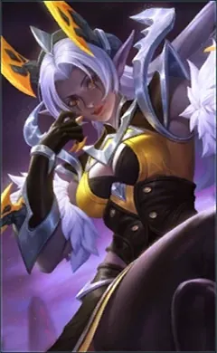

[Tier list](https://boostmlbb.ru/en/heroes/)[Items](https://boostmlbb.ru/en/items/)[Skins](https://boostmlbb.ru/en/skins/)[News & guides](https://boostmlbb.ru/en/news/)

[Tier list](https://boostmlbb.ru/en/heroes/)

# Selena

A

AssassinMageMid Lane

Win rate

48.3%

Pick rate

1.4%

Ban rate

3.4%

[Overview](https://boostmlbb.ru/#overview)[Build](https://boostmlbb.ru/#build)[How to play](https://boostmlbb.ru/#howto)[Skills](https://boostmlbb.ru/#skills)[Counters](https://boostmlbb.ru/#draft)[Skins](https://boostmlbb.ru/#skins)[Lore](https://boostmlbb.ru/#lore)

## Overview

### Attributes

-   Durability**30**
-   Offense**70**
-   Control**100**
-   Difficulty**80**

-   Initiator
-   Finisher

### More assassins on this lane

[Harley](https://boostmlbb.ru/en/heroes/harley.html)[Kadita](https://boostmlbb.ru/en/heroes/kadita.html)[Gusion](https://boostmlbb.ru/en/heroes/gusion.html)

### Places in the rankings

-   [Best MLBB mages**8 of 32**](https://boostmlbb.ru/en/heroes/best-mage.html)
-   [Best MLBB assassins**4 of 29**](https://boostmlbb.ru/en/heroes/best-assassin.html)
-   [Best MLBB mid laners**6 of 29**](https://boostmlbb.ru/en/heroes/best-mid.html)

## Build

Build 1Build 2Build 3

Win rate

53.2%

Pick rate

4.8%

#### Core items

-   [

    

    Starlium Scythe

    ](https://boostmlbb.ru/en/items/starlium-scythe.html)
-   [

    

    Glowing Wand

    ](https://boostmlbb.ru/en/items/glowing-wand.html)
-   [

    

    Wishing Lantern

    ](https://boostmlbb.ru/en/items/wishing-lantern.html)

#### Spell

Flicker

#### Emblem and talents

Mage

-   

    Inspire

-   

    Wilderness Blessing

-   

    Lethal Ignition

Win rate

57.3%

Pick rate

4.1%

#### Core items

-   [

    

    Starlium Scythe

    ](https://boostmlbb.ru/en/items/starlium-scythe.html)
-   [

    

    Lightning Truncheon

    ](https://boostmlbb.ru/en/items/lightning-truncheon.html)
-   [

    

    Divine Glaive

    ](https://boostmlbb.ru/en/items/divine-glaive.html)

#### Spell

Flicker

#### Emblem and talents

Mage

-   

    Inspire

-   

    Wilderness Blessing

-   

    Lethal Ignition

Win rate

54.4%

Pick rate

2.0%

#### Core items

-   [

    

    Starlium Scythe

    ](https://boostmlbb.ru/en/items/starlium-scythe.html)
-   [

    

    Glowing Wand

    ](https://boostmlbb.ru/en/items/glowing-wand.html)
-   [

    

    Lightning Truncheon

    ](https://boostmlbb.ru/en/items/lightning-truncheon.html)

#### Spell

Flicker

#### Emblem and talents

Mage

-   

    Inspire

-   

    Bargain Hunter

-   

    Quantum Charge

## How to play Selena

### Selena combos

#### Teamfight

1.  1
2.  2
3.  Ult
4.  2
5.  1
6.  2

Stay in Elven Form to cast her 1st and 2nd skill combo to catch the enemy hero in distance. Then cast her Ultimate to enter her Abyssal Form. Follow with her 2nd and 1st skill combo to close in and finish off the target, then cast her 2nd Skill to dash away.

#### Laning

1.  2
2.  1

Elven Form Selena can use her 2nd Skill to stun the enemy, then use her 1st Skill to poke enemies and deal damage.

### When strongest

Stronger late: 49.4% at 16–18 minutes. Do not take risks early, farm and fight together with your team.

1.  **46.2**10–12
2.  **48.9**12–14
3.  **49.4**14–16
4.  **49.4**16–18
5.  **48.8**18–20
6.  **49.4**20+

Win rate % by match length in minutes, all ranks. Dashed line: 50%

### Level-up priority

1.  Primal Darkness
2.  Abyssal Trap
3.  Abyssal Arrow

## Skills

Passive**Symbiosis**Skill 1**Abyssal Trap**Skill 2**Abyssal Arrow**Ultimate**Primal Darkness**

Passive

### Symbiosis

Selena can switch freely between her two forms.

**Elven Form:** Selena applies Abyssal Mark when her skills deal damage. Marks last 8s and can stack up to 2 times.

**Abyssal Form:** Selena's Basic Attacks become melee and deal (+25% Total Magic Power) additional Magic Damage. Her skills deal 240-450 (+40% Total Magic Power) additional Magic Damage to enemies with Abyssal Mark and consume their mark stacks by 1. This damage is increased to 250% against Creeps and Minions.

Skill 1

### Abyssal Trap

Cooldown **8 Mana Cost: 70 s**

Selena summons an Abyssal Devil to lurk underground. The Abyssal Devil will attach itself to any enemy that approaches, inflicting a stack of Abyssal Mark and reducing their Movement Speed by 50% for 1s. The Abyssal Devil then explodes, dealing 350 (+150% Total Magic Power) Magic Damage to enemies in the area and reducing their Movement Speed by 50% for 1s.

Each additional Abyssal Devil on an enemy increases the final damage by 50%.

Each Abyssal Devil can lurk up to 60s and up to 3 Abyssal Devils can exist at the same time.

Skill 2

### Abyssal Arrow

Cooldown **12 Mana Cost: 80 s**

Selena fires an abyssal wraith in the target direction that stops when it hits an enemy hero, Creep, or Summon, dealing 250 (+20% Total Magic Power) to 500 (+40% Total Magic Power) Magic Damage to the target hit and stunning them for 0.5s to 2.5s while revealing their locations (the damage and stun duration increase with the wraith's travel distance).

The wraith will pick up Abyssal Trap as it travels over it and will apply the trap to the enemy target upon stunning them.

If the wraith stuns an enemy for 0.9s or longer, Selena will gain 60% Movement Speed for 2s.

Ultimate

### Primal Darkness

Cooldown **5.5 s**

**Passive:** Selena gains 5 .

**Active:** Selena enters Abyssal Form and gains 20% Movement Speed for 0.8s. This also immediately resets the cooldown of Soul Eater and Garotte.

## Selena counters

### Who counters Selena

[Benedetta](https://boostmlbb.ru/en/heroes/benedetta.html)[Ixia](https://boostmlbb.ru/en/heroes/ixia.html)[X.Borg](https://boostmlbb.ru/en/heroes/x-borg.html)[Beatrix](https://boostmlbb.ru/en/heroes/beatrix.html)[Helcurt](https://boostmlbb.ru/en/heroes/helcurt.html)

### Who Selena counters

[Popol and Kupa](https://boostmlbb.ru/en/heroes/popol-and-kupa.html)[Chip](https://boostmlbb.ru/en/heroes/chip.html)

## Selena skins

[Silverbolt RaikoGrand · 2026](https://boostmlbb.ru/en/skins/selena/silverbolt-raiko.html)[Curse of CinderGrand · 2025](https://boostmlbb.ru/en/skins/selena/curse-of-cinder.html)[Lady VengeanceGrand · 2021](https://boostmlbb.ru/en/skins/selena/lady-vengeance.html)[Gothic CurseCommon · 2021](https://boostmlbb.ru/en/skins/selena/gothic-curse.html)[S.T.U.N. SelenaDeluxe · 2021](https://boostmlbb.ru/en/skins/selena/s-t-u-n-selena.html)[Thunder FlashExquisite · 2020](https://boostmlbb.ru/en/skins/selena/thunder-flash.html)[Double IdentityExceptional · 2019](https://boostmlbb.ru/en/skins/selena/double-identity.html)[Gemini - ShadowDeluxe · 2019](https://boostmlbb.ru/en/skins/selena/gemini-shadow.html)[VirusDeluxe · 2019](https://boostmlbb.ru/en/skins/selena/virus.html)[Wasp QueenCommon · 2018](https://boostmlbb.ru/en/skins/selena/wasp-queen.html)

[All 10 Selena skins: prices and how to get them](https://boostmlbb.ru/en/skins/selena.html)

## Lore

> Dark Elf girl who fell into the Abyss.

[Read the full story ↗](https://kazukiofficial.com/stories/selena)Kazuki Official [Hero stats on the game site ↗](https://www.mobilelegends.com/hero/detail?heroid=63)

**Rank up on Selena**The calculator shows the price

[Calculate price](https://boostmlbb.ru/en/order.html?type=hero)

## Frequently asked questions

Who counters Selena in MLBB?

Over the last 30 days the toughest opponents are Benedetta, Ixia, X.Borg, Beatrix and Helcurt.

How do you play Selena?

Level "Abyssal Trap" first and take the ultimate whenever it is available. Stronger late: 49.4% at 16–18 minutes. Do not take risks early, farm and fight together with your team. Teamfight combo: Stay in Elven Form to cast her 1st and 2nd skill combo to catch the enemy hero in distance. Then cast her Ultimate to enter her Abyssal Form. Follow with her 2nd and 1st skill combo to close in and finish off the target, then cast her 2nd Skill to dash away.

What is Selena’s win rate right now?

48.34% at Mythical Glory over the last 7 days and 48.46% across all ranks over 30 days, as of 27 November 2026.

What role and lane does Selena play?

Assassin and mage, played in the Mid Lane.

Is Selena strong in the current meta?

Tier A, #25 of 133 heroes and #4 among assassins. The tier counts how often the hero is picked and banned and how well it wins at Mythical Glory over 7 days: banned in 3.4% of matches, 48.3% win rate. In professional games over the last month the hero is drafted in 32.9% of them.

What is the best build for Selena?

The most popular ranked build: Starlium Scythe, Glowing Wand and Wishing Lantern as core items, the Mage emblem with Inspire, Wilderness Blessing and Lethal Ignition, and Flicker. It wins 53.21% of matches.
