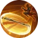

[Tier list](https://boostmlbb.ru/en/heroes/)[News & guides](https://boostmlbb.ru/en/news/)

Tier S

# Sun

Fighter · EXP Lane or Jungle

Win rate

53.72%

Pick rate

1.75%

Ban rate

35.31%

**#11 of 133 by win rate**All ranks · 30 days to 23 November 2026

[Build](https://boostmlbb.ru/#build)[Counters](https://boostmlbb.ru/#draft)[Skills](https://boostmlbb.ru/#skills)[Stats](https://boostmlbb.ru/#ranks)[Lore](https://boostmlbb.ru/#lore)

Push · Damage · Difficulty 50/100

## Build

Most picked in ranked · EXP Lane

Core items

WindtalkerCorrosion ScytheGreat Dragon Spear

Emblem and talents

SupportInspireWilderness BlessingQuantum Charge

Battle spell

Petrify

Wins with this build **58.06%**Picked in **1.35%** of matches

Alternative builds (2)

Core items

Thunder BeltDominance IceOracle

Emblem and talents

SupportAgilityWilderness BlessingQuantum Charge

Battle spell

Revitalize

Wins with this build **59.72%**Picked in **1.88%** of matches

Core items

Corrosion ScytheDemon Hunter SwordGolden Staff

Emblem and talents

AssassinThrillBargain HunterQuantum Charge

Battle spell

Petrify

Wins with this build **58.23%**Picked in **1.31%** of matches

## Counters and teammates

### Counters

[Jawhead](https://boostmlbb.ru/en/heroes/jawhead.html)[Diggie](https://boostmlbb.ru/en/heroes/diggie.html)[Harley](https://boostmlbb.ru/en/heroes/harley.html)[Saber](https://boostmlbb.ru/en/heroes/saber.html)[Karrie](https://boostmlbb.ru/en/heroes/karrie.html)

### Strong against

[Badang](https://boostmlbb.ru/en/heroes/badang.html)[Suyou](https://boostmlbb.ru/en/heroes/suyou.html)[Kimmy](https://boostmlbb.ru/en/heroes/kimmy.html)[Alucard](https://boostmlbb.ru/en/heroes/alucard.html)[Ruby](https://boostmlbb.ru/en/heroes/ruby.html)[Natan](https://boostmlbb.ru/en/heroes/natan.html)[Marcel](https://boostmlbb.ru/en/heroes/marcel.html)[Joy](https://boostmlbb.ru/en/heroes/joy.html)[Faramis](https://boostmlbb.ru/en/heroes/faramis.html)

### Teammates

Win rate change as a duo

[Balmond+2.35 pp](https://boostmlbb.ru/en/heroes/balmond.html)[Lapu-Lapu+2.34 pp](https://boostmlbb.ru/en/heroes/lapu-lapu.html)[X.Borg+2.34 pp](https://boostmlbb.ru/en/heroes/x-borg.html)[Terizla+2.32 pp](https://boostmlbb.ru/en/heroes/terizla.html)

## Skills

Level-up priority · Clone Techniques → Endless Variety → Swift Exchange → Instantaneous Move

Passive**Simian God**

Enemies hit by Sun or his Doppelgangers will have their reduced by 5% (stacks up to 6 times). Sun recovers HP equal to 75 plus 15% of the Doppelganger's Physical Attack each time a Doppelganger deals damage.
Sun or his Doppelgangers' Basic Attacks deal 65 extra damage to creeps.

Skill 1**Endless Variety**

**Cooldown 6.5 Mana Cost: 70 s**

Sun hurls his Golden Staff in the target direction, dealing 280 (+40% Total Physical Attack) Physical Damage to enemies in its path.
Upon hitting an enemy hero or creep, or upon reaching maximum range, the Golden Staff transforms into a Doppelganger that pursues enemies. The Doppelganger inherits Sun's attributes, deals 60% of Sun's damage, and takes 150% damage for 5s.
This skill shares its level and cooldown with Swift Exchange.

Skill 2**Swift Exchange**

**Cooldown 6.5 Mana Cost: 70 s**

Sun hurls his Golden Staff in the target direction, dealing 280 (+40% Total Physical Attack) Physical Damage to enemies in its path.
He conjures a Doppelganger at his location that inherits his attributes, deals 60% damage, and takes 150% damage for 5s.
Sun transforms into the Golden Staff and becomes concealed, reappearing at its maximum range.

Skill 3**Instantaneous Move**

**Cooldown 5 Mana Cost: 40 s**

Sun commands his Doppelgangers to strike at the target enemy with him, dealing 270 (+40% Total Physical Attack) Physical Damage and slowing the target and enemies behind them by 25% (can be stacked) for 1.5s. This counts as Basic Attack damage and can trigger Attack Effects but cannot Crit.

Ultimate**Clone Techniques**

**Cooldown 32 s**

Sun summons a Doppelganger that inherits his attributes, deals 80% damage, and takes 120% damage for 8s.

## Win rate by rank

-   Epic**55.91%**
-   Legend**55.49%**
-   Mythic**54.40%**
-   Mythical Honor**52.90%**
-   Mythical Glory**52.58%**

## Lore

The immortal Monkey King, resolute and unyielding like the mountain that bore him.

[Read the full story ↗](https://kazukiofficial.com/stories/sun)Kazuki Official

[Hero stats on the game site](https://www.mobilelegends.com/hero/detail?heroid=27)

[Hero boost pricing](https://boostmlbb.ru/en/order.html?type=hero)

## Frequently asked questions

Who counters Sun in MLBB?

Over the last 30 days the toughest opponents are Jawhead, Diggie, Harley, Saber and Karrie.

What is Sun’s win rate right now?

53.72% over the last 30 days across all ranks and 52.58% in Mythical Glory, as of 23 November 2026.

What role and lane does Sun play?

Fighter, played in the EXP Lane or in the jungle.

Is Sun strong in the current meta?

Tier S: #11 of 133 heroes by 30-day win rate and #3 among fighters.

What is the best build for Sun?

The most popular ranked build: Windtalker, Corrosion Scythe and Great Dragon Spear as core items, the Support emblem with Inspire, Wilderness Blessing and Quantum Charge, and Petrify. It wins 58.06% of matches.
