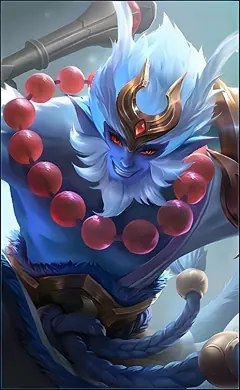

[Tier list](https://boostmlbb.ru/en/heroes/)[Items](https://boostmlbb.ru/en/items/)[Skins](https://boostmlbb.ru/en/skins/)[News & guides](https://boostmlbb.ru/en/news/)

[Tier list](https://boostmlbb.ru/en/heroes/)

# Sun

B

FighterEXP LaneJungle

Win rate

53.1%

Pick rate

1.5%

Ban rate

58.5%

[Overview](https://boostmlbb.ru/#overview)[Build](https://boostmlbb.ru/#build)[How to play](https://boostmlbb.ru/#howto)[Skills](https://boostmlbb.ru/#skills)[Counters](https://boostmlbb.ru/#draft)[Skins](https://boostmlbb.ru/#skins)[Lore](https://boostmlbb.ru/#lore)

## Overview

### Attributes

-   Durability**50**
-   Offense**50**
-   Control**10**
-   Difficulty**50**

-   Push
-   Damage

### Win rate by rank, 30 days

1.  **55.9%**Epic
2.  **55.6%**Legend
3.  **54.6%**Mythic
4.  **53.1%**Honor
5.  **52.8%**Glory

Dashed line: 50% win rate

### More fighters on this lane

[Freya](https://boostmlbb.ru/en/heroes/freya.html)[Aulus](https://boostmlbb.ru/en/heroes/aulus.html)[Paquito](https://boostmlbb.ru/en/heroes/paquito.html)[Lukas](https://boostmlbb.ru/en/heroes/lukas.html)[Suyou](https://boostmlbb.ru/en/heroes/suyou.html)[Cici](https://boostmlbb.ru/en/heroes/cici.html)[Sora](https://boostmlbb.ru/en/heroes/sora.html)[Yu Zhong](https://boostmlbb.ru/en/heroes/yu-zhong.html)

### Places in the rankings

-   [Best MLBB junglers**7 of 37**](https://boostmlbb.ru/en/heroes/best-jungle.html)
-   [Best MLBB fighters**6 of 44**](https://boostmlbb.ru/en/heroes/best-fighter.html)

## Build

Build 1Build 2Build 3

Win rate

59.7%

Pick rate

1.9%

#### Core items

-   [

    

    Thunder Belt

    ](https://boostmlbb.ru/en/items/thunder-belt.html)
-   [

    

    Dominance Ice

    ](https://boostmlbb.ru/en/items/dominance-ice.html)
-   [

    

    Oracle

    ](https://boostmlbb.ru/en/items/oracle.html)

#### Spell

Revitalize

#### Emblem and talents

Support

-   

    Agility

-   

    Wilderness Blessing

-   

    Quantum Charge

Win rate

58.1%

Pick rate

1.4%

#### Core items

-   [

    

    Windtalker

    ](https://boostmlbb.ru/en/items/windtalker.html)
-   [

    

    Corrosion Scythe

    ](https://boostmlbb.ru/en/items/corrosion-scythe.html)
-   [

    

    Great Dragon Spear

    ](https://boostmlbb.ru/en/items/great-dragon-spear.html)

#### Spell

Petrify

#### Emblem and talents

Support

-   

    Inspire

-   

    Wilderness Blessing

-   

    Quantum Charge

Win rate

58.2%

Pick rate

1.3%

#### Core items

-   [

    

    Corrosion Scythe

    ](https://boostmlbb.ru/en/items/corrosion-scythe.html)
-   [

    

    Demon Hunter Sword

    ](https://boostmlbb.ru/en/items/demon-hunter-sword.html)
-   [

    

    Golden Staff

    ](https://boostmlbb.ru/en/items/golden-staff.html)

#### Spell

Petrify

#### Emblem and talents

Assassin

-   

    Thrill

-   

    Bargain Hunter

-   

    Quantum Charge

## How to play Sun

### Sun combos

#### Teamfight

1.  Ult
2.  2
3.  3
4.  Attack

In teamfights, Sun can start with his Ultimate to summon a Doppelganger, and approach the enemy with his 2nd Skill. Finally, he can use his 2nd Skill and Basic Attacks to deal damage.

#### Laning

1.  1
2.  2
3.  3
4.  Attack

Use Sun's 1st Skill to chip away at enemies, and close the distance once they're low on HP with his 2nd Skill. Then use his 3rd Skill to deal a burst of damage with his Dopplegangers. Sun can start with his Ultimate to summon a Doppleganger, then Blink on the enemy with his 2nd Skill, and finally use his 3rd Skill and Basic Attacks finish them off.

### When strongest

Stronger late: 56.8% at 18–20 minutes. Do not take risks early, farm and fight together with your team.

1.  **47.7**10–12
2.  **50.5**12–14
3.  **51.8**14–16
4.  **55.6**16–18
5.  **56.8**18–20
6.  **56.0**20+

Win rate % by match length in minutes, all ranks. Dashed line: 50%

### Level-up priority

1.  Clone Techniques
2.  Endless Variety
3.  Swift Exchange
4.  Instantaneous Move

## Skills

Passive**Simian God**Skill 1**Endless Variety**Skill 2**Swift Exchange**Skill 3**Instantaneous Move**Ultimate**Clone Techniques**

Passive

### Simian God

Enemies hit by Sun or his Doppelgangers will have their reduced by 5% (stacks up to 6 times). Sun recovers HP equal to 75 plus 15% of the Doppelganger's Physical Attack each time a Doppelganger deals damage.

Sun or his Doppelgangers' Basic Attacks deal 65 extra damage to creeps.

Skill 1

### Endless Variety

Cooldown **6.5 Mana Cost: 70 s**

Sun hurls his Golden Staff in the target direction, dealing 280 (+40% Total Physical Attack) Physical Damage to enemies in its path.

Upon hitting an enemy hero or creep, or upon reaching maximum range, the Golden Staff transforms into a Doppelganger that pursues enemies. The Doppelganger inherits Sun's attributes, deals 60% of Sun's damage, and takes 150% damage for 5s.

This skill shares its level and cooldown with Swift Exchange.

Skill 2

### Swift Exchange

Cooldown **6.5 Mana Cost: 70 s**

Sun hurls his Golden Staff in the target direction, dealing 280 (+40% Total Physical Attack) Physical Damage to enemies in its path.

He conjures a Doppelganger at his location that inherits his attributes, deals 60% damage, and takes 150% damage for 5s.

Sun transforms into the Golden Staff and becomes concealed, reappearing at its maximum range.

Skill 3

### Instantaneous Move

Cooldown **5 Mana Cost: 40 s**

Sun commands his Doppelgangers to strike at the target enemy with him, dealing 270 (+40% Total Physical Attack) Physical Damage and slowing the target and enemies behind them by 25% (can be stacked) for 1.5s. This counts as Basic Attack damage and can trigger Attack Effects but cannot Crit.

Ultimate

### Clone Techniques

Cooldown **32 s**

Sun summons a Doppelganger that inherits his attributes, deals 80% damage, and takes 120% damage for 8s.

## Sun counters

### Who counters Sun

[Jawhead](https://boostmlbb.ru/en/heroes/jawhead.html)[Diggie](https://boostmlbb.ru/en/heroes/diggie.html)[Harley](https://boostmlbb.ru/en/heroes/harley.html)[Saber](https://boostmlbb.ru/en/heroes/saber.html)[Karrie](https://boostmlbb.ru/en/heroes/karrie.html)

### Who Sun counters

[Badang](https://boostmlbb.ru/en/heroes/badang.html)[Suyou](https://boostmlbb.ru/en/heroes/suyou.html)[Kimmy](https://boostmlbb.ru/en/heroes/kimmy.html)[Alucard](https://boostmlbb.ru/en/heroes/alucard.html)[Ruby](https://boostmlbb.ru/en/heroes/ruby.html)[Natan](https://boostmlbb.ru/en/heroes/natan.html)[Marcel](https://boostmlbb.ru/en/heroes/marcel.html)[Joy](https://boostmlbb.ru/en/heroes/joy.html)[Faramis](https://boostmlbb.ru/en/heroes/faramis.html)

## Sun skins

[Celestial RebelExquisite · 2026](https://boostmlbb.ru/en/skins/sun/celestial-rebel.html)[Wicked FlamesExquisite · 2022](https://boostmlbb.ru/en/skins/sun/wicked-flames.html)[Spring BlessingsDeluxe · 2022](https://boostmlbb.ru/en/skins/sun/spring-blessings.html)[Simian CurseExceptional · 2021](https://boostmlbb.ru/en/skins/sun/simian-curse.html)[Celestial OutlawCommon · 2020](https://boostmlbb.ru/en/skins/sun/celestial-outlaw.html)[Street LegendExceptional · 2018](https://boostmlbb.ru/en/skins/sun/street-legend.html)[Battle BuddhaCommon · 2017](https://boostmlbb.ru/en/skins/sun/battle-buddha.html)[Rock StarExceptional · 2017](https://boostmlbb.ru/en/skins/sun/rock-star.html)

[All 8 Sun skins: prices and how to get them](https://boostmlbb.ru/en/skins/sun.html)

## Lore

> The immortal Monkey King, resolute and unyielding like the mountain that bore him.

[Read the full story ↗](https://kazukiofficial.com/stories/sun)Kazuki Official [Hero stats on the game site ↗](https://www.mobilelegends.com/hero/detail?heroid=27)

**Rank up on Sun**The calculator shows the price

[Calculate price](https://boostmlbb.ru/en/order.html?type=hero)

## Frequently asked questions

Who counters Sun in MLBB?

Over the last 30 days the toughest opponents are Jawhead, Diggie, Harley, Saber and Karrie.

How do you play Sun?

Level "Endless Variety" first and take the ultimate whenever it is available. Stronger late: 56.8% at 18–20 minutes. Do not take risks early, farm and fight together with your team. Teamfight combo: In teamfights, Sun can start with his Ultimate to summon a Doppelganger, and approach the enemy with his 2nd Skill. Finally, he can use his 2nd Skill and Basic Attacks to deal damage.

What is Sun’s win rate right now?

53.08% at Mythical Glory over the last 7 days and 53.84% across all ranks over 30 days, as of 25 November 2026.

What role and lane does Sun play?

Fighter, played in the EXP Lane or in the jungle.

Is Sun strong in the current meta?

Tier B, #17 of 133 heroes and #6 among fighters. The tier counts how often the hero is picked and banned and how well it wins at Mythical Glory over 7 days: banned in 58.5% of matches, 53.1% win rate. In professional games over the last month the hero is drafted in 0.0% of them.

What is the best build for Sun?

The most popular ranked build: Thunder Belt, Dominance Ice and Oracle as core items, the Support emblem with Agility, Wilderness Blessing and Quantum Charge, and Revitalize. It wins 59.72% of matches.
