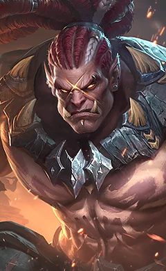

[Tier list](https://boostmlbb.ru/en/heroes/)[News & guides](https://boostmlbb.ru/en/news/)

# Suyou

B

FighterAssassinJungle

Win rate

49.4%

Pick rate

1.6%

Ban rate

1.8%

[Overview](https://boostmlbb.ru/#overview)[Build](https://boostmlbb.ru/#build)[Skills](https://boostmlbb.ru/#skills)[Counters](https://boostmlbb.ru/#draft)[Lore](https://boostmlbb.ru/#lore)

## Overview

### Attributes

-   Durability**60**
-   Offense**60**
-   Control**50**
-   Difficulty**50**

-   Chase
-   Burst

### Win rate by rank, 30 days

1.  **50.9%**Epic
2.  **50.1%**Legend
3.  **49.7%**Mythic
4.  **50.0%**Honor
5.  **49.4%**Glory

Dashed line: 50% win rate

### More fighters on this lane

[Freya](https://boostmlbb.ru/en/heroes/freya.html)[Aulus](https://boostmlbb.ru/en/heroes/aulus.html)[Paquito](https://boostmlbb.ru/en/heroes/paquito.html)[Sun](https://boostmlbb.ru/en/heroes/sun.html)[Lukas](https://boostmlbb.ru/en/heroes/lukas.html)[Dyrroth](https://boostmlbb.ru/en/heroes/dyrroth.html)[Alpha](https://boostmlbb.ru/en/heroes/alpha.html)[Thamuz](https://boostmlbb.ru/en/heroes/thamuz.html)

### Places in the rankings

-   [Best MLBB junglers**9 of 37**](https://boostmlbb.ru/en/heroes/best-jungle.html)
-   [Best MLBB fighters**10 of 44**](https://boostmlbb.ru/en/heroes/best-fighter.html)

## Build

Build 1Build 2Build 3

Win rate

53.5%

Pick rate

21.8%

#### Core items

-   

    Hunter Strike

-   

    War Axe

-   

    Queen's Wings

#### Spell

Retribution

#### Emblem and talents

Assassin

-   

    Thrill

-   

    Seasoned Hunter

-   

    Impure Rage

Win rate

55.5%

Pick rate

14.1%

#### Core items

-   

    Hunter Strike

-   

    Sky Piercer

-   

    War Axe

#### Spell

Retribution

#### Emblem and talents

Assassin

-   

    Thrill

-   

    Seasoned Hunter

-   

    Impure Rage

Win rate

56.6%

Pick rate

7.5%

#### Core items

-   

    Hunter Strike

-   

    Sky Piercer

-   

    War Axe

#### Spell

Retribution

#### Emblem and talents

Assassin

-   

    Thrill

-   

    Seasoned Hunter

-   

    Killing Spree

## Skills

Level-up**Soul Sever**_›_**Evil Queller**_›_**Blade Surge**

Passive**Transient Immortal**Skill 1**Blade Surge**Skill 2**Soul Sever**Ultimate**Evil Queller**

Passive

### Transient Immortal

Tap-casting any skill puts Suyou in Mortal Form, granting 40 Movement Speed and reducing the interval between his Basic Attacks.

Hold-casting any skill puts Suyou in Immortal Form, increasing his Basic Attack damage to 125% and granting 20% Physical Damage Reduction.

In this form, Suyou gains 1% Physical Damage Reduction for every 20 extra he has, up to 40%.

Skill 1

### Blade Surge

**Tap:** Suyou throws his weapon in the target direction, dealing 250 (+100% Extra Physical Attack) Physical Damage to enemies in its path. Suyou then blinks to the weapon's location, catches it, and performs a slash in the opposite direction, dealing 375 (+150% Extra Physical Attack) Physical Damage.

**Hold:** Suyou channels the Immortal's power and charges in the target direction, dealing 250 (+100% Extra Physical Attack) Physical Damage to enemies along the path. When hitting an enemy hero, he stops and stuns enemies in a rectangular area in front for 0.6s. The charge distance increases with the hold time.

Suyou can be controlled while charging, but the skill cannot be interrupted.

Skill 2

### Soul Sever

**Tap:** Suyou performs a sweeping attack with his weapon, dealing Physical Damage equal to 280 (+200% Extra Physical Attack) (+ 15% of target's lost ) to enemies in a fan-shaped area.

**Hold:** Suyou channels the power of the Immortal to perform 3 cleaves in a fan-shaped area. The first two strikes deal 225 (+80% Extra Physical Attack) Physical Damage each, while the final strike deals 360 (+128% Extra Physical Attack) Physical Damage and recovers 150 (+50% Extra Physical Attack) HP for himself.

Ultimate

### Evil Queller

**Tap:** Suyou glides backward and swings his weapon in the target direction, dealing 420 (+120% Extra Physical Attack) Physical Damage to enemies in a rectangular area and on his path backward, and reducing their Movement Speed by 30% for 1.5s.

**Hold:** Suyou uses the Immortal's power to shoot a deadly arrow in the target direction, dealing 580 (+165% Extra Physical Attack) Physical Damage to the target hit. The range increases with the hold time.

Suyou can be controlled while charging, but the skill cannot be interrupted.

## Counters

### Counters

Beat this hero

[Natalia](https://boostmlbb.ru/en/heroes/natalia.html)[Sun](https://boostmlbb.ru/en/heroes/sun.html)[X.Borg](https://boostmlbb.ru/en/heroes/x-borg.html)[Yin](https://boostmlbb.ru/en/heroes/yin.html)[Balmond](https://boostmlbb.ru/en/heroes/balmond.html)

### Easy targets

This hero beats them

[Harith](https://boostmlbb.ru/en/heroes/harith.html)

## Lore

> An exorcist from Zhu'an who has inherited the power of the Immortal Nuo.

[Read the full story ↗](https://kazukiofficial.com/stories/suyou)Kazuki Official [Hero stats on the game site ↗](https://www.mobilelegends.com/hero/detail?heroid=126)

**Rank up on Suyou**The calculator shows the price

[Calculate price](https://boostmlbb.ru/en/order.html?type=hero)

## Frequently asked questions

Who counters Suyou in MLBB?

Over the last 30 days the toughest opponents are Natalia, Sun, X.Borg, Yin and Balmond.

What is Suyou’s win rate right now?

49.41% at Mythical Glory over the last 7 days and 49.70% across all ranks over 30 days, as of 24 November 2026.

What role and lane does Suyou play?

Fighter and assassin, played in the jungle.

Is Suyou strong in the current meta?

Tier B, #29 of 133 heroes and #10 among fighters. The tier counts how often the hero is picked and banned and how well it wins at Mythical Glory over 7 days: banned in 1.8% of matches, 49.4% win rate. In professional games over the last month the hero is drafted in 25.3% of them.

What is the best build for Suyou?

The most popular ranked build: Hunter Strike, War Axe and Queen's Wings as core items, the Assassin emblem with Thrill, Seasoned Hunter and Impure Rage, and Retribution. It wins 53.49% of matches.
