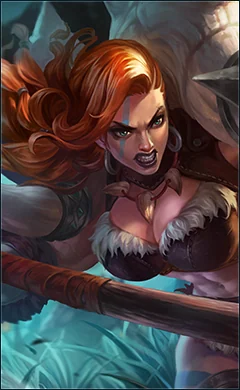

[Tier list](https://boostmlbb.ru/en/heroes/)

# Terizla

C

TankFighterEXP Lane

Win rate

49.9%

Pick rate

0.3%

Ban rate

0.1%

[Overview](https://boostmlbb.ru/#overview)[Build](https://boostmlbb.ru/#build)[How to play](https://boostmlbb.ru/#howto)[Skills](https://boostmlbb.ru/#skills)[Counters](https://boostmlbb.ru/#draft)[Skins](https://boostmlbb.ru/#skins)[Lore](https://boostmlbb.ru/#lore)

## Overview

### Attributes

-   Durability**90**
-   Offense**30**
-   Control**40**
-   Difficulty**20**

-   Burst
-   Crowd Control

### More tanks on this lane

[Masha](https://boostmlbb.ru/en/heroes/masha.html)[Alice](https://boostmlbb.ru/en/heroes/alice.html)[Esmeralda](https://boostmlbb.ru/en/heroes/esmeralda.html)[Gloo](https://boostmlbb.ru/en/heroes/gloo.html)[Barats](https://boostmlbb.ru/en/heroes/barats.html)[Uranus](https://boostmlbb.ru/en/heroes/uranus.html)[Hilda](https://boostmlbb.ru/en/heroes/hilda.html)[Gatotkaca](https://boostmlbb.ru/en/heroes/gatotkaca.html)

### Places in the rankings

-   [Best MLBB fighters**34 of 44**](https://boostmlbb.ru/en/heroes/best-fighter.html)
-   [Best MLBB tanks**19 of 25**](https://boostmlbb.ru/en/heroes/best-tank.html)

## Build

Build 1Build 2Build 3

Win rate

57.1%

Pick rate

14.0%

#### Core items

-   [

    

    War Axe

    ](https://boostmlbb.ru/en/items/war-axe.html)
-   [

    

    Queen's Wings

    ](https://boostmlbb.ru/en/items/queens-wings.html)
-   [

    

    Oracle

    ](https://boostmlbb.ru/en/items/oracle.html)

#### Spell

Flicker

#### Emblem and talents

Fighter

-   

    Thrill

-   

    Festival of Blood

-   

    Brave Smite

Win rate

59.5%

Pick rate

5.1%

#### Core items

-   [

    

    War Axe

    ](https://boostmlbb.ru/en/items/war-axe.html)
-   [

    

    Dominance Ice

    ](https://boostmlbb.ru/en/items/dominance-ice.html)
-   [

    

    Queen's Wings

    ](https://boostmlbb.ru/en/items/queens-wings.html)

#### Spell

Flicker

#### Emblem and talents

Fighter

-   

    Thrill

-   

    Festival of Blood

-   

    Brave Smite

Win rate

57.0%

Pick rate

3.7%

#### Core items

-   [

    

    War Axe

    ](https://boostmlbb.ru/en/items/war-axe.html)
-   [

    

    Queen's Wings

    ](https://boostmlbb.ru/en/items/queens-wings.html)
-   [

    

    Blade Armor

    ](https://boostmlbb.ru/en/items/blade-armor.html)

#### Spell

Flicker

#### Emblem and talents

Fighter

-   

    Thrill

-   

    Festival of Blood

-   

    Brave Smite

## How to play Terizla

### Terizla combos

#### Teamfight

1.  Ult
2.  1
3.  2

In teamfights, Terizla can open with his Ultimate and his 1st Skill to control the enemy team, then use his 2nd Skill to repeatedly hit the targets pulled by the Scaffold.

#### Laning

1.  1
2.  2

In the laning phase, Terizla can use his 1st Skill to slow the enemy, then his 2nd Skill to repeatedly deal damage to them.

### When strongest

Stronger early: 55.7% at 10–12 minutes. Push your lane, take objectives and close the game before the lead fades.

1.  **55.7**10–12
2.  **53.7**12–14
3.  **51.7**14–16
4.  **48.9**16–18
5.  **47.7**18–20
6.  **47.1**20+

Win rate % by match length in minutes, all ranks. Dashed line: 50%

### Level-up priority

1.  Penalty Zone
2.  Execution Strike
3.  Revenge Strike

## Skills

Passive**Body of Smith**Skill 1**Revenge Strike**Skill 2**Execution Strike**Ultimate**Penalty Zone**

Passive

### Body of Smith

Terizla gains 1% extra Damage Reduction (up to 20 (+1 × hero level)%) for every 2.5% HP lost.

He cannot gain extra Attack Speed and will convert every 1% extra Attack Speed into 1 .

Skill 1

### Revenge Strike

Cooldown **8.5 s**

Terizla strikes the ground with his hammer, sending a fissure forward that deals 300 (+80% Extra Physical Attack) Physical Damage. Upon hitting its first target, the fissure burrows into them, slowing them by 15%. Terizla also gains 15% Movement Speed for 3.5s.

The fissure then explodes, dealing 300 (+80% Extra Physical Attack) (+ 20% of the target's lost ) Physical Damage.

Skill 2

### Execution Strike

Cooldown **9 s**

Terizla swings his hammer in a fan-shaped area ahead. This skill can be cast up to 3 times. The first two attacks deal 90 (+135% Total Physical Attack) Physical Damage each, while the third deals 225 (+220% Total Physical Attack) Physical Damage. Enemies hit will also be slowed by 20% for 1.25s (the Slowing Effect can stack).

Deals only 80% damage to Minions.

Ultimate

### Penalty Zone

Cooldown **50 s**

Terizla jumps to the designated area, dealing 300 (+100% Total Physical Attack) Physical Damage and knocking enemies airborne for 0.6s. He then summons Scaffold and slows enemies by 25%. Scaffold will send out a hook at enemy heroes in range and pull them several times while dealing 150 (+30% Total Physical Attack) Physical Damage each time.

## Terizla counters

### Who counters Terizla

[Argus](https://boostmlbb.ru/en/heroes/argus.html)[Phoveus](https://boostmlbb.ru/en/heroes/phoveus.html)[Popol and Kupa](https://boostmlbb.ru/en/heroes/popol-and-kupa.html)[Odette](https://boostmlbb.ru/en/heroes/odette.html)[Lolita](https://boostmlbb.ru/en/heroes/lolita.html)

### Who Terizla counters

[X.Borg](https://boostmlbb.ru/en/heroes/x-borg.html)

## Terizla skins

[Soulblight TyrantExquisite · 2025](https://boostmlbb.ru/en/skins/terizla/soulblight-tyrant.html)[Flames of JudgementDeluxe · 2024](https://boostmlbb.ru/en/skins/terizla/flames-of-judgement.html)[RustwreckCommon · 2023](https://boostmlbb.ru/en/skins/terizla/rustwreck.html)[FlareCommon · 2023](https://boostmlbb.ru/en/skins/terizla/flare.html)[Hammer GiantExceptional · 2020](https://boostmlbb.ru/en/skins/terizla/hammer-giant.html)[Abyss GuardCommon · 2019](https://boostmlbb.ru/en/skins/terizla/abyss-guard.html)

[All 6 Terizla skins: prices and how to get them](https://boostmlbb.ru/en/skins/terizla.html)

## Lore

> Once an eccentric master smith, but now an avenger siding with the Abyss.

[Read the full story ↗](https://play.mobilelegends.com/lore/hero/Terizla)Official Mobile Legends site [Hero stats on the game site ↗](https://www.mobilelegends.com/hero/detail?heroid=82)

**Rank up on Terizla**The calculator shows the price

[Calculate price](https://boostmlbb.ru/en/order.html?type=hero)

## Frequently asked questions

Who counters Terizla in MLBB?

Over the last 30 days the toughest opponents are Argus, Phoveus, Popol and Kupa, Odette and Lolita.

How do you play Terizla?

Level "Execution Strike" first and take the ultimate whenever it is available. Stronger early: 55.7% at 10–12 minutes. Push your lane, take objectives and close the game before the lead fades. Teamfight combo: In teamfights, Terizla can open with his Ultimate and his 1st Skill to control the enemy team, then use his 2nd Skill to repeatedly hit the targets pulled by the Scaffold.

What is Terizla’s win rate right now?

49.89% at Mythical Glory over the last 7 days and 50.60% across all ranks over 30 days, as of 27 November 2026.

What role and lane does Terizla play?

Tank and fighter, played in the EXP Lane.

Is Terizla strong in the current meta?

Tier C, #108 of 133 heroes and #19 among tanks. The tier counts how often the hero is picked and banned and how well it wins at Mythical Glory over 7 days: banned in 0.1% of matches, 49.9% win rate. In professional games over the last month the hero is drafted in 0.5% of them.

What is the best build for Terizla?

The most popular ranked build: War Axe, Queen's Wings and Oracle as core items, the Fighter emblem with Thrill, Festival of Blood and Brave Smite, and Flicker. It wins 57.11% of matches.
