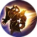

[Home](https://boostmlbb.ru/en/) / [Heroes](https://boostmlbb.ru/en/heroes/)

Tier B

# Uranus

Tank · EXP Lane

**#83 of 133 by win rate**All ranks · 30 days to 23 November 2026

Win rate

49.34%

Pick rate

0.31%

Ban rate

0.33%

Regen · · Difficulty 20/100

[Build](https://boostmlbb.ru/#build)[Counters and teammates](https://boostmlbb.ru/#draft)[Skills](https://boostmlbb.ru/#skills)[Win rate by rank](https://boostmlbb.ru/#ranks)[Lore](https://boostmlbb.ru/#lore)

## Build

Most picked in ranked · EXP Lane

Core items

Thunder BeltDominance IceOracle

Emblem and talents

CommonAgilityTenacityConcussive Blast

Battle spell

Revitalize

Wins with this build **60.19%**Picked in **3.01%** of matches

Alternative builds (2)

Core items

Thunder BeltOracleDominance Ice

Emblem and talents

CommonAgilityTenacityConcussive Blast

Battle spell

Revitalize

Wins with this build **58.65%**Picked in **6.41%** of matches

Core items

OracleAntique CuirassChastise Pauldron

Emblem and talents

CommonAgilityTenacityConcussive Blast

Battle spell

Revitalize

Wins with this build **56.37%**Picked in **2.24%** of matches

## Counters and teammates

### Counters

[Argus](https://boostmlbb.ru/en/heroes/argus.html)[Yin](https://boostmlbb.ru/en/heroes/yin.html)[Gatotkaca](https://boostmlbb.ru/en/heroes/gatotkaca.html)[Diggie](https://boostmlbb.ru/en/heroes/diggie.html)[Granger](https://boostmlbb.ru/en/heroes/granger.html)

### Strong against

[Dyrroth](https://boostmlbb.ru/en/heroes/dyrroth.html)[Kimmy](https://boostmlbb.ru/en/heroes/kimmy.html)[Aldous](https://boostmlbb.ru/en/heroes/aldous.html)[Luo Yi](https://boostmlbb.ru/en/heroes/luo-yi.html)

### Teammates

Win rate gain when playing together

[Angela+3.52 pp](https://boostmlbb.ru/en/heroes/angela.html)[Alpha+1.58 pp](https://boostmlbb.ru/en/heroes/alpha.html)[Bane+1.50 pp](https://boostmlbb.ru/en/heroes/bane.html)[Sun+1.31 pp](https://boostmlbb.ru/en/heroes/sun.html)

## Skills

Level-up priority · Consecration → Ionic Edge → Transcendent Ward

Passive**Radiance**

Each time Uranus takes damage, he gains a stack of Radiance. Each stack recovers 1.2-11.2 HP (increases with level) every 0.8s for 10s, up to 20 stacks.
Uranus's Basic Attacks deal (+80% Total Physical Attack) (+ 4-8 × Radiance stacks) Magic Damage (increases with level).

Skill 1**Ionic Edge**

**Cooldown 4 Mana Cost: 60 s**

Uranus releases 2 energy blades that orbit around him, dealing 155 (+30% Total Magic Power) (+6 × Radiance stacks) Magic Damage to enemies hit and slowing them by 30% for 2s.
Each blade can only damage the same target once.

Skill 2**Transcendent Ward**

**Cooldown 10 Mana Cost: 80 s**

Uranus charges to the target location, dealing 80 (+20% Total Magic Power) Magic Damage to enemies along the way, and 160 (+80% Total Magic Power) Magic Damage to enemies at the target location and slowing them by 25%. Uranus also generates a 300 (+200% Total Magic Power) shield for 4s.
The shield explodes at the end of its duration or when destroyed, dealing 300 (+150% Total Magic Power) Magic Damage to enemies nearby.

Ultimate**Consecration**

**Cooldown 42 Mana Cost: 100 s**

Uranus unleashes the energy stored within his body, removing slow effects on himself, recovering 200 HP, and gaining 60% Movement Speed for 8s (decays over time).
Uranus directly gains 5 stacks of Radiance, increasing shields received and HP Regen by 20% for 8s.

## Win rate by rank

-   Epic**51.65%**
-   Legend**50.82%**
-   Mythic**50.13%**
-   Mythical Honor**49.00%**
-   Mythical Glory**48.25%**

## Lore

Guardian made from lightning and air, guards the Celestial Palace.

[Hero card](https://www.mobilelegends.com/hero/detail?heroid=59)[MLBB Wiki](https://mobile-legends.fandom.com/wiki/Uranus)

[Hero boost pricing](https://boostmlbb.ru/en/order.html?type=hero)

## Frequently asked questions

Who counters Uranus in MLBB?

Over the last 30 days the toughest opponents are Argus, Yin, Gatotkaca, Diggie and Granger.

What is Uranus’s win rate right now?

49.34% over the last 30 days across all ranks and 48.25% in Mythical Glory, as of 23 November 2026.

What role and lane does Uranus play?

Tank, played in the EXP Lane.

Is Uranus strong in the current meta?

Tier B: #83 of 133 heroes by 30-day win rate and #16 among tanks.

What is the best build for Uranus?

The most popular ranked build: Thunder Belt, Dominance Ice and Oracle as core items, the Common emblem with Agility, Tenacity and Concussive Blast, and Revitalize. It wins 60.19% of matches.
