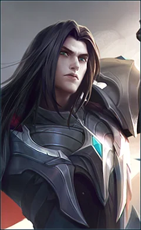
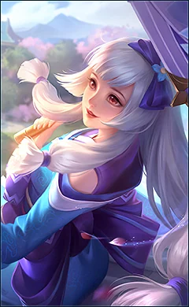
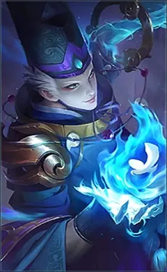

[Tier list](https://boostmlbb.ru/en/heroes/)[Items](https://boostmlbb.ru/en/items/)[Skins](https://boostmlbb.ru/en/skins/)[News & guides](https://boostmlbb.ru/en/news/)

[Tier list](https://boostmlbb.ru/en/heroes/)

# Valir

A

MageMid Lane

Win rate

53.5%

Pick rate

1.3%

Ban rate

4.2%

[Overview](https://boostmlbb.ru/#overview)[Build](https://boostmlbb.ru/#build)[How to play](https://boostmlbb.ru/#howto)[Skills](https://boostmlbb.ru/#skills)[Counters](https://boostmlbb.ru/#draft)[Skins](https://boostmlbb.ru/#skins)[Lore](https://boostmlbb.ru/#lore)

## Overview

### Attributes

-   Durability**20**
-   Offense**70**
-   Control**70**
-   Difficulty**20**

-   Damage
-   Guard

### Win rate by rank, 30 days

1.  **54.2%**Epic
2.  **54.2%**Legend
3.  **54.5%**Mythic
4.  **54.2%**Honor
5.  **53.7%**Glory

Dashed line: 50% win rate

### More mages on this lane

[Kimmy](https://boostmlbb.ru/en/heroes/kimmy.html)[Eudora](https://boostmlbb.ru/en/heroes/eudora.html)[Zhuxin](https://boostmlbb.ru/en/heroes/zhuxin.html)[Zetian](https://boostmlbb.ru/en/heroes/zetian.html)[Xavier](https://boostmlbb.ru/en/heroes/xavier.html)[Lylia](https://boostmlbb.ru/en/heroes/lylia.html)[Lunox](https://boostmlbb.ru/en/heroes/lunox.html)[Valentina](https://boostmlbb.ru/en/heroes/valentina.html)

### Places in the rankings

-   [Best MLBB mages**6 of 32**](https://boostmlbb.ru/en/heroes/best-mage.html)
-   [Best MLBB mid laners**4 of 29**](https://boostmlbb.ru/en/heroes/best-mid.html)

## Build

Build 1Build 2

Win rate

59.4%

Pick rate

24.0%

#### Core items

-   [

    

    Glowing Wand

    ](https://boostmlbb.ru/en/items/glowing-wand.html)
-   [

    

    Ice Queen Wand

    ](https://boostmlbb.ru/en/items/ice-queen-wand.html)
-   [

    

    Wishing Lantern

    ](https://boostmlbb.ru/en/items/wishing-lantern.html)

#### Spell

Flicker

#### Emblem and talents

Common

-   

    Inspire

-   

    Festival of Blood

-   

    Impure Rage

Win rate

60.7%

Pick rate

3.3%

#### Core items

-   [

    

    Glowing Wand

    ](https://boostmlbb.ru/en/items/glowing-wand.html)
-   [

    

    Ice Queen Wand

    ](https://boostmlbb.ru/en/items/ice-queen-wand.html)
-   [

    

    Brute Force Breastplate

    ](https://boostmlbb.ru/en/items/brute-force-breastplate.html)

#### Spell

Flicker

#### Emblem and talents

Common

-   

    Inspire

-   

    Festival of Blood

-   

    Impure Rage

## How to play Valir

### Valir combos

#### Teamfight

1.  Ult
2.  1
3.  1
4.  2
5.  1

In teamfights, activate Valir's Ultimate to enhance his skills, then blast the enemy with his 1st Skill. If the enemy tries to get close, use his 2nd Skill to push them away, and hit them with his 1st Skill for high damage.

#### Laning

1.  1
2.  2
3.  1

In the laning phase, harass enemies with Valir's 1st Skill until their HP is low, then cast his 2nd Skill to push them back and follow up immediately with his 1st Skill for burst damage.

### When strongest

Stronger early: 58.5% at 10–12 minutes. Push your lane, take objectives and close the game before the lead fades.

1.  **58.5**10–12
2.  **55.3**12–14
3.  **53.6**14–16
4.  **52.6**16–18
5.  **52.3**18–20
6.  **51.9**20+

Win rate % by match length in minutes, all ranks. Dashed line: 50%

### Level-up priority

1.  Vengeance Flame
2.  Burst Fireball
3.  Searing Torrent

## Skills

Passive**Ashing**Skill 1**Burst Fireball**Skill 2**Searing Torrent**Ultimate**Vengeance Flame**

Passive

### Ashing

Valir's skills apply a stack of Ablaze to enemies hit, dealing them Magic Damage equal to 1 (+0.2% Total Magic Power)% of their per second for 3s.

At 3 stacks, the fire detonates, dealing Magic Damage equal to 5 (+1% Total Magic Power)% of the target's and stunning them for 1s.

A target can only be stunned by Valir's skills once every 7s.

Skill 1

### Burst Fireball

Cooldown **1.5 Mana Cost: 45 s**

Valir launches a fireball that explodes upon hitting the first target, dealing 235 (+80% Total Magic Power) Magic Damage and slowing them by 30% for 1s. The flame on the ground explodes after 1s, dealing 118 (+40% Total Magic Power) Magic Damage.

Valir recharges 1 fireball every 9s (up to 2 charges). Hitting an enemy hero or legend creep with this skill immediately restores 1 charge, while hitting a minion restores 4s of the recharge time.

**Vengeance Flame:** Increases the cast range of Burst Fireball by 30%.

Skill 2

### Searing Torrent

Cooldown **13 Mana Cost: 75 s**

Valir unleashes a torrent of flames in the target direction, dealing 200 (+60% Total Magic Power) Magic Damage and knocking them back to the end of its path.

**Vengeance Flame:** The torrent forms a firewall at the end of its path that lasts 4s, dealing 100 (+30% Total Magic Power) Magic Damage to nearby enemies every 1s.

Enemies hit by the torrent or the firewall are slowed by 25% for 1s.

Ultimate

### Vengeance Flame

Cooldown **36 Mana Cost: 100 s**

Valir removes all debuffs on himself and gains 40% Movement Speed that decays over 3s. Meanwhile, he conjures 4 Vengeance Flames that enhance Burst Fireball and Searing Torrent for 9s.

## Valir counters

### Who counters Valir

[Fredrinn](https://boostmlbb.ru/en/heroes/fredrinn.html)[Alice](https://boostmlbb.ru/en/heroes/alice.html)[Balmond](https://boostmlbb.ru/en/heroes/balmond.html)[Leomord](https://boostmlbb.ru/en/heroes/leomord.html)[Hylos](https://boostmlbb.ru/en/heroes/hylos.html)

### Who Valir counters

[Gusion](https://boostmlbb.ru/en/heroes/gusion.html)[Novaria](https://boostmlbb.ru/en/heroes/novaria.html)[Harley](https://boostmlbb.ru/en/heroes/harley.html)[Rafaela](https://boostmlbb.ru/en/heroes/rafaela.html)[Kagura](https://boostmlbb.ru/en/heroes/kagura.html)[Kaja](https://boostmlbb.ru/en/heroes/kaja.html)[Helcurt](https://boostmlbb.ru/en/heroes/helcurt.html)[Pharsa](https://boostmlbb.ru/en/heroes/pharsa.html)[Diggie](https://boostmlbb.ru/en/heroes/diggie.html)[Mathilda](https://boostmlbb.ru/en/heroes/mathilda.html)

## Valir skins

[Kyo KusanagiGrand · 2024](https://boostmlbb.ru/en/skins/valir/kyo-kusanagi.html)[Phoenix IkkiDeluxe · 2022](https://boostmlbb.ru/en/skins/valir/phoenix-ikki.html)[Leo IkkiGrand · 2022](https://boostmlbb.ru/en/skins/valir/leo-ikki.html)[Shikigami SumonnerExceptional · 2022](https://boostmlbb.ru/en/skins/valir/shikigami-sumonner.html)[Infernal BlazeSupreme · 2022](https://boostmlbb.ru/en/skins/valir/infernal-blaze.html)[DemonlordExquisite · 2021](https://boostmlbb.ru/en/skins/valir/demonlord.html)[DictatorExceptional · 2020](https://boostmlbb.ru/en/skins/valir/dictator.html)[Draconic FlameDeluxe · 2019](https://boostmlbb.ru/en/skins/valir/draconic-flame.html)[Arcane SeekerCommon · 2018](https://boostmlbb.ru/en/skins/valir/arcane-seeker.html)[Pale FlameCommon · 2018](https://boostmlbb.ru/en/skins/valir/pale-flame.html)

[All 10 Valir skins: prices and how to get them](https://boostmlbb.ru/en/skins/valir.html)

## Lore

> Heir to Fire Throat, fire mage.

[Read the full story ↗](https://kazukiofficial.com/stories/valir)Kazuki Official [Hero stats on the game site ↗](https://www.mobilelegends.com/hero/detail?heroid=57)

**Rank up on Valir**The calculator shows the price

[Calculate price](https://boostmlbb.ru/en/order.html?type=hero)

## Frequently asked questions

Who counters Valir in MLBB?

Over the last 30 days the toughest opponents are Fredrinn, Alice, Balmond, Leomord and Hylos.

How do you play Valir?

Level "Burst Fireball" first and take the ultimate whenever it is available. Stronger early: 58.5% at 10–12 minutes. Push your lane, take objectives and close the game before the lead fades. Teamfight combo: In teamfights, activate Valir's Ultimate to enhance his skills, then blast the enemy with his 1st Skill. If the enemy tries to get close, use his 2nd Skill to push them away, and hit them with his 1st Skill for high damage.

What is Valir’s win rate right now?

53.45% at Mythical Glory over the last 7 days and 54.01% across all ranks over 30 days, as of 27 November 2026.

What role and lane does Valir play?

Mage, played in the Mid Lane.

Is Valir strong in the current meta?

Tier A, #20 of 133 heroes and #6 among mages. The tier counts how often the hero is picked and banned and how well it wins at Mythical Glory over 7 days: banned in 4.2% of matches, 53.5% win rate. In professional games over the last month the hero is drafted in 40.7% of them.

What is the best build for Valir?

The most popular ranked build: Glowing Wand, Ice Queen Wand and Wishing Lantern as core items, the Common emblem with Inspire, Festival of Blood and Impure Rage, and Flicker. It wins 59.43% of matches.
