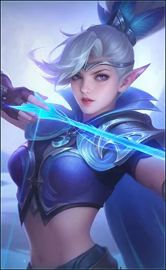
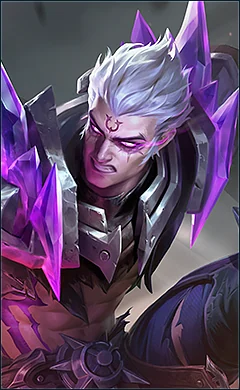

[Tier list](https://boostmlbb.ru/en/heroes/)[Items](https://boostmlbb.ru/en/items/)[Skins](https://boostmlbb.ru/en/skins/)[News & guides](https://boostmlbb.ru/en/news/)

[Tier list](https://boostmlbb.ru/en/heroes/)

# Wanwan

D

MarksmanGold Lane

Win rate

47.1%

Pick rate

0.2%

Ban rate

0.1%

[Overview](https://boostmlbb.ru/#overview)[Build](https://boostmlbb.ru/#build)[How to play](https://boostmlbb.ru/#howto)[Skills](https://boostmlbb.ru/#skills)[Counters](https://boostmlbb.ru/#draft)[Skins](https://boostmlbb.ru/#skins)[Lore](https://boostmlbb.ru/#lore)

## Overview

### Attributes

-   Durability**20**
-   Offense**60**
-   Control**30**
-   Difficulty**80**

-   Finisher
-   Burst

### Win rate by rank, 30 days

1.  **45.7%**Epic
2.  **48.0%**Legend
3.  **48.0%**Mythic
4.  **48.3%**Honor
5.  **47.0%**Glory

Dashed line: 50% win rate

### More marksmen on this lane

[Obsidia](https://boostmlbb.ru/en/heroes/obsidia.html)[Bruno](https://boostmlbb.ru/en/heroes/bruno.html)[Clint](https://boostmlbb.ru/en/heroes/clint.html)[Brody](https://boostmlbb.ru/en/heroes/brody.html)[Hanabi](https://boostmlbb.ru/en/heroes/hanabi.html)[Moskov](https://boostmlbb.ru/en/heroes/moskov.html)[Claude](https://boostmlbb.ru/en/heroes/claude.html)[Miya](https://boostmlbb.ru/en/heroes/miya.html)

### Places in the rankings

-   [Best MLBB marksmen**22 of 23**](https://boostmlbb.ru/en/heroes/best-marksman.html)

## Build

Build 1Build 2Build 3

Win rate

49.3%

Pick rate

3.8%

#### Core items

-   [

    

    Corrosion Scythe

    ](https://boostmlbb.ru/en/items/corrosion-scythe.html)
-   [

    

    Windtalker

    ](https://boostmlbb.ru/en/items/windtalker.html)
-   [

    

    Demon Hunter Sword

    ](https://boostmlbb.ru/en/items/demon-hunter-sword.html)
-   [

    

    Wind of Nature

    ](https://boostmlbb.ru/en/items/wind-of-nature.html)

#### Spell

Inspire

#### Emblem and talents

Marksman

-   

    Swift

-   

    Weapons Master

-   

    Weakness Finder

Win rate

57.5%

Pick rate

3.1%

#### Core items

-   [

    

    Corrosion Scythe

    ](https://boostmlbb.ru/en/items/corrosion-scythe.html)
-   [

    

    Windtalker

    ](https://boostmlbb.ru/en/items/windtalker.html)
-   [

    

    Rose Gold Meteor

    ](https://boostmlbb.ru/en/items/rose-gold-meteor.html)
-   [

    

    Haas's Claws

    ](https://boostmlbb.ru/en/items/haas-claws.html)

#### Spell

Inspire

#### Emblem and talents

Marksman

-   

    Swift

-   

    Master Assassin

-   

    Weakness Finder

Win rate

58.9%

Pick rate

3.0%

#### Core items

-   [

    

    Corrosion Scythe

    ](https://boostmlbb.ru/en/items/corrosion-scythe.html)
-   [

    

    Windtalker

    ](https://boostmlbb.ru/en/items/windtalker.html)
-   [

    

    Rose Gold Meteor

    ](https://boostmlbb.ru/en/items/rose-gold-meteor.html)
-   [

    

    Haas's Claws

    ](https://boostmlbb.ru/en/items/haas-claws.html)

#### Spell

Inspire

#### Emblem and talents

Marksman

-   

    Swift

-   

    Weapons Master

-   

    Weakness Finder

## How to play Wanwan

### Wanwan combos

#### Teamfight

1.  1
2.  Attack
3.  Ult

In teamfights, use Basic Attacks to dash with her Passive and adjust position for damage, and then land as many hits as possible with her 1st Skill. After hitting all Weaknesses, reap kills with her Ultimate.

#### Laning

1.  Attack
2.  1
3.  Attack
4.  Ult

In the laning phase, Wanwan can poke enemies with her 1st Skill and then use Basic Attacks to dash with her Passive and adjust Swallow Daggers' paths to control enemies. After hitting an enemy's three Weaknesses, she can finish them off with her Ultimate.

### When strongest

Stronger late: 52.5% after minute 20. Do not take risks early, farm and fight together with your team.

1.  **41.1**10–12
2.  **45.1**12–14
3.  **47.6**14–16
4.  **50.2**16–18
5.  **51.2**18–20
6.  **52.5**20+

Win rate % by match length in minutes, all ranks. Dashed line: 50%

### Level-up priority

1.  Crossbow of Tang
2.  Swallow’s Path
3.  Needles in Flowers

## Skills

Passive**Tiger Pace**Skill 1**Swallow’s Path**Skill 2**Needles in Flowers**Ultimate**Crossbow of Tang**

Passive

### Tiger Pace

Enemy heroes hit by Wanwan's attacks will have their weaknesses and positions exposed for 5s. When hitting an enemy's weakness, Wanwan deals 67 (+3 × hero level) extra True Damage and increases their damage taken from her subsequent attacks by 10% for 5s.

Wanwan can dash a short distance after each arrow fired from her Basic Attack. The dash speed scales with her Attack Speed.

Skill 1

### Swallow’s Path

Cooldown **12 Mana Cost: 85 s**

Wanwan throws a Fire Swallow in the target direction, triggering Tiger Pace while dealing 120 (+40% Total Physical Attack) Physical Damage to enemies in its path. The Fire Swallow then turns into 3 rotating Swallow Daggers. After a short delay, these Swallow Daggers will fly back to Wanwan one after another, dealing 120 (+40% Total Physical Attack) Physical Damage to enemies on their way back and slowing them by 30% for 1.5s. Enemies hit twice by the Swallow Daggers will be immobilized for 0.5s.

Skill 2

### Needles in Flowers

Cooldown **24 Mana Cost: 125 s**

Wanwan removes all debuffs on herself and triggers Tiger Pace. Meanwhile, she shoots Deadly Needles in all directions, dealing 150 (+60% Total Physical Attack) Physical Damage to enemies hit.

Ultimate

### Crossbow of Tang

Wanwan leaps into the air and becomes untargetable, firing arrows at the target enemy hero for 2.5s in rapid succession, dealing 60 (+35% Total Physical Attack) Physical Damage per arrow. If the target is killed during this attack, Wanwan will switch to another enemy hero in her attack range, gain 30% Attack Speed, and extend the skill duration by 1s (this effect can trigger up to 3 times). Wanwan can trigger Tiger Pace upon killing an enemy and at the end of the duration.

Crossbow of Tang can only be cast on enemy heroes with all their weaknesses hit and Wanwan gains 100% Movement Speed during the duration. This damage is regarded as Basic Attack damage, and the firing rate scales with Wanwan's Attack Speed.

## Wanwan counters

### Who counters Wanwan

[Yin](https://boostmlbb.ru/en/heroes/yin.html)[Ixia](https://boostmlbb.ru/en/heroes/ixia.html)[Atlas](https://boostmlbb.ru/en/heroes/atlas.html)[Guinevere](https://boostmlbb.ru/en/heroes/guinevere.html)[Hanabi](https://boostmlbb.ru/en/heroes/hanabi.html)

### Who Wanwan counters

[Paquito](https://boostmlbb.ru/en/heroes/paquito.html)[Cyclops](https://boostmlbb.ru/en/heroes/cyclops.html)[Bruno](https://boostmlbb.ru/en/heroes/bruno.html)[Irithel](https://boostmlbb.ru/en/heroes/irithel.html)[Lunox](https://boostmlbb.ru/en/heroes/lunox.html)[Khufra](https://boostmlbb.ru/en/heroes/khufra.html)[Phoveus](https://boostmlbb.ru/en/heroes/phoveus.html)[Faramis](https://boostmlbb.ru/en/heroes/faramis.html)

## Wanwan skins

[Summer SplashExceptional · 2025](https://boostmlbb.ru/en/skins/wanwan/summer-splash.html)[Flying SwallowGrand · 2024](https://boostmlbb.ru/en/skins/wanwan/flying-swallow.html)[M-World WanwanDeluxe · 2022](https://boostmlbb.ru/en/skins/wanwan/m-world-wanwan.html)[E-girlExceptional · 2021](https://boostmlbb.ru/en/skins/wanwan/e-girl.html)[Pixel BlastExquisite · 2021](https://boostmlbb.ru/en/skins/wanwan/pixel-blast.html)[Teen PopExceptional · 2020](https://boostmlbb.ru/en/skins/wanwan/teen-pop.html)[Shoujo CommanderCommon · 2020](https://boostmlbb.ru/en/skins/wanwan/shoujo-commander.html)[Darting StarCommon · 2019](https://boostmlbb.ru/en/skins/wanwan/darting-star.html)

[All 8 Wanwan skins: prices and how to get them](https://boostmlbb.ru/en/skins/wanwan.html)

## Lore

> The Agile Tiger of the Oriental Fighters and a lively young girl who wields the Crossbow of Tang.

[Read the full story ↗](https://play.mobilelegends.com/lore/hero/Wanwan)Official Mobile Legends site [Hero stats on the game site ↗](https://www.mobilelegends.com/hero/detail?heroid=89)

**Rank up on Wanwan**The calculator shows the price

[Calculate price](https://boostmlbb.ru/en/order.html?type=hero)

## Frequently asked questions

Who counters Wanwan in MLBB?

Over the last 30 days the toughest opponents are Yin, Ixia, Atlas, Guinevere and Hanabi.

How do you play Wanwan?

Level "Swallow’s Path" first and take the ultimate whenever it is available. Stronger late: 52.5% after minute 20. Do not take risks early, farm and fight together with your team. Teamfight combo: In teamfights, use Basic Attacks to dash with her Passive and adjust position for damage, and then land as many hits as possible with her 1st Skill. After hitting all Weaknesses, reap kills with her Ultimate.

What is Wanwan’s win rate right now?

47.11% at Mythical Glory over the last 7 days and 47.52% across all ranks over 30 days, as of 25 November 2026.

What role and lane does Wanwan play?

Marksman, played in the Gold Lane.

Is Wanwan strong in the current meta?

Tier D, #125 of 133 heroes and #22 among marksmen. The tier counts how often the hero is picked and banned and how well it wins at Mythical Glory over 7 days: banned in 0.1% of matches, 47.1% win rate. In professional games over the last month the hero is drafted in 0.9% of them.

What is the best build for Wanwan?

The most popular ranked build: Corrosion Scythe, Windtalker, Demon Hunter Sword and Wind of Nature as core items, the Marksman emblem with Swift, Weapons Master and Weakness Finder, and Inspire. It wins 49.34% of matches.
