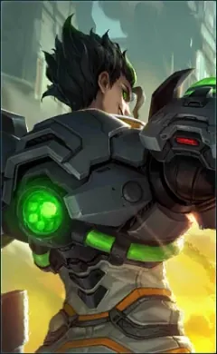

[Tier list](https://boostmlbb.ru/en/heroes/)[Items](https://boostmlbb.ru/en/items/)[Skins](https://boostmlbb.ru/en/skins/)[News & guides](https://boostmlbb.ru/en/news/)

[Tier list](https://boostmlbb.ru/en/heroes/)

# X.Borg

C

FighterEXP Lane

Win rate

49.0%

Pick rate

0.5%

Ban rate

0.9%

[Overview](https://boostmlbb.ru/#overview)[Build](https://boostmlbb.ru/#build)[How to play](https://boostmlbb.ru/#howto)[Skills](https://boostmlbb.ru/#skills)[Counters](https://boostmlbb.ru/#draft)[Skins](https://boostmlbb.ru/#skins)[Lore](https://boostmlbb.ru/#lore)

## Overview

### Attributes

-   Durability**80**
-   Offense**30**
-   Control**10**
-   Difficulty**60**

-   Regen
-   Burst

### More fighters on this lane

[Freya](https://boostmlbb.ru/en/heroes/freya.html)[Aulus](https://boostmlbb.ru/en/heroes/aulus.html)[Paquito](https://boostmlbb.ru/en/heroes/paquito.html)[Sun](https://boostmlbb.ru/en/heroes/sun.html)[Lukas](https://boostmlbb.ru/en/heroes/lukas.html)[Cici](https://boostmlbb.ru/en/heroes/cici.html)[Sora](https://boostmlbb.ru/en/heroes/sora.html)[Yu Zhong](https://boostmlbb.ru/en/heroes/yu-zhong.html)

### Places in the rankings

-   [Best MLBB fighters**28 of 44**](https://boostmlbb.ru/en/heroes/best-fighter.html)

## Build

Build 1Build 2Build 3

Win rate

55.0%

Pick rate

6.6%

#### Core items

-   [

    

    War Axe

    ](https://boostmlbb.ru/en/items/war-axe.html)
-   [

    

    Dominance Ice

    ](https://boostmlbb.ru/en/items/dominance-ice.html)
-   [

    

    Brute Force Breastplate

    ](https://boostmlbb.ru/en/items/brute-force-breastplate.html)

#### Spell

Flicker

#### Emblem and talents

Tank

-   

    Agility

-   

    Festival of Blood

-   

    Impure Rage

Win rate

55.3%

Pick rate

2.1%

#### Core items

-   [

    

    War Axe

    ](https://boostmlbb.ru/en/items/war-axe.html)
-   [

    

    Dominance Ice

    ](https://boostmlbb.ru/en/items/dominance-ice.html)
-   [

    

    Brute Force Breastplate

    ](https://boostmlbb.ru/en/items/brute-force-breastplate.html)

#### Spell

Flicker

#### Emblem and talents

Tank

-   

    Thrill

-   

    Festival of Blood

-   

    Impure Rage

Win rate

52.0%

Pick rate

1.6%

#### Core items

-   [

    

    War Axe

    ](https://boostmlbb.ru/en/items/war-axe.html)
-   [

    

    Sky Piercer

    ](https://boostmlbb.ru/en/items/sky-piercer.html)
-   [

    

    Immortality

    ](https://boostmlbb.ru/en/items/immortality.html)

#### Spell

Flicker

#### Emblem and talents

Tank

-   

    Thrill

-   

    Seasoned Hunter

-   

    Impure Rage

## How to play X.Borg

### X.Borg combos

#### Teamfight

1.  1
2.  Ult
3.  2

In teamfights, cast X.Borg's 1st Skill, then activate his Ultimate when enemies are clustered, and uses his 2nd Skill to pull them back to him.

#### Laning

1.  1
2.  2

In the laning phase, cast X.Borg's 1st Skill then use his 2nd Skill to pull enemies toward him.

### When strongest

Stronger early: 52.7% at 10–12 minutes. Push your lane, take objectives and close the game before the lead fades.

1.  **52.7**10–12
2.  **50.7**12–14
3.  **49.9**14–16
4.  **48.7**16–18
5.  **48.8**18–20
6.  **48.7**20+

Win rate % by match length in minutes, all ranks. Dashed line: 50%

### Level-up priority

1.  Last Insanity
2.  Fire Missiles
3.  Fire Stake

## Skills

Passive**Firaga Armor**Skill 1**Fire Missiles**Skill 2**Fire Stake**Ultimate**Last Insanity**

Passive

### Firaga Armor

Firaga Armor inherits 160% of X.Borg's and absorbs all incoming damage when it's active. When destroyed, X.Borg rolls in the direction of the Joystick (he is invincible during this process). The Armor's energy will gradually regenerate while X.Borg is in the Armorless State. At full energy, X.Borg re-equips the Armor and restores it to 30% HP.

X.Borg's attacks cause enemies to enter the Overheated state. Enemies in the Overheated state will drop Firaga Supplies when they take damage from X.Borg. Picking up supplies restores 10% of the Armor's HP (or 10 Energy while in the Armorless State).

X.Borg's skills deal True Damage to enemies in the Overheated state.

Skill 1

### Fire Missiles

Cooldown **4 s**

X.Borg sprays fire, dealing 25 (+60% Total Physical Attack) (+40% Total Magic Power) Physical Damage 7 times over 2s to enemies in front of him (75% damage to minions).

**Armorless State:** The attack area becomes narrower but longer, while the damage is reduced to 60%.

Skill 2

### Fire Stake

Cooldown **9 s**

X.Borg fires 5 Fire Stakes forward and recalls them after 1.7s. Each stake deals 50 (+20% Total Physical Attack) Physical Damage and pulls enemies and Firaga Supplies along its path back to him.

**Armorless State:** X.Borg adjusts the Fire Stake launcher, making the stakes travel farther and closer together.

Ultimate

### Last Insanity

Cooldown **30 s**

X.Borg charges in the target direction while spinning and spraying fire (cannot pick up Firaga Supplies during this time), dealing 90 (+60% Extra Physical Attack) (+45% Total Magic Power) Physical Damage 12 times and slowing enemies hit by 25%. He stops upon touching an enemy hero and will slow them by an additional 40%.

After 3s, his mecha suit detonates, dealing 300 (+ 15% target's ) True Damage. If his armor is destroyed, it will immediately explode, but damage drops to 50%. The detonation destroys his armor, removes all control effects, and collects all nearby Firaga Supplies. Cannot be used in Armorless State.

**Use Again:** Immediately stop spraying fire and detonate early.

## X.Borg counters

### Who counters X.Borg

[Baxia](https://boostmlbb.ru/en/heroes/baxia.html)[Barats](https://boostmlbb.ru/en/heroes/barats.html)[Terizla](https://boostmlbb.ru/en/heroes/terizla.html)[Phoveus](https://boostmlbb.ru/en/heroes/phoveus.html)[Martis](https://boostmlbb.ru/en/heroes/martis.html)

### Who X.Borg counters

[Nolan](https://boostmlbb.ru/en/heroes/nolan.html)[Selena](https://boostmlbb.ru/en/heroes/selena.html)[Gusion](https://boostmlbb.ru/en/heroes/gusion.html)[Paquito](https://boostmlbb.ru/en/heroes/paquito.html)[Suyou](https://boostmlbb.ru/en/heroes/suyou.html)[Chou](https://boostmlbb.ru/en/heroes/chou.html)[Floryn](https://boostmlbb.ru/en/heroes/floryn.html)[Zilong](https://boostmlbb.ru/en/heroes/zilong.html)[Ling](https://boostmlbb.ru/en/heroes/ling.html)[Helcurt](https://boostmlbb.ru/en/heroes/helcurt.html)

## X.Borg skins

[BumblebeeGrand · 2025](https://boostmlbb.ru/en/skins/x-borg/bumblebee.html)[Pecados RioterCommon · 2025](https://boostmlbb.ru/en/skins/x-borg/pecados-rioter.html)[Moto DrifterCommon · 2023](https://boostmlbb.ru/en/skins/x-borg/moto-drifter.html)[Tesla ManiacGrand · 2020](https://boostmlbb.ru/en/skins/x-borg/tesla-maniac.html)[Graffiti FashionExceptional · 2020](https://boostmlbb.ru/en/skins/x-borg/graffiti-fashion.html)[Blue StormCommon · 2019](https://boostmlbb.ru/en/skins/x-borg/blue-storm.html)

[All 6 X.Borg skins: prices and how to get them](https://boostmlbb.ru/en/skins/x-borg.html)

## Lore

> An uncontrollable flame that's determined to take revenge against Eruditio.

[Read the full story ↗](https://kazukiofficial.com/stories/x-borg)Kazuki Official [Hero stats on the game site ↗](https://www.mobilelegends.com/hero/detail?heroid=83)

**Rank up on X.Borg**The calculator shows the price

[Calculate price](https://boostmlbb.ru/en/order.html?type=hero)

## Frequently asked questions

Who counters X.Borg in MLBB?

Over the last 30 days the toughest opponents are Baxia, Barats, Terizla, Phoveus and Martis.

How do you play X.Borg?

Level "Fire Missiles" first and take the ultimate whenever it is available. Stronger early: 52.7% at 10–12 minutes. Push your lane, take objectives and close the game before the lead fades. Teamfight combo: In teamfights, cast X.Borg's 1st Skill, then activate his Ultimate when enemies are clustered, and uses his 2nd Skill to pull them back to him.

What is X.Borg’s win rate right now?

48.97% at Mythical Glory over the last 7 days and 49.93% across all ranks over 30 days, as of 27 November 2026.

What role and lane does X.Borg play?

Fighter, played in the EXP Lane.

Is X.Borg strong in the current meta?

Tier C, #91 of 133 heroes and #28 among fighters. The tier counts how often the hero is picked and banned and how well it wins at Mythical Glory over 7 days: banned in 0.9% of matches, 49.0% win rate. In professional games over the last month the hero is drafted in 0.9% of them.

What is the best build for X.Borg?

The most popular ranked build: War Axe, Dominance Ice and Brute Force Breastplate as core items, the Tank emblem with Agility, Festival of Blood and Impure Rage, and Flicker. It wins 55.02% of matches.
