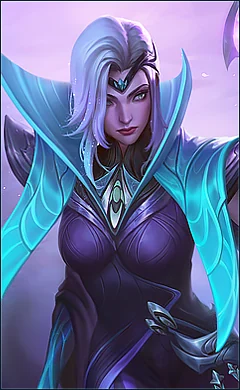
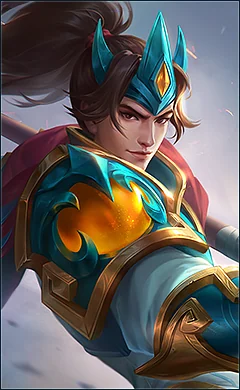

[Tier list](https://boostmlbb.ru/en/heroes/)[News & guides](https://boostmlbb.ru/en/news/)

# Xavier

B

MageMid Lane

Win rate

53.5%

Pick rate

1.8%

Ban rate

1.3%

[Overview](https://boostmlbb.ru/#overview)[Build](https://boostmlbb.ru/#build)[Skills](https://boostmlbb.ru/#skills)[Counters](https://boostmlbb.ru/#draft)[Lore](https://boostmlbb.ru/#lore)

## Overview

### Attributes

-   Durability**20**
-   Offense**100**
-   Control**80**
-   Difficulty**50**

-   Damage
-   Burst

### Win rate by rank, 30 days

1.  **48.7%**Epic
2.  **49.4%**Legend
3.  **50.6%**Mythic
4.  **51.8%**Honor
5.  **52.8%**Glory

Dashed line: 50% win rate

### More mages on this lane

[Kimmy](https://boostmlbb.ru/en/heroes/kimmy.html)[Eudora](https://boostmlbb.ru/en/heroes/eudora.html)[Zhuxin](https://boostmlbb.ru/en/heroes/zhuxin.html)[Valir](https://boostmlbb.ru/en/heroes/valir.html)[Zetian](https://boostmlbb.ru/en/heroes/zetian.html)[Lylia](https://boostmlbb.ru/en/heroes/lylia.html)[Lunox](https://boostmlbb.ru/en/heroes/lunox.html)[Valentina](https://boostmlbb.ru/en/heroes/valentina.html)

### Places in the rankings

-   [Best MLBB mages**10 of 32**](https://boostmlbb.ru/en/heroes/best-mage.html)
-   [Best MLBB mid laners**8 of 29**](https://boostmlbb.ru/en/heroes/best-mid.html)

## Build

Build 1Build 2Build 3

Win rate

58.9%

Pick rate

11.2%

#### Core items

-   

    Enchanted Talisman

-   

    Glowing Wand

-   

    Lightning Truncheon

#### Spell

Flicker

#### Emblem and talents

Mage

-   

    Inspire

-   

    Bargain Hunter

-   

    Impure Rage

Win rate

55.6%

Pick rate

6.5%

#### Core items

-   

    Enchanted Talisman

-   

    Sky Piercer

-   

    Lightning Truncheon

#### Spell

Flicker

#### Emblem and talents

Mage

-   

    Inspire

-   

    Bargain Hunter

-   

    Impure Rage

Win rate

59.1%

Pick rate

4.8%

#### Core items

-   

    Enchanted Talisman

-   

    Glowing Wand

-   

    Lightning Truncheon

#### Spell

Flicker

#### Emblem and talents

Mage

-   

    Rupture

-   

    Bargain Hunter

-   

    Impure Rage

## Skills

Level-up**Dawning Light**_›_**Infinite Extension**_›_**Mystic Field**

Passive**Transcendence**Skill 1**Infinite Extension**Skill 2**Mystic Field**Ultimate**Dawning Light**

Passive

### Transcendence

When Xavier's skills hit enemy heroes, he gains 60% Movement Speed for 1.2s (decays over time) and 1 energy charge. At 3 charges, his next skill triggers the Transcendence state.

**Transcendence:** In this state, Xavier's Skills 1 and 2 have their cooldowns reduced by 4s, and his Ultimate by 36s. Transcendence lasts 5s and can be extended by 1s each time his skills hit enemies.

Skill 1

### Infinite Extension

Cooldown **6.5 Mana Cost: 45 s**

Xavier fires a Mystic Bullet that deals 480 (+100% Total Magic Power) Magic Damage to enemies it passes through.

The Bullet's flying distance increases each time it hits an enemy or the Mystic Barrier (up to 5 times).

Skill 2

### Mystic Field

Cooldown **13 Mana Cost: 80 s**

Xavier summons a Mystic Barrier that lasts 5s. Enemies touching the Barrier are slowed by 50%, while allies gain 50% extra Movement Speed (decays over 1.2s).

When hit by Xavier's other skills, the Barrier expands into a Mystic Field for 3s, dealing 440 (+130% Total Magic Power) Magic Damage to enemies within and immobilizing them for 0.8s.

Ultimate

### Dawning Light

Cooldown **56 Mana Cost: 120 s**

Xavier unleashes a beam of Mystic magic in the target direction, dealing 600 (+180% Total Magic Power) Magic Damage to all enemies along its path.

Once cast, he also directly enters the Transcendence state and resets the state's duration.

## Counters

### Counters

Beat this hero

[Popol and Kupa](https://boostmlbb.ru/en/heroes/popol-and-kupa.html)[Belerick](https://boostmlbb.ru/en/heroes/belerick.html)[Atlas](https://boostmlbb.ru/en/heroes/atlas.html)[Gloo](https://boostmlbb.ru/en/heroes/gloo.html)[Carmilla](https://boostmlbb.ru/en/heroes/carmilla.html)

### Easy targets

This hero beats them

[Zilong](https://boostmlbb.ru/en/heroes/zilong.html)[Helcurt](https://boostmlbb.ru/en/heroes/helcurt.html)[Aldous](https://boostmlbb.ru/en/heroes/aldous.html)[Natalia](https://boostmlbb.ru/en/heroes/natalia.html)

## Lore

> Former member of the Knights of Light who's determined to forge a path of his own.

[Read the full story ↗](https://play.mobilelegends.com/lore/hero/Xavier)Official Mobile Legends site [Hero stats on the game site ↗](https://www.mobilelegends.com/hero/detail?heroid=115)

**Rank up on Xavier**The calculator shows the price

[Calculate price](https://boostmlbb.ru/en/order.html?type=hero)

## Frequently asked questions

Who counters Xavier in MLBB?

Over the last 30 days the toughest opponents are Popol and Kupa, Belerick, Atlas, Gloo and Carmilla.

What is Xavier’s win rate right now?

53.46% at Mythical Glory over the last 7 days and 51.87% across all ranks over 30 days, as of 25 November 2026.

What role and lane does Xavier play?

Mage, played in the Mid Lane.

Is Xavier strong in the current meta?

Tier B, #37 of 133 heroes and #10 among mages. The tier counts how often the hero is picked and banned and how well it wins at Mythical Glory over 7 days: banned in 1.3% of matches, 53.5% win rate. In professional games over the last month the hero is drafted in 1.0% of them.

What is the best build for Xavier?

The most popular ranked build: Enchanted Talisman, Glowing Wand and Lightning Truncheon as core items, the Mage emblem with Inspire, Bargain Hunter and Impure Rage, and Flicker. It wins 58.91% of matches.
