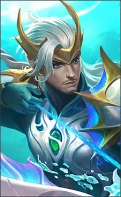

[Tier list](https://boostmlbb.ru/en/heroes/)[Items](https://boostmlbb.ru/en/items/)[Skins](https://boostmlbb.ru/en/skins/)[News & guides](https://boostmlbb.ru/en/news/)

[Tier list](https://boostmlbb.ru/en/heroes/)

# Yi Sun-shin

B

AssassinMarksmanJungle

Win rate

48.5%

Pick rate

1.1%

Ban rate

1.4%

[Overview](https://boostmlbb.ru/#overview)[Build](https://boostmlbb.ru/#build)[How to play](https://boostmlbb.ru/#howto)[Skills](https://boostmlbb.ru/#skills)[Counters](https://boostmlbb.ru/#draft)[Skins](https://boostmlbb.ru/#skins)[Lore](https://boostmlbb.ru/#lore)

## Overview

### Attributes

-   Durability**40**
-   Offense**90**
-   Control**40**
-   Difficulty**60**

-   Finisher
-   Chase

### Win rate by rank, 30 days

1.  **51.8%**Epic
2.  **49.7%**Legend
3.  **48.9%**Mythic
4.  **49.2%**Honor
5.  **48.7%**Glory

Dashed line: 50% win rate

### More assassins on this lane

[Nolan](https://boostmlbb.ru/en/heroes/nolan.html)[Hirara](https://boostmlbb.ru/en/heroes/hirara.html)[Saber](https://boostmlbb.ru/en/heroes/saber.html)[Harley](https://boostmlbb.ru/en/heroes/harley.html)[Fanny](https://boostmlbb.ru/en/heroes/fanny.html)[Ling](https://boostmlbb.ru/en/heroes/ling.html)[Karina](https://boostmlbb.ru/en/heroes/karina.html)[Gusion](https://boostmlbb.ru/en/heroes/gusion.html)

### Places in the rankings

-   [Best MLBB junglers**16 of 37**](https://boostmlbb.ru/en/heroes/best-jungle.html)
-   [Best MLBB marksmen**12 of 23**](https://boostmlbb.ru/en/heroes/best-marksman.html)
-   [Best MLBB assassins**15 of 29**](https://boostmlbb.ru/en/heroes/best-assassin.html)

## Build

Build 1Build 2Build 3

Win rate

53.6%

Pick rate

14.7%

#### Core items

-   [

    

    Hunter Strike

    ](https://boostmlbb.ru/en/items/hunter-strike.html)
-   [

    

    War Axe

    ](https://boostmlbb.ru/en/items/war-axe.html)
-   [

    

    Endless Battle

    ](https://boostmlbb.ru/en/items/endless-battle.html)

#### Spell

Retribution

#### Emblem and talents

Assassin

-   

    Thrill

-   

    Seasoned Hunter

-   

    Killing Spree

Win rate

54.2%

Pick rate

13.6%

#### Core items

-   [

    

    Hunter Strike

    ](https://boostmlbb.ru/en/items/hunter-strike.html)
-   [

    

    Sky Piercer

    ](https://boostmlbb.ru/en/items/sky-piercer.html)
-   [

    

    Endless Battle

    ](https://boostmlbb.ru/en/items/endless-battle.html)

#### Spell

Retribution

#### Emblem and talents

Assassin

-   

    Thrill

-   

    Seasoned Hunter

-   

    Killing Spree

Win rate

53.7%

Pick rate

7.6%

#### Core items

-   [

    

    Hunter Strike

    ](https://boostmlbb.ru/en/items/hunter-strike.html)
-   [

    

    War Axe

    ](https://boostmlbb.ru/en/items/war-axe.html)
-   [

    

    Endless Battle

    ](https://boostmlbb.ru/en/items/endless-battle.html)

#### Spell

Retribution

#### Emblem and talents

Assassin

-   

    Thrill

-   

    Weapons Master

-   

    Killing Spree

## How to play Yi Sun-shin

### Yi Sun-shin combos

#### Teamfight

1.  Ult
2.  1
3.  Attack
4.  1
5.  Attack
6.  2
7.  Attack

In teamfights, start with Yi Sun-shin's Ultimate, then use his enhanced 1st Skill to send his Turtle Ship into the enemy to stun them. Follow up with ranged Basic Attacks, then use his 1st Skill to get close and perform 2 enhanced Basic Attacks. Tap his 2nd Skill to perform another slash, and secure the kill with 2 more enhanced Basic Attacks.

#### Laning

1.  Attack
2.  1
3.  Attack
4.  2
5.  Attack

In the laning phase, Yi Sun-shin should use his enhanced Basic Attacks from a distance, then close in with his 1st Skill and slash the enemy with two enhanced Basic Attacks. Follow up with a slash from his 2nd Skill and finish with 2 more enhanced Basic Attacks.

### When strongest

Stronger early: 52.1% at 10–12 minutes. Push your lane, take objectives and close the game before the lead fades.

1.  **52.1**10–12
2.  **49.0**12–14
3.  **47.9**14–16
4.  **47.8**16–18
5.  **48.0**18–20
6.  **48.8**20+

Win rate % by match length in minutes, all ranks. Dashed line: 50%

### Level-up priority

1.  Mountain Shocker
2.  Traceless
3.  Blood Floods

## Skills

Passive**Heavenly Vow**Skill 1**Traceless**Skill 2**Blood Floods**Ultimate**Mountain Shocker**

Passive

### Heavenly Vow

Yi Sun-shin attacks with his longbow or glaive based on his distance from the target.

**Weapon Mastery:** After each weapon swap, his next 2 Basic Attacks gain extra Attack Speed and deal 70% and 55% Crit Damage respectively. He also gains 15% Movement Speed for 1s.

Skill 1

### Traceless

Cooldown **12 Mana Cost: 50 s**

Yi Sun-shin dashes forward and slashes with his glaive, dealing 150 (+40% Total Physical Attack) Physical Damage and gaining Control Immunity for 0.4s.

Each Weapon Mastery triggered reduces the cooldown of Traceless by 1s.

Skill 2

### Blood Floods

Cooldown **11 Mana Cost: 60 s**

**Tap:** Yi Sun-shin slashes swiftly with his glaive, dealing 240 (+80% Total Physical Attack) Physical Damage.

**Hold:** Yi Sun-shin shoots a powerful arrow forward, dealing 240 (+80% Total Physical Attack) Physical Damage to the target (damage scales with hold time, up to 200%).

Casting this skill immediately triggers Weapon Mastery.

Ultimate

### Mountain Shocker

Cooldown **60 Mana Cost: 150 s**

Yi Sun-shin summons a turtle ship and reveals the whole map for 2s. The turtle ship lasts up to 10s, during which he gains 70% burst Movement Speed (decays to 20% over 2s).

**Use Again:** Yi Sun-shin commands the turtle ship to ram the target area, dealing 160 (+50% Total Physical Attack) Physical Damage to enemies in the center and stunning them for 0.8s. Meanwhile, he commands the naval fleet to launch 3 waves of cannon attacks over a larger area. Each wave deals 160 (+50% Total Physical Attack) Physical Damage and slows enemies by 30%.

Casting this skill immediately triggers Weapon Mastery.

## Yi Sun-shin counters

### Who counters Yi Sun-shin

[Khufra](https://boostmlbb.ru/en/heroes/khufra.html)[Thamuz](https://boostmlbb.ru/en/heroes/thamuz.html)[Benedetta](https://boostmlbb.ru/en/heroes/benedetta.html)[Nana](https://boostmlbb.ru/en/heroes/nana.html)[Melissa](https://boostmlbb.ru/en/heroes/melissa.html)

## Yi Sun-shin skins

[Waveb­reakerExceptional · 2025](https://boostmlbb.ru/en/skins/yi-sun-shin/wavebreaker.html)[Surging TorrentCommon · 2023](https://boostmlbb.ru/en/skins/yi-sun-shin/surging-torrent.html)[Azure SentryExceptional · 2021](https://boostmlbb.ru/en/skins/yi-sun-shin/azure-sentry.html)[Astral WandererExquisite · 2019](https://boostmlbb.ru/en/skins/yi-sun-shin/astral-wanderer.html)[Fleet WardenDeluxe · 2017](https://boostmlbb.ru/en/skins/yi-sun-shin/fleet-warden.html)[Roguish RangerCommon · 2017](https://boostmlbb.ru/en/skins/yi-sun-shin/roguish-ranger.html)[Apocalypse AgentCommon · 2017](https://boostmlbb.ru/en/skins/yi-sun-shin/apocalypse-agent.html)[Major GeneralCommon · 2017](https://boostmlbb.ru/en/skins/yi-sun-shin/major-general.html)

[All 8 Yi Sun-shin skins: prices and how to get them](https://boostmlbb.ru/en/skins/yi-sun-shin.html)

## Lore

> Leader of the City of the Dragon Fleet.

[Read the full story ↗](https://play.mobilelegends.com/lore/hero/Yi_Sunshin)Official Mobile Legends site [Hero stats on the game site ↗](https://www.mobilelegends.com/hero/detail?heroid=30)

**Rank up on Yi Sun-shin**The calculator shows the price

[Calculate price](https://boostmlbb.ru/en/order.html?type=hero)

## Frequently asked questions

Who counters Yi Sun-shin in MLBB?

Over the last 30 days the toughest opponents are Khufra, Thamuz, Benedetta, Nana and Melissa.

How do you play Yi Sun-shin?

Level "Traceless" first and take the ultimate whenever it is available. Stronger early: 52.1% at 10–12 minutes. Push your lane, take objectives and close the game before the lead fades. Teamfight combo: In teamfights, start with Yi Sun-shin's Ultimate, then use his enhanced 1st Skill to send his Turtle Ship into the enemy to stun them. Follow up with ranged Basic Attacks, then use his 1st Skill to get close and perform 2 enhanced Basic Attacks. Tap his 2nd Skill to perform another slash, and secure the kill with 2 more enhanced Basic Attacks.

What is Yi Sun-shin’s win rate right now?

48.51% at Mythical Glory over the last 7 days and 49.01% across all ranks over 30 days, as of 27 November 2026.

What role and lane does Yi Sun-shin play?

Assassin and marksman, played in the jungle.

Is Yi Sun-shin strong in the current meta?

Tier B, #66 of 133 heroes and #15 among assassins. The tier counts how often the hero is picked and banned and how well it wins at Mythical Glory over 7 days: banned in 1.4% of matches, 48.5% win rate. In professional games over the last month the hero is drafted in 2.5% of them.

What is the best build for Yi Sun-shin?

The most popular ranked build: Hunter Strike, War Axe and Endless Battle as core items, the Assassin emblem with Thrill, Seasoned Hunter and Killing Spree, and Retribution. It wins 53.59% of matches.
