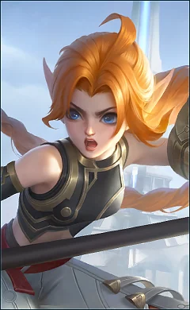

[Tier list](https://boostmlbb.ru/en/heroes/)[News & guides](https://boostmlbb.ru/en/news/)

# Zhask

C

MageMid Lane

Win rate

51.5%

Pick rate

0.3%

Ban rate

0.1%

[Overview](https://boostmlbb.ru/#overview)[Build](https://boostmlbb.ru/#build)[Skills](https://boostmlbb.ru/#skills)[Counters](https://boostmlbb.ru/#draft)[Lore](https://boostmlbb.ru/#lore)

## Overview

### Attributes

-   Durability**10**
-   Offense**100**
-   Control**40**
-   Difficulty**70**

-   Chase
-   Damage

### Win rate by rank, 30 days

1.  **52.6%**Epic
2.  **53.1%**Legend
3.  **53.4%**Mythic
4.  **52.6%**Honor
5.  **51.5%**Glory

Dashed line: 50% win rate

### More mages on this lane

[Kimmy](https://boostmlbb.ru/en/heroes/kimmy.html)[Eudora](https://boostmlbb.ru/en/heroes/eudora.html)[Zhuxin](https://boostmlbb.ru/en/heroes/zhuxin.html)[Valir](https://boostmlbb.ru/en/heroes/valir.html)[Zetian](https://boostmlbb.ru/en/heroes/zetian.html)[Lylia](https://boostmlbb.ru/en/heroes/lylia.html)[Xavier](https://boostmlbb.ru/en/heroes/xavier.html)[Lunox](https://boostmlbb.ru/en/heroes/lunox.html)

## Build

Build 1Build 2Build 3

Win rate

58.5%

Pick rate

5.6%

#### Core items

-   

    Glowing Wand

-   

    Genius Wand

-   

    Holy Crystal

#### Spell

Flicker

#### Emblem and talents

Mage

-   

    Rupture

-   

    Bargain Hunter

-   

    Impure Rage

Win rate

58.6%

Pick rate

3.6%

#### Core items

-   

    Glowing Wand

-   

    Holy Crystal

-   

    Divine Glaive

#### Spell

Flameshot

#### Emblem and talents

Mage

-   

    Rupture

-   

    Bargain Hunter

-   

    Impure Rage

Win rate

55.1%

Pick rate

2.8%

#### Core items

-   

    Sky Piercer

-   

    Glowing Wand

-   

    Divine Glaive

#### Spell

Flameshot

#### Emblem and talents

Mage

-   

    Rupture

-   

    Weapons Master

-   

    Impure Rage

## Skills

Level-up**Dominator's Descent**_›_**Nightmaric Spawn**_›_**Mind Eater**_›_**Hive Clones**

Passive**Decimation**Skill 1**Nightmaric Spawn**Skill 2**Mind Eater**Skill 3**Hive Clones**Ultimate**Dominator's Descent**

Passive

### Decimation

Upon death, Zhask summons a frenzied Nightmaric Spawn on the spot, which gradually loses HP over time until death.

Skill 1

### Nightmaric Spawn

Cooldown **13 Mana Cost: 60 s**

Zhask summons a Nightmaric Spawn that inherits 55% of his , , and . It automatically fires Death Ray at nearby enemies, dealing 55 (+ 20%) (+ 20% Extra Attack Speed) Magic Damage and slowing them by up to 30%. It disappears when Zhask moves too far away.

Death Ray is considered a Basic Attack but cannot Crit.

**Fusion Enhanced:** Nightmaric Spawn deals 180% damage and can be repositioned.

Skill 2

### Mind Eater

Cooldown **8 Mana Cost: 50 s**

Zhask fires a penetrating psychic beam in the target direction, dealing 300 (+100% Total Magic Power) Magic Damage. Afterward, the Nightmaric Spawn attacks enemies hit by Mind Eater, dealing 120 (+80% Total Magic Power) Magic Damage and stunning them for 0.5s.

**Fusion Enhanced:** Mind Eater damage is increased to 540 (+180% Total Magic Power).

Skill 3

### Hive Clones

Cooldown **10 Mana Cost: 60 s**

Zhask releases a swarm of Hive Clones in the target direction. The clones explode upon hitting an enemy, dealing 55 (+18% Total Magic Power) Magic Damage and reducing their Movement Speed by 80% for 1s.

If the Hive Clones hit no target, they burrow into the ground to ambush passing enemies.

**Fusion Enhanced:** Zhask releases several swarms of Hive Clones.

Subsequent damage to the same target decays to 20%.

Ultimate

### Dominator's Descent

Cooldown **48 Mana Cost: 120 s**

Zhask selects a target area to summon an enhanced Nightmaric Spawn and fuses with it. Nightmaric Spawn can inherit 100% of his attributes and get extra attributes. His skills are enhanced during the fusion period.

**Use Again:** Zhask immediately gets off the Nightmaric Spawn and loses enhancement.

## Counters

### Counters

Beat this hero

[Lolita](https://boostmlbb.ru/en/heroes/lolita.html)[Diggie](https://boostmlbb.ru/en/heroes/diggie.html)[Kaja](https://boostmlbb.ru/en/heroes/kaja.html)[Arlott](https://boostmlbb.ru/en/heroes/arlott.html)[Hayabusa](https://boostmlbb.ru/en/heroes/hayabusa.html)

### Easy targets

This hero beats them

[Belerick](https://boostmlbb.ru/en/heroes/belerick.html)[Vexana](https://boostmlbb.ru/en/heroes/vexana.html)[Natan](https://boostmlbb.ru/en/heroes/natan.html)

## Lore

> King of the Swarm who disrupts the balance of the universe.

[Read the full story ↗](https://play.mobilelegends.com/lore/hero/Zhask)Official Mobile Legends site [Hero stats on the game site ↗](https://www.mobilelegends.com/hero/detail?heroid=50)

**Rank up on Zhask**The calculator shows the price

[Calculate price](https://boostmlbb.ru/en/order.html?type=hero)

## Frequently asked questions

Who counters Zhask in MLBB?

Over the last 30 days the toughest opponents are Lolita, Diggie, Kaja, Arlott and Hayabusa.

What is Zhask’s win rate right now?

51.54% at Mythical Glory over the last 7 days and 52.54% across all ranks over 30 days, as of 24 November 2026.

What role and lane does Zhask play?

Mage, played in the Mid Lane.

Is Zhask strong in the current meta?

Tier C, #107 of 133 heroes and #27 among mages. The tier counts how often the hero is picked and banned and how well it wins at Mythical Glory over 7 days: banned in 0.1% of matches, 51.5% win rate. In professional games over the last month the hero is drafted in 0.0% of them.

What is the best build for Zhask?

The most popular ranked build: Glowing Wand, Genius Wand and Holy Crystal as core items, the Mage emblem with Rupture, Bargain Hunter and Impure Rage, and Flicker. It wins 58.52% of matches.
