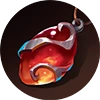

[Tier list](https://boostmlbb.ru/en/heroes/)[Items](https://boostmlbb.ru/en/items/)[Skins](https://boostmlbb.ru/en/skins/)[News & guides](https://boostmlbb.ru/en/news/)

[All items](https://boostmlbb.ru/en/items/)

# Ares Belt

[Defense](https://boostmlbb.ru/en/items/#defense)Component

Price

700

-   **+600**HP

## Recipe

700Ares Belt

-   [300Vitality Crystal](https://boostmlbb.ru/en/items/vitality-crystal.html "Vitality Crystal")

Parts cost 300, assembly adds 400 gold.

### Builds into

[2 070Brute Force BreastplateAttack, speed, CC reduction](https://boostmlbb.ru/en/items/brute-force-breastplate.html)[2 120ImmortalityRevive](https://boostmlbb.ru/en/items/immortality.html)[2 170Antique CuirassLowers enemy Physical Attack](https://boostmlbb.ru/en/items/antique-cuirass.html)[2 500Guardian HelmetConstant HP regen](https://boostmlbb.ru/en/items/guardian-helmet.html)[2 250Queen's WingsSurvive at low HP](https://boostmlbb.ru/en/items/queens-wings.html)[1 820Thunder BeltDamage for tanks](https://boostmlbb.ru/en/items/thunder-belt.html)[1 910Cursed HelmetWaveclear and durability](https://boostmlbb.ru/en/items/cursed-helmet.html)[2 100Chastise PauldronSlows enemy attacks](https://boostmlbb.ru/en/items/chastise-pauldron.html)

## More defense items

[630Steel Legplates](https://boostmlbb.ru/en/items/steel-legplates.html)[730Dreadnaught Armor](https://boostmlbb.ru/en/items/dreadnaught-armor.html)[780Black Ice Shield](https://boostmlbb.ru/en/items/black-ice-shield.html)[1 020Silence Robe](https://boostmlbb.ru/en/items/silence-robe.html)[800Molten Essence](https://boostmlbb.ru/en/items/molten-essence.html)[450Hero's Ring](https://boostmlbb.ru/en/items/heros-ring.html)[140Healing Necklace](https://boostmlbb.ru/en/items/healing-necklace.html)[220Magic Resist Cloak](https://boostmlbb.ru/en/items/magic-resist-cloak.html)

[All items](https://boostmlbb.ru/en/items/#defense)

**We rank up while you are busy**The calculator shows the price

[Calculate price](https://boostmlbb.ru/en/order.html)

## Frequently asked questions

How much does Ares Belt cost and what does it build from?

700 gold. Parts: Vitality Crystal (300); assembly adds 400 gold.

What does Ares Belt give?

+600 HP.
