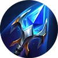

[Tier list](https://boostmlbb.ru/en/heroes/)[Items](https://boostmlbb.ru/en/items/)[Skins](https://boostmlbb.ru/en/skins/)[News & guides](https://boostmlbb.ru/en/news/)

[All items](https://boostmlbb.ru/en/items/)

# Azure Blade

[Magic](https://boostmlbb.ru/en/items/#magic)Component

Price

600

-   **+5**Mana Regen
-   **+5%**Cooldown Reduction

## Effect

Unique passive

### Judgement

After casting a skill, the next Basic Attack within 3s deals 50 extra True Damage. 1.5s cooldown.

## Recipe

600Azure Blade

-   [120Magic Necklace](https://boostmlbb.ru/en/items/magic-necklace.html "Magic Necklace")
-   [120Magic Necklace](https://boostmlbb.ru/en/items/magic-necklace.html "Magic Necklace")

Parts cost 240, assembly adds 360 gold.

### Builds into

[2 330Endless BattleEmpowered Basic Attack](https://boostmlbb.ru/en/items/endless-battle.html)[2 120Starlium ScytheEmpowered Basic Attack](https://boostmlbb.ru/en/items/starlium-scythe.html)

## More magic items

[700Elegant Gem](https://boostmlbb.ru/en/items/elegant-gem.html)[600Exotic Veil](https://boostmlbb.ru/en/items/exotic-veil.html)[950Tome of Evil](https://boostmlbb.ru/en/items/tome-of-evil.html)[820Magic Wand](https://boostmlbb.ru/en/items/magic-wand.html)[500Mystic Container](https://boostmlbb.ru/en/items/mystic-container.html)[500Expert Gloves](https://boostmlbb.ru/en/items/expert-gloves.html)[450Book of Sages](https://boostmlbb.ru/en/items/book-of-sages.html)[120Magic Necklace](https://boostmlbb.ru/en/items/magic-necklace.html)

[All items](https://boostmlbb.ru/en/items/#magic)

**We rank up while you are busy**The calculator shows the price

[Calculate price](https://boostmlbb.ru/en/order.html)

## Frequently asked questions

How much does Azure Blade cost and what does it build from?

600 gold. Parts: Magic Necklace ×2 (120 each); assembly adds 360 gold.

What does Azure Blade give?

+5 Mana Regen, +5% Cooldown Reduction. Judgement: after casting a skill, the next Basic Attack within 3s deals 50 extra True Damage. 1.5s cooldown.
