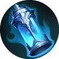

[Tier list](https://boostmlbb.ru/en/heroes/)[Items](https://boostmlbb.ru/en/items/)[News & guides](https://boostmlbb.ru/en/news/)

# Concentrated Energy

[Magic](https://boostmlbb.ru/en/items/#magic)Finished item

Price

2 020

-   **+20%**Hybrid Lifesteal
-   **+75**Magic Power
-   **+400**HP

## Effect

Unique passive

### Recharge

Magic Damage grants 5 Magic Power, up to 6 stacks (once every 0.4s). At full stacks, Magic Damage increases by 12% for 5s.

## Recipe

2 020Concentrated Energy

-   [820Magic Wand](https://boostmlbb.ru/en/items/magic-wand.html "Magic Wand")
    -   [300Mystery Codex](https://boostmlbb.ru/en/items/mystery-codex.html "Mystery Codex")
    -   [300Mystery Codex](https://boostmlbb.ru/en/items/mystery-codex.html "Mystery Codex")
-   [500Mystic Container](https://boostmlbb.ru/en/items/mystic-container.html "Mystic Container")
    -   [300Mystery Codex](https://boostmlbb.ru/en/items/mystery-codex.html "Mystery Codex")
-   [300Vitality Crystal](https://boostmlbb.ru/en/items/vitality-crystal.html "Vitality Crystal")

Parts cost 1,620, assembly adds 400 gold.

## Who builds it

Heroes whose popular ranked build has the item, with the build’s win rate

-   [Alice55.0%](https://boostmlbb.ru/en/heroes/alice.html#build)
-   [Kimmy54.3%](https://boostmlbb.ru/en/heroes/kimmy.html#build)
-   [Harley49.0%](https://boostmlbb.ru/en/heroes/harley.html#build)
-   [Guinevere56.6%](https://boostmlbb.ru/en/heroes/guinevere.html#build)
-   [Karina57.7%](https://boostmlbb.ru/en/heroes/karina.html#build)
-   [Cyclops58.2%](https://boostmlbb.ru/en/heroes/cyclops.html#build)
-   [Silvanna56.9%](https://boostmlbb.ru/en/heroes/silvanna.html#build)
-   [Gatotkaca55.1%](https://boostmlbb.ru/en/heroes/gatotkaca.html#build)
-   [Natan54.4%](https://boostmlbb.ru/en/heroes/natan.html#build)
-   [Julian52.7%](https://boostmlbb.ru/en/heroes/julian.html#build)
-   [Joy54.9%](https://boostmlbb.ru/en/heroes/joy.html#build)

## Story

> Inspired by the explosion of the Infinite Gateway, scientists built it on the laws of condensing and amplifying energy.

[Patch history ↗](https://liquipedia.net/mobilelegends/Concentrated_Energy#Version_History)

## More magic items

[2 250Wishing LanternAgainst high HP](https://boostmlbb.ru/en/items/wishing-lantern.html)[1 850Flask of the OasisProtects allies](https://boostmlbb.ru/en/items/flask-of-the-oasis.html)[2 000Genius WandMagic Defense shred](https://boostmlbb.ru/en/items/genius-wand.html)[2 250Lightning TruncheonBurst on skills](https://boostmlbb.ru/en/items/lightning-truncheon.html)[2 100Blood WingsShield and speed](https://boostmlbb.ru/en/items/blood-wings.html)[2 120Starlium ScytheEmpowered Basic Attack](https://boostmlbb.ru/en/items/starlium-scythe.html)[2 050Glowing WandAnti-heal](https://boostmlbb.ru/en/items/glowing-wand.html)[2 040Ice Queen WandSlow on skill hit](https://boostmlbb.ru/en/items/ice-queen-wand.html)

[All items](https://boostmlbb.ru/en/items/#magic)

**We rank up while you are busy**The calculator shows the price

[Calculate price](https://boostmlbb.ru/en/order.html)

## Frequently asked questions

How much does Concentrated Energy cost and what does it build from?

2,020 gold. Parts: Magic Wand (820), Mystic Container (500) and Vitality Crystal (300); assembly adds 400 gold.

What does Concentrated Energy give?

+20% Hybrid Lifesteal, +75 Magic Power, +400 HP. Recharge: magic Damage grants 5 Magic Power, up to 6 stacks (once every 0.4s). At full stacks, Magic Damage increases by 12% for 5s.

Which heroes build Concentrated Energy?

It is in the popular ranked builds of 11 heroes, among them Alice, Kimmy, Harley, Guinevere, Karina and Cyclops.
