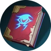

[Tier list](https://boostmlbb.ru/en/heroes/)[Items](https://boostmlbb.ru/en/items/)[Skins](https://boostmlbb.ru/en/skins/)[News & guides](https://boostmlbb.ru/en/news/)

[All items](https://boostmlbb.ru/en/items/)

# Flask of the Oasis

[Magic](https://boostmlbb.ru/en/items/#magic)Finished item

Price

1 850

-   **+12%**Healing Effect
-   **+60**Magic Power
-   **+300**HP
-   **+10%**Cooldown Reduction

## Effect

Unique passive

### Blessing

When a heal or shield skill hits a target whose HP is below 35% (or falls below it within 3s), they get a shield of 100 × hero level for 3s and the caster’s skill cooldowns drop by 2s. Once every 60s per target; not on self-only heals and shields.

## Recipe

1 850Flask of the Oasis

-   [820Magic Wand](https://boostmlbb.ru/en/items/magic-wand.html "Magic Wand")
    -   [300Mystery Codex](https://boostmlbb.ru/en/items/mystery-codex.html "Mystery Codex")
-   [450Book of Sages](https://boostmlbb.ru/en/items/book-of-sages.html "Book of Sages")
-   [300Vitality Crystal](https://boostmlbb.ru/en/items/vitality-crystal.html "Vitality Crystal")

Parts cost 1,570, assembly adds 280 gold.

## Who builds it

Heroes whose popular ranked build has the item, with the build’s win rate

-   [Marcel64.6%](https://boostmlbb.ru/en/heroes/marcel.html#build)
-   [Estes59.1%](https://boostmlbb.ru/en/heroes/estes.html#build)
-   [Minotaur60.5%](https://boostmlbb.ru/en/heroes/minotaur.html#build)
-   [Floryn54.0%](https://boostmlbb.ru/en/heroes/floryn.html#build)
-   [Rafaela57.2%](https://boostmlbb.ru/en/heroes/rafaela.html#build)
-   [Angela56.8%](https://boostmlbb.ru/en/heroes/angela.html#build)
-   [Diggie63.0%](https://boostmlbb.ru/en/heroes/diggie.html#build)
-   [Lolita60.9%](https://boostmlbb.ru/en/heroes/lolita.html#build)
-   [Mathilda52.5%](https://boostmlbb.ru/en/heroes/mathilda.html#build)

## Story

> Mages mimicked the magic of the Oasis, helping to protect more people with the power of the martyr.

[Patch history ↗](https://liquipedia.net/mobilelegends/Flask_of_the_Oasis#Version_History)

## More magic items

[2 250Wishing LanternAgainst high HP](https://boostmlbb.ru/en/items/wishing-lantern.html)[2 000Genius WandMagic Defense shred](https://boostmlbb.ru/en/items/genius-wand.html)[2 250Lightning TruncheonBurst on skills](https://boostmlbb.ru/en/items/lightning-truncheon.html)[2 100Blood WingsShield and speed](https://boostmlbb.ru/en/items/blood-wings.html)[2 120Starlium ScytheEmpowered Basic Attack](https://boostmlbb.ru/en/items/starlium-scythe.html)[2 050Glowing WandAnti-heal](https://boostmlbb.ru/en/items/glowing-wand.html)[2 040Ice Queen WandSlow on skill hit](https://boostmlbb.ru/en/items/ice-queen-wand.html)[2 020Concentrated EnergySustained damage](https://boostmlbb.ru/en/items/concentrated-energy.html)

[All items](https://boostmlbb.ru/en/items/#magic)

**We rank up while you are busy**The calculator shows the price

[Calculate price](https://boostmlbb.ru/en/order.html)

## Frequently asked questions

How much does Flask of the Oasis cost and what does it build from?

1,850 gold. Parts: Magic Wand (820), Book of Sages (450) and Vitality Crystal (300); assembly adds 280 gold.

What does Flask of the Oasis give?

+12% Healing Effect, +60 Magic Power, +300 HP, +10% Cooldown Reduction. Blessing: when a heal or shield skill hits a target whose HP is below 35% (or falls below it within 3s), they get a shield of 100 × hero level for 3s and the caster’s skill cooldowns drop by 2s. Once every 60s per target; not on self-only heals and shields.

Which heroes build Flask of the Oasis?

It is in the popular ranked builds of 9 heroes, among them Marcel, Estes, Minotaur, Floryn, Rafaela and Angela.
