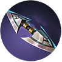

[All items](https://boostmlbb.ru/en/items/)

# Haas's Claws

[Attack](https://boostmlbb.ru/en/items/#attack)Finished item

Price

2 020

-   **+20%**Lifesteal
-   **+40**Physical Attack
-   **+15%**Attack Speed
-   **+20%**Crit Chance

## Effect

Unique passive

### Frenzy

Critical strikes grant 20% Attack Speed for 2s.

## Recipe

2 020Haas's Claws

-   [900Rogue Meteor](https://boostmlbb.ru/en/items/rogue-meteor.html "Rogue Meteor")
    -   [320Javelin](https://boostmlbb.ru/en/items/javelin.html "Javelin")
    -   [280Knife](https://boostmlbb.ru/en/items/knife.html "Knife")
-   [400Vampire Mallet](https://boostmlbb.ru/en/items/vampire-mallet.html "Vampire Mallet")
-   [250Dagger](https://boostmlbb.ru/en/items/dagger.html "Dagger")

Parts cost 1,550, assembly adds 470 gold.

## Who builds it

Heroes whose popular ranked build has the item, with the build’s win rate

-   [Obsidia55.1%](https://boostmlbb.ru/en/heroes/obsidia.html#build)
-   [Bruno61.6%](https://boostmlbb.ru/en/heroes/bruno.html#build)
-   [Miya55.8%](https://boostmlbb.ru/en/heroes/miya.html#build)
-   [Argus61.5%](https://boostmlbb.ru/en/heroes/argus.html#build)
-   [Melissa61.6%](https://boostmlbb.ru/en/heroes/melissa.html#build)
-   [Ling57.8%](https://boostmlbb.ru/en/heroes/ling.html#build)
-   [Irithel58.9%](https://boostmlbb.ru/en/heroes/irithel.html#build)
-   [Layla54.9%](https://boostmlbb.ru/en/heroes/layla.html#build)
-   [Wanwan57.5%](https://boostmlbb.ru/en/heroes/wanwan.html#build)
-   [Roger56.5%](https://boostmlbb.ru/en/heroes/roger.html#build)
-   [Zilong52.8%](https://boostmlbb.ru/en/heroes/zilong.html#build)

## Story

> Those who lost the war were banished to the Abyss with an insatiable hunger for blood. Haas was the first to succumb to his desire when he bowed to the Queen.

[Patch history ↗](https://liquipedia.net/mobilelegends/Haas's_Claws#Version_History)

## More attack items

[2 120Malefic GunAttack range](https://boostmlbb.ru/en/items/malefic-gun.html)[2 140Great Dragon SpearCooldown and crit](https://boostmlbb.ru/en/items/great-dragon-spear.html)[2 050Sea HalberdAnti-heal](https://boostmlbb.ru/en/items/sea-halberd.html)[2 030Rose Gold MeteorShield at low HP](https://boostmlbb.ru/en/items/rose-gold-meteor.html)[2 010Hunter StrikeBurst of speed](https://boostmlbb.ru/en/items/hunter-strike.html)[3 010Blade of DespairHighest Physical Attack](https://boostmlbb.ru/en/items/blade-of-despair.html)[1 950Blade of the HeptaseasBest for assassins](https://boostmlbb.ru/en/items/blade-of-the-heptaseas.html)[1 880WindtalkerSplash damage](https://boostmlbb.ru/en/items/windtalker.html)

[All items](https://boostmlbb.ru/en/items/#attack)

**We rank up while you are busy**The calculator shows the price

[Calculate price](https://boostmlbb.ru/en/order.html)

## Frequently asked questions

How much does Haas's Claws cost and what does it build from?

2,020 gold. Parts: Rogue Meteor (900), Vampire Mallet (400) and Dagger (250); assembly adds 470 gold.

What does Haas's Claws give?

+20% Lifesteal, +40 Physical Attack, +15% Attack Speed, +20% Crit Chance. Frenzy: critical strikes grant 20% Attack Speed for 2s.

Which heroes build Haas's Claws?

It is in the popular ranked builds of 11 heroes, among them Obsidia, Bruno, Miya, Argus, Melissa and Ling.
