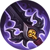
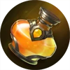
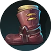

[Tier list](https://boostmlbb.ru/en/heroes/)[Items](https://boostmlbb.ru/en/items/)[Skins](https://boostmlbb.ru/en/skins/)[News & guides](https://boostmlbb.ru/en/news/)

# MLBB items

97 items · prices as in the game on 25 November 2026

Find an item

AllAttackMagicDefenseMovementJungleRoam

## Attack

[2 120Malefic GunAttack range](https://boostmlbb.ru/en/items/malefic-gun.html)[2 140Great Dragon SpearCooldown and crit](https://boostmlbb.ru/en/items/great-dragon-spear.html)[2 050Sea HalberdAnti-heal](https://boostmlbb.ru/en/items/sea-halberd.html)[2 030Rose Gold MeteorShield at low HP](https://boostmlbb.ru/en/items/rose-gold-meteor.html)[2 010Hunter StrikeBurst of speed](https://boostmlbb.ru/en/items/hunter-strike.html)[3 010Blade of DespairHighest Physical Attack](https://boostmlbb.ru/en/items/blade-of-despair.html)[1 950Blade of the HeptaseasBest for assassins](https://boostmlbb.ru/en/items/blade-of-the-heptaseas.html)[1 880WindtalkerSplash damage](https://boostmlbb.ru/en/items/windtalker.html)[2 330Endless BattleEmpowered Basic Attack](https://boostmlbb.ru/en/items/endless-battle.html)[2 390Berserker's FuryCrit chance and damage](https://boostmlbb.ru/en/items/berserkers-fury.html)[2 020Haas's ClawsLifesteal](https://boostmlbb.ru/en/items/haas-claws.html)[2 060Malefic RoarHigh Physical Penetration](https://boostmlbb.ru/en/items/malefic-roar.html)[1 910Winter CrownBrief invulnerability](https://boostmlbb.ru/en/items/winter-crown.html)[2 050Fleeting TimeUltimate cooldown](https://boostmlbb.ru/en/items/fleeting-time.html)[1 500Sky PiercerBest for finishing](https://boostmlbb.ru/en/items/sky-piercer.html)[2 100War AxeSustained damage](https://boostmlbb.ru/en/items/war-axe.html)[1 910Wind of NaturePhysical damage immunity](https://boostmlbb.ru/en/items/wind-of-nature.html)[2 000Golden StaffStronger attack effects](https://boostmlbb.ru/en/items/golden-staff.html)[2 050Corrosion ScytheSlow on hit](https://boostmlbb.ru/en/items/corrosion-scythe.html)[2 180Demon Hunter SwordTank killer](https://boostmlbb.ru/en/items/demon-hunter-sword.html)

### Components and potions

[1 050Magic Blade](https://boostmlbb.ru/en/items/magic-blade.html)[830Fury Hammer](https://boostmlbb.ru/en/items/fury-hammer.html)[900Rogue Meteor](https://boostmlbb.ru/en/items/rogue-meteor.html)[650Ogre Tomahawk](https://boostmlbb.ru/en/items/ogre-tomahawk.html)[910Legion Sword](https://boostmlbb.ru/en/items/legion-sword.html)[1 000Swift Crossbow](https://boostmlbb.ru/en/items/swift-crossbow.html)[600Regular Spear](https://boostmlbb.ru/en/items/regular-spear.html)[500Expert Gloves](https://boostmlbb.ru/en/items/expert-gloves.html)[450Iron Hunting Bow](https://boostmlbb.ru/en/items/iron-hunting-bow.html)[400Vampire Mallet](https://boostmlbb.ru/en/items/vampire-mallet.html)[320Javelin](https://boostmlbb.ru/en/items/javelin.html)[280Knife](https://boostmlbb.ru/en/items/knife.html)[250Dagger](https://boostmlbb.ru/en/items/dagger.html)[1 500Power Potion](https://boostmlbb.ru/en/items/power-potion.html)

## Magic

[2 250Wishing LanternAgainst high HP](https://boostmlbb.ru/en/items/wishing-lantern.html)[1 850Flask of the OasisProtects allies](https://boostmlbb.ru/en/items/flask-of-the-oasis.html)[2 000Genius WandMagic Defense shred](https://boostmlbb.ru/en/items/genius-wand.html)[2 250Lightning TruncheonBurst on skills](https://boostmlbb.ru/en/items/lightning-truncheon.html)[2 100Blood WingsShield and speed](https://boostmlbb.ru/en/items/blood-wings.html)[2 120Starlium ScytheEmpowered Basic Attack](https://boostmlbb.ru/en/items/starlium-scythe.html)[2 050Glowing WandAnti-heal](https://boostmlbb.ru/en/items/glowing-wand.html)[2 040Ice Queen WandSlow on skill hit](https://boostmlbb.ru/en/items/ice-queen-wand.html)[2 020Concentrated EnergySustained damage](https://boostmlbb.ru/en/items/concentrated-energy.html)[3 000Holy CrystalHighest Magic Power](https://boostmlbb.ru/en/items/holy-crystal.html)[1 970Divine GlaiveMagic Penetration](https://boostmlbb.ru/en/items/divine-glaive.html)[2 030Clock of DestinyFor magic tanks](https://boostmlbb.ru/en/items/clock-of-destiny.html)[1 910Winter CrownBrief invulnerability](https://boostmlbb.ru/en/items/winter-crown.html)[2 050Fleeting TimeUltimate cooldown](https://boostmlbb.ru/en/items/fleeting-time.html)[1 500Sky PiercerBest for finishing](https://boostmlbb.ru/en/items/sky-piercer.html)[2 030Feather of HeavenMagic Basic Attacks](https://boostmlbb.ru/en/items/feather-of-heaven.html)[2 070Enchanted TalismanMana and cooldown](https://boostmlbb.ru/en/items/enchanted-talisman.html)

### Components, potions and special items

[700Elegant Gem](https://boostmlbb.ru/en/items/elegant-gem.html)[600Exotic Veil](https://boostmlbb.ru/en/items/exotic-veil.html)[600Azure Blade](https://boostmlbb.ru/en/items/azure-blade.html)[950Tome of Evil](https://boostmlbb.ru/en/items/tome-of-evil.html)[820Magic Wand](https://boostmlbb.ru/en/items/magic-wand.html)[500Mystic Container](https://boostmlbb.ru/en/items/mystic-container.html)[500Expert Gloves](https://boostmlbb.ru/en/items/expert-gloves.html)[450Book of Sages](https://boostmlbb.ru/en/items/book-of-sages.html)[120Magic Necklace](https://boostmlbb.ru/en/items/magic-necklace.html)[220Power Crystal](https://boostmlbb.ru/en/items/power-crystal.html)[300Mystery Codex](https://boostmlbb.ru/en/items/mystery-codex.html)[Lantern of Hope](https://boostmlbb.ru/en/items/lantern-of-hope.html)[Flower of Hope](https://boostmlbb.ru/en/items/flower-of-hope.html)[1 500Magic Potion](https://boostmlbb.ru/en/items/magic-potion.html)

## Defense

[2 050Fleeting TimeUltimate cooldown](https://boostmlbb.ru/en/items/fleeting-time.html)[1 880Radiant ArmorAgainst magic damage](https://boostmlbb.ru/en/items/radiant-armor.html)[2 100Chastise PauldronSlows enemy attacks](https://boostmlbb.ru/en/items/chastise-pauldron.html)[2 070Brute Force BreastplateAttack, speed, CC reduction](https://boostmlbb.ru/en/items/brute-force-breastplate.html)[2 120ImmortalityRevive](https://boostmlbb.ru/en/items/immortality.html)[2 010Dominance IceAnti-heal](https://boostmlbb.ru/en/items/dominance-ice.html)[2 150Athena's ShieldAgainst burst magic](https://boostmlbb.ru/en/items/athenas-shield.html)[1 860OracleStronger healing](https://boostmlbb.ru/en/items/oracle.html)[2 170Antique CuirassLowers enemy Physical Attack](https://boostmlbb.ru/en/items/antique-cuirass.html)[2 500Guardian HelmetConstant HP regen](https://boostmlbb.ru/en/items/guardian-helmet.html)[1 910Cursed HelmetWaveclear and durability](https://boostmlbb.ru/en/items/cursed-helmet.html)[1 820Thunder BeltDamage for tanks](https://boostmlbb.ru/en/items/thunder-belt.html)[2 250Queen's WingsSurvive at low HP](https://boostmlbb.ru/en/items/queens-wings.html)[1 910Blade ArmorReflects damage](https://boostmlbb.ru/en/items/blade-armor.html)

### Components and potions

[630Steel Legplates](https://boostmlbb.ru/en/items/steel-legplates.html)[730Dreadnaught Armor](https://boostmlbb.ru/en/items/dreadnaught-armor.html)[780Black Ice Shield](https://boostmlbb.ru/en/items/black-ice-shield.html)[1 020Silence Robe](https://boostmlbb.ru/en/items/silence-robe.html)[800Molten Essence](https://boostmlbb.ru/en/items/molten-essence.html)[700Ares Belt](https://boostmlbb.ru/en/items/ares-belt.html)[450Hero's Ring](https://boostmlbb.ru/en/items/heros-ring.html)[140Healing Necklace](https://boostmlbb.ru/en/items/healing-necklace.html)[220Magic Resist Cloak](https://boostmlbb.ru/en/items/magic-resist-cloak.html)[220Leather Jerkin](https://boostmlbb.ru/en/items/leather-jerkin.html)[300Vitality Crystal](https://boostmlbb.ru/en/items/vitality-crystal.html)[1 500Rock Potion](https://boostmlbb.ru/en/items/rock-potion.html)

## Movement

[720Demon BootsFast Mana regen](https://boostmlbb.ru/en/items/demon-boots.html)[720Rapid BootsHigh Movement Speed](https://boostmlbb.ru/en/items/rapid-boots.html)[720Swift BootsAttack Speed](https://boostmlbb.ru/en/items/swift-boots.html)[720Arcane BootsMagic Penetration](https://boostmlbb.ru/en/items/arcane-boots.html)[720Magic BootsCooldown Reduction](https://boostmlbb.ru/en/items/magic-boots.html)[720Tough BootsShorter crowd control](https://boostmlbb.ru/en/items/tough-boots.html)[720Warrior BootsStacking Physical Defense](https://boostmlbb.ru/en/items/warrior-boots.html)

### Components and special items

[250Boots](https://boostmlbb.ru/en/items/boots.html)[Allow Throw](https://boostmlbb.ru/en/items/allow-throw.html)[Throw Forbidden](https://boostmlbb.ru/en/items/throw-forbidden.html)[Broken Heart](https://boostmlbb.ru/en/items/broken-heart.html)

## Jungle

[Flame RetributionFor duels: the enemy gets weaker while you get stronger.](https://boostmlbb.ru/en/items/retribution.html#flame)[Ice RetributionFor chasing a target down or getting away.](https://boostmlbb.ru/en/items/retribution.html#ice)[Bloody RetributionFor junglers who need to survive the fight.](https://boostmlbb.ru/en/items/retribution.html#bloody)

## Roam

[EncourageFor team fights.](https://boostmlbb.ru/en/items/roam-blessings.html#encourage)[FavorFor healers and shielders.](https://boostmlbb.ru/en/items/roam-blessings.html#favor)[Dire HitFor roamers who move a lot and start fights.](https://boostmlbb.ru/en/items/roam-blessings.html#dire-hit)[ConcealFor ambushes and rotations.](https://boostmlbb.ru/en/items/roam-blessings.html#conceal)

No item with that name. Check the spelling.

Show all

## Most built

-   [Sky Piercerin 34 heroes’ builds](https://boostmlbb.ru/en/items/sky-piercer.html)
-   [Dominance Icein 31 heroes’ builds](https://boostmlbb.ru/en/items/dominance-ice.html)
-   [War Axein 28 heroes’ builds](https://boostmlbb.ru/en/items/war-axe.html)
-   [Glowing Wandin 27 heroes’ builds](https://boostmlbb.ru/en/items/glowing-wand.html)
-   [Hunter Strikein 20 heroes’ builds](https://boostmlbb.ru/en/items/hunter-strike.html)
-   [Divine Glaivein 19 heroes’ builds](https://boostmlbb.ru/en/items/divine-glaive.html)
-   [Chastise Pauldronin 19 heroes’ builds](https://boostmlbb.ru/en/items/chastise-pauldron.html)
-   [Oraclein 18 heroes’ builds](https://boostmlbb.ru/en/items/oracle.html)
-   [Queen's Wingsin 18 heroes’ builds](https://boostmlbb.ru/en/items/queens-wings.html)
