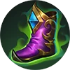

[Tier list](https://boostmlbb.ru/en/heroes/)[Items](https://boostmlbb.ru/en/items/)[News & guides](https://boostmlbb.ru/en/news/)

# Roam blessings

[Roam](https://boostmlbb.ru/en/items/#roam)Roam blessing

## Options

### Encourage

Passive: you and nearby allied heroes gain 20 extra Hybrid Defense.

For team fights.

### Favor

Passive: every so often, your next heal or shield skill also restores HP to the nearby allied hero with the lowest HP, you included.

For healers and shielders.

### Dire Hit

Passive: every so often, the next attack on an enemy hero with low HP deals extra Hybrid Damage based on their Max HP.

For roamers who finish kills themselves.

### Conceal

Active: nearby allied heroes become camouflaged and gain 40% Movement Speed for 5s. Dealing or taking damage ends it.

For ambushes and rotations.

## How it works

### Thriving

Near allied heroes you gain 30% of the EXP and Gold from minions and creeps. Damaging enemy heroes (once every 15s) and revealing enemies also grant EXP and Gold. The blessing skill unlocks after 1,000 Gold from Thriving.

## Boots you can enchant

[720Demon BootsFast Mana regen](https://boostmlbb.ru/en/items/demon-boots.html)[720Rapid BootsHigh Movement Speed](https://boostmlbb.ru/en/items/rapid-boots.html)[720Swift BootsAttack Speed](https://boostmlbb.ru/en/items/swift-boots.html)[720Arcane BootsMagic Penetration](https://boostmlbb.ru/en/items/arcane-boots.html)[720Magic BootsCooldown Reduction](https://boostmlbb.ru/en/items/magic-boots.html)[720Tough BootsShorter crowd control](https://boostmlbb.ru/en/items/tough-boots.html)[720Warrior BootsStacking Physical Defense](https://boostmlbb.ru/en/items/warrior-boots.html)

**We rank up while you are busy**The calculator shows the price

[Calculate price](https://boostmlbb.ru/en/order.html)

## Frequently asked questions

What roam blessings are there in MLBB?

There are 4: Encourage, Favor, Dire Hit and Conceal. Encourage — for team fights. Favor — for healers and shielders. Dire Hit — for roamers who finish kills themselves. Conceal — for ambushes and rotations.
