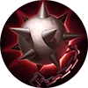

[Tier list](https://boostmlbb.ru/en/heroes/)[Items](https://boostmlbb.ru/en/items/)[Skins](https://boostmlbb.ru/en/skins/)[News & guides](https://boostmlbb.ru/en/news/)

[All items](https://boostmlbb.ru/en/items/)

# Rogue Meteor

[Attack](https://boostmlbb.ru/en/items/#attack)Component

Price

900

-   **+15%**Attack Speed
-   **+10%**Crit Chance

## Recipe

900Rogue Meteor

-   [320Javelin](https://boostmlbb.ru/en/items/javelin.html "Javelin")
-   [280Knife](https://boostmlbb.ru/en/items/knife.html "Knife")

Parts cost 600, assembly adds 300 gold.

### Builds into

[1 880WindtalkerSplash damage](https://boostmlbb.ru/en/items/windtalker.html)[2 020Haas's ClawsLifesteal](https://boostmlbb.ru/en/items/haas-claws.html)

## More attack items

[1 050Magic Blade](https://boostmlbb.ru/en/items/magic-blade.html)[830Fury Hammer](https://boostmlbb.ru/en/items/fury-hammer.html)[650Ogre Tomahawk](https://boostmlbb.ru/en/items/ogre-tomahawk.html)[910Legion Sword](https://boostmlbb.ru/en/items/legion-sword.html)[1 000Swift Crossbow](https://boostmlbb.ru/en/items/swift-crossbow.html)[600Regular Spear](https://boostmlbb.ru/en/items/regular-spear.html)[500Expert Gloves](https://boostmlbb.ru/en/items/expert-gloves.html)[450Iron Hunting Bow](https://boostmlbb.ru/en/items/iron-hunting-bow.html)

[All items](https://boostmlbb.ru/en/items/#attack)

**We rank up while you are busy**The calculator shows the price

[Calculate price](https://boostmlbb.ru/en/order.html)

## Frequently asked questions

How much does Rogue Meteor cost and what does it build from?

900 gold. Parts: Javelin (320) and Knife (280); assembly adds 300 gold.

What does Rogue Meteor give?

+15% Attack Speed, +10% Crit Chance.
