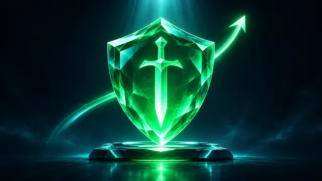

Services

# Choose your boost type

We'll pick the best option for your goals and budget

[Prices](https://boostmlbb.ru/en/prices.html) [Calculator](https://boostmlbb.ru/en/order.html)

[

Popular

### Standard boost

Account boosting requires game account access. Confirm the route and start time before ordering.

-   Maximum speed
-   Agreed route
-   Account access terms

from 55 ₽/star

Order

](https://boostmlbb.ru/en/order.html?type=standard)[

Duo

### Duo boost

You play alongside the booster on the same team. Learn and improve!

-   You play yourself
-   Learn as you go
-   Safe

from 95 ₽/star

Order

](https://boostmlbb.ru/en/order.html?type=party)[

### Role boost

The booster plays only the role you choose (tank, mage, marksman, etc.).

-   Choose a role
-   Improve role win rate

from 60 ₽/star

Order

](https://boostmlbb.ru/en/order.html?type=role)[

### Hero boosting

A rank route on your chosen hero. Pricing is per star; a leaderboard position is not guaranteed.

-   Choose a hero
-   Agreed route

from 65 ₽/star

Order

](https://boostmlbb.ru/en/order.html?type=hero)[

Hot

### Rising boost

Rising mode completion with a guaranteed result. Fixed price per stage.

-   7 stages
-   Guaranteed result

Price in calculator

Order

](https://boostmlbb.ru/en/order.html?type=rising)

#### Security terms

Choose a format

#### PRO Players

Choose a player

#### Telegram support

Telegram support

#### Agreed route

Agreed route

Bonus

### 5 free stars

When your friend orders 25+ stars

[Message @Cla1ve](https://t.me/Cla1ve)

More

## Formats and rules

Prices, timing and differences of each boost format.

[Service**Mythic boost**Star prices in Honor, Glory and ImmortalOpen](https://boostmlbb.ru/en/boost/mythic.html) [Service**Hero MMR boost**Rank and rating of your heroOpen](https://boostmlbb.ru/en/boost/hero.html) [Guide**Party or account boost**How the formats differ and which costs lessOpen](https://boostmlbb.ru/en/guides/party-boost.html) [Guide**Mythic placement**10 matches, double wins and priceOpen](https://boostmlbb.ru/en/guides/mythic-placement.html)
