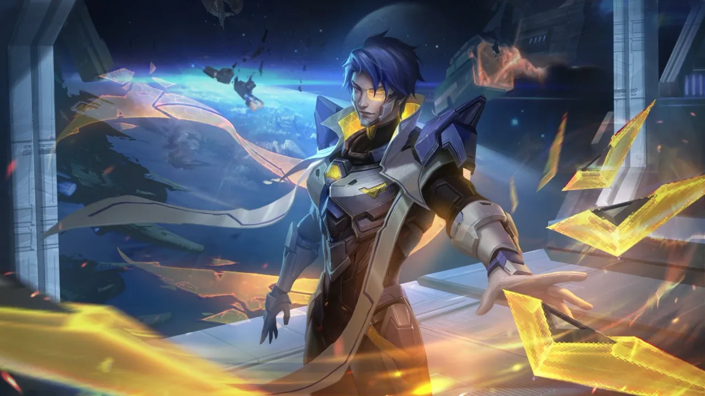

[Tier list](https://boostmlbb.ru/en/heroes/)[Items](https://boostmlbb.ru/en/items/)[Skins](https://boostmlbb.ru/en/skins/)[News & guides](https://boostmlbb.ru/en/news/)

[Skins](https://boostmlbb.ru/en/skins/)/[Aamon](https://boostmlbb.ru/en/skins/aamon.html)/Cyber Assassin

[Aamon skin](https://boostmlbb.ru/en/skins/aamon.html)

# Cyber Assassin

ExceptionalStarLightLimited

How to get

StarLight reward for January 2023.

Released

1 January 2023

## What the skin changes

-   New look
-   New skill effects
-   Showcase animation
-   Showcase scene
-   Attribute bonus

## All Aamon skins [5](https://boostmlbb.ru/en/skins/aamon.html)

[Soul ReaverExquisite · 2025](https://boostmlbb.ru/en/skins/aamon/soul-reaver.html)[Vessel of DeceitGrand · 2023](https://boostmlbb.ru/en/skins/aamon/vessel-of-deceit.html)[Cyber AssassinExceptional · 2023](https://boostmlbb.ru/en/skins/aamon/cyber-assassin.html)[Noble CrestCommon · 2022](https://boostmlbb.ru/en/skins/aamon/noble-crest.html)[Night's EdgeCommon · 2021](https://boostmlbb.ru/en/skins/aamon/night-s-edge.html)

## StarLight series

[Tideborn SailorKalea · 2026](https://boostmlbb.ru/en/skins/kalea/tideborn-sailor.html)[Kitsune's ShadowHayabusa · 2026](https://boostmlbb.ru/en/skins/hayabusa/kitsune-s-shadow.html)[Fangs of SlaughterHanzo · 2026](https://boostmlbb.ru/en/skins/hanzo/fangs-of-slaughter.html)[Smoul­dering FortressBelerick · 2026](https://boostmlbb.ru/en/skins/belerick/smouldering-fortress.html)[Magitech WraithObsidia · 2026](https://boostmlbb.ru/en/skins/obsidia/magitech-wraith.html)[Elysian LuminanceZetian · 2026](https://boostmlbb.ru/en/skins/zetian/elysian-luminance.html)[Guardian BattalionHilda · 2026](https://boostmlbb.ru/en/skins/hilda/guardian-battalion.html)[Dreaming KoiHarley · 2026](https://boostmlbb.ru/en/skins/harley/dreaming-koi.html)

**Rank up on Aamon**The calculator shows the price

[Calculate price](https://boostmlbb.ru/en/order.html?type=hero)

## Frequently asked questions

How to get the Cyber Assassin skin for Aamon?

StarLight reward for January 2023.

When was Cyber Assassin released?

1 January 2023.

What class is Cyber Assassin?

Exceptional, StarLight series.
