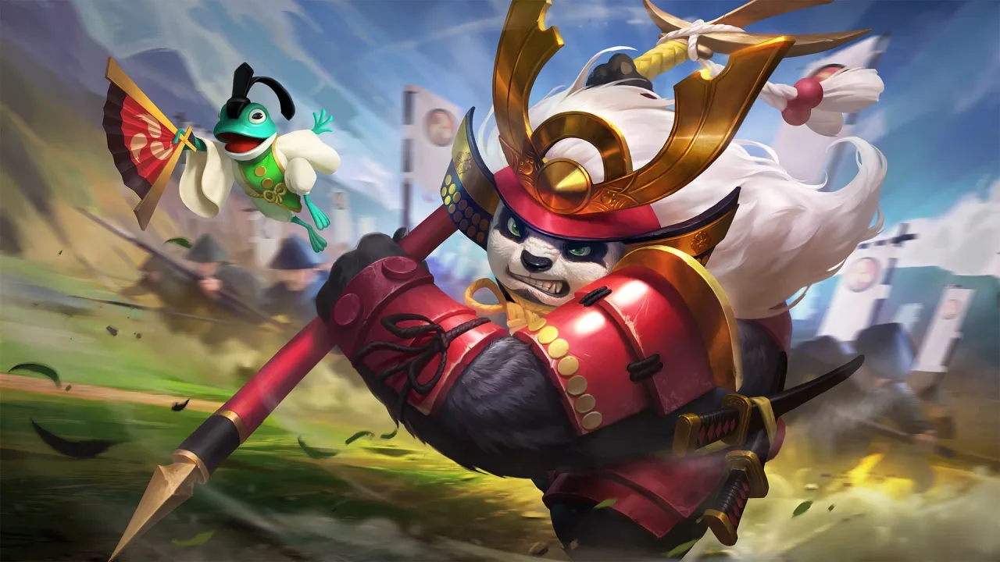
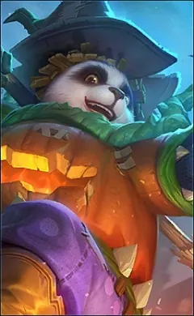

[Tier list](https://boostmlbb.ru/en/heroes/)[Items](https://boostmlbb.ru/en/items/)[Skins](https://boostmlbb.ru/en/skins/)[News & guides](https://boostmlbb.ru/en/news/)

[Skins](https://boostmlbb.ru/en/skins/)/[Akai](https://boostmlbb.ru/en/skins/akai.html)/Akazonae Samurai

[Akai skin](https://boostmlbb.ru/en/skins/akai.html)

# Akazonae Samurai

ExceptionalStarLightLimited

How to get

StarLight reward for June 2018.

Released

1 June 2018

## What the skin changes

-   New look
-   New skill effects
-   Showcase animation
-   Attribute bonus

## All Akai skins [9](https://boostmlbb.ru/en/skins/akai.html)

[Marvelous MaestroDeluxe · 2024](https://boostmlbb.ru/en/skins/akai/marvelous-maestro.html)[Pumpkin BrawlerExceptional · 2023](https://boostmlbb.ru/en/skins/akai/pumpkin-brawler.html)[Kung Fu PandaGrand · 2022](https://boostmlbb.ru/en/skins/akai/kung-fu-panda.html)[Street EnforcerCommon · 2021](https://boostmlbb.ru/en/skins/akai/street-enforcer.html)[Stream RecluseCommon · 2020](https://boostmlbb.ru/en/skins/akai/stream-recluse.html)[Akazonae SamuraiExceptional · 2018](https://boostmlbb.ru/en/skins/akai/akazonae-samurai.html)[Imperial AssassinExquisite · 2018](https://boostmlbb.ru/en/skins/akai/imperial-assassin.html)[MonkCommon · 2017](https://boostmlbb.ru/en/skins/akai/monk.html)[Summer PartyExceptional · 2016](https://boostmlbb.ru/en/skins/akai/summer-party.html)

## StarLight series

[Tideborn SailorKalea · 2026](https://boostmlbb.ru/en/skins/kalea/tideborn-sailor.html)[Kitsune's ShadowHayabusa · 2026](https://boostmlbb.ru/en/skins/hayabusa/kitsune-s-shadow.html)[Fangs of SlaughterHanzo · 2026](https://boostmlbb.ru/en/skins/hanzo/fangs-of-slaughter.html)[Smoul­dering FortressBelerick · 2026](https://boostmlbb.ru/en/skins/belerick/smouldering-fortress.html)[Magitech WraithObsidia · 2026](https://boostmlbb.ru/en/skins/obsidia/magitech-wraith.html)[Elysian LuminanceZetian · 2026](https://boostmlbb.ru/en/skins/zetian/elysian-luminance.html)[Guardian BattalionHilda · 2026](https://boostmlbb.ru/en/skins/hilda/guardian-battalion.html)[Dreaming KoiHarley · 2026](https://boostmlbb.ru/en/skins/harley/dreaming-koi.html)

**Rank up on Akai**The calculator shows the price

[Calculate price](https://boostmlbb.ru/en/order.html?type=hero)

## Frequently asked questions

How to get the Akazonae Samurai skin for Akai?

StarLight reward for June 2018.

When was Akazonae Samurai released?

1 June 2018.

What class is Akazonae Samurai?

Exceptional, StarLight series.
