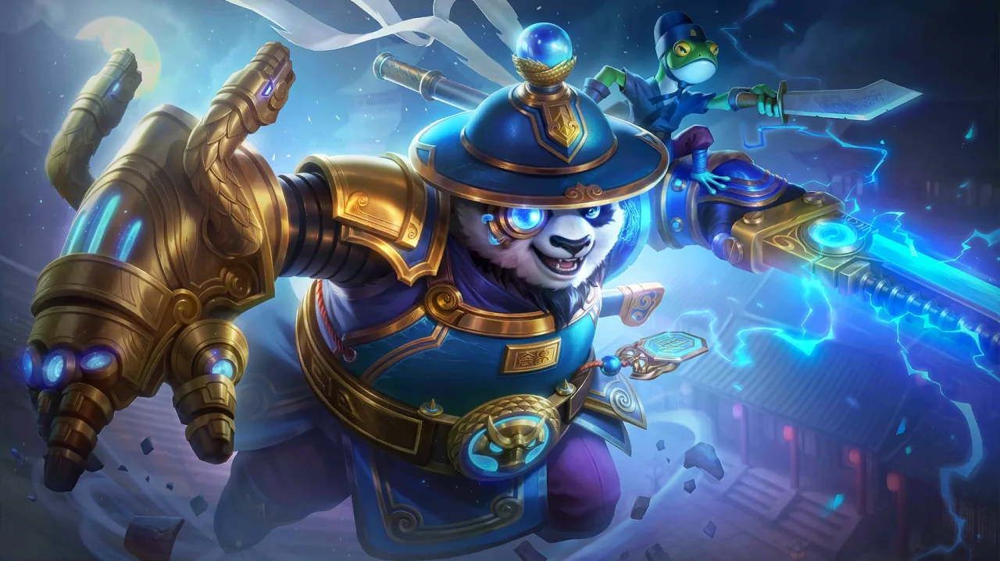

[Tier list](https://boostmlbb.ru/en/heroes/)[Items](https://boostmlbb.ru/en/items/)[Skins](https://boostmlbb.ru/en/skins/)[News & guides](https://boostmlbb.ru/en/news/)

[Skins](https://boostmlbb.ru/en/skins/)/[Akai](https://boostmlbb.ru/en/skins/akai.html)/Imperial Assassin

[Akai skin](https://boostmlbb.ru/en/skins/akai.html)

# Imperial Assassin

ExquisiteLuckyboxLimited

How to get

Came out of Lucky Boxes in events. Limited skins come back in event draws from time to time.

Released

2018

## What the skin changes

-   New look
-   New skill effects
-   Showcase animation
-   Showcase scene
-   Attribute bonus

## All Akai skins [9](https://boostmlbb.ru/en/skins/akai.html)

[Marvelous MaestroDeluxe · 2024](https://boostmlbb.ru/en/skins/akai/marvelous-maestro.html)[Pumpkin BrawlerExceptional · 2023](https://boostmlbb.ru/en/skins/akai/pumpkin-brawler.html)[Kung Fu PandaGrand · 2022](https://boostmlbb.ru/en/skins/akai/kung-fu-panda.html)[Street EnforcerCommon · 2021](https://boostmlbb.ru/en/skins/akai/street-enforcer.html)[Stream RecluseCommon · 2020](https://boostmlbb.ru/en/skins/akai/stream-recluse.html)[Akazonae SamuraiExceptional · 2018](https://boostmlbb.ru/en/skins/akai/akazonae-samurai.html)[Imperial AssassinExquisite · 2018](https://boostmlbb.ru/en/skins/akai/imperial-assassin.html)[MonkCommon · 2017](https://boostmlbb.ru/en/skins/akai/monk.html)[Summer PartyExceptional · 2016](https://boostmlbb.ru/en/skins/akai/summer-party.html)

## Luckybox series

[Lady CraneGuinevere · 2025](https://boostmlbb.ru/en/skins/guinevere/lady-crane.html)[Butterfly SeraphimLunox · 2025](https://boostmlbb.ru/en/skins/lunox/butterfly-seraphim.html)[Mecha DragonClaude · 2025](https://boostmlbb.ru/en/skins/claude/mecha-dragon.html)[Lunar MagicChang'e · 2020](https://boostmlbb.ru/en/skins/change/lunar-magic.html)[Thunder FlashSelena · 2020](https://boostmlbb.ru/en/skins/selena/thunder-flash.html)[RaksheshaHanabi · 2020](https://boostmlbb.ru/en/skins/hanabi/rakshesha.html)[Video-Game DominatorUranus · 2020](https://boostmlbb.ru/en/skins/uranus/video-game-dominator.html)[God of WarMartis · 2020](https://boostmlbb.ru/en/skins/martis/god-of-war.html)

**Rank up on Akai**The calculator shows the price

[Calculate price](https://boostmlbb.ru/en/order.html?type=hero)

## Frequently asked questions

How to get the Imperial Assassin skin for Akai?

Came out of Lucky Boxes in events. Limited skins come back in event draws from time to time.

When was Imperial Assassin released?

2018.

What class is Imperial Assassin?

Exquisite, Luckybox series.
