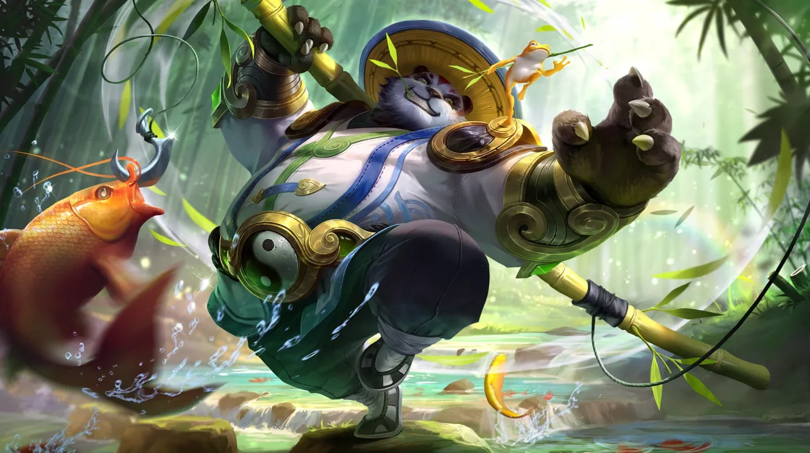

[Tier list](https://boostmlbb.ru/en/heroes/)[Items](https://boostmlbb.ru/en/items/)[Skins](https://boostmlbb.ru/en/skins/)[News & guides](https://boostmlbb.ru/en/news/)

[Skins](https://boostmlbb.ru/en/skins/)/[Akai](https://boostmlbb.ru/en/skins/akai.html)/Stream Recluse

[Akai skin](https://boostmlbb.ru/en/skins/akai.html)

# Stream Recluse

CommonEliteLimited

How to get

First top-up gift in Season 14.

Released

2020

## What the skin changes

-   New look
-   Attribute bonus

## All Akai skins [9](https://boostmlbb.ru/en/skins/akai.html)

[Marvelous MaestroDeluxe · 2024](https://boostmlbb.ru/en/skins/akai/marvelous-maestro.html)[Pumpkin BrawlerExceptional · 2023](https://boostmlbb.ru/en/skins/akai/pumpkin-brawler.html)[Kung Fu PandaGrand · 2022](https://boostmlbb.ru/en/skins/akai/kung-fu-panda.html)[Street EnforcerCommon · 2021](https://boostmlbb.ru/en/skins/akai/street-enforcer.html)[Stream RecluseCommon · 2020](https://boostmlbb.ru/en/skins/akai/stream-recluse.html)[Akazonae SamuraiExceptional · 2018](https://boostmlbb.ru/en/skins/akai/akazonae-samurai.html)[Imperial AssassinExquisite · 2018](https://boostmlbb.ru/en/skins/akai/imperial-assassin.html)[MonkCommon · 2017](https://boostmlbb.ru/en/skins/akai/monk.html)[Summer PartyExceptional · 2016](https://boostmlbb.ru/en/skins/akai/summer-party.html)

## Elite series

[Golden OsmanthusChang'e · 2026](https://boostmlbb.ru/en/skins/change/golden-osmanthus.html)[Warlord KingMartis · 2025](https://boostmlbb.ru/en/skins/martis/warlord-king.html)[High Seas CadetKimmy · 2024](https://boostmlbb.ru/en/skins/kimmy/high-seas-cadet.html)[Verdant LancerSilvanna · 2024](https://boostmlbb.ru/en/skins/silvanna/verdant-lancer.html)[Bloodhoof MarauderHylos · 2024](https://boostmlbb.ru/en/skins/hylos/bloodhoof-marauder.html)[Elegant ButterflyGuinevere · 2024](https://boostmlbb.ru/en/skins/guinevere/elegant-butterfly.html)[Marques of BladesLancelot · 2024](https://boostmlbb.ru/en/skins/lancelot/marques-of-blades.html)[Badlands HiatusChip · 2024](https://boostmlbb.ru/en/skins/chip/badlands-hiatus.html)

**Rank up on Akai**The calculator shows the price

[Calculate price](https://boostmlbb.ru/en/order.html?type=hero)

## Frequently asked questions

How to get the Stream Recluse skin for Akai?

First top-up gift in Season 14.

When was Stream Recluse released?

2020.

What class is Stream Recluse?

Common, Elite series.
