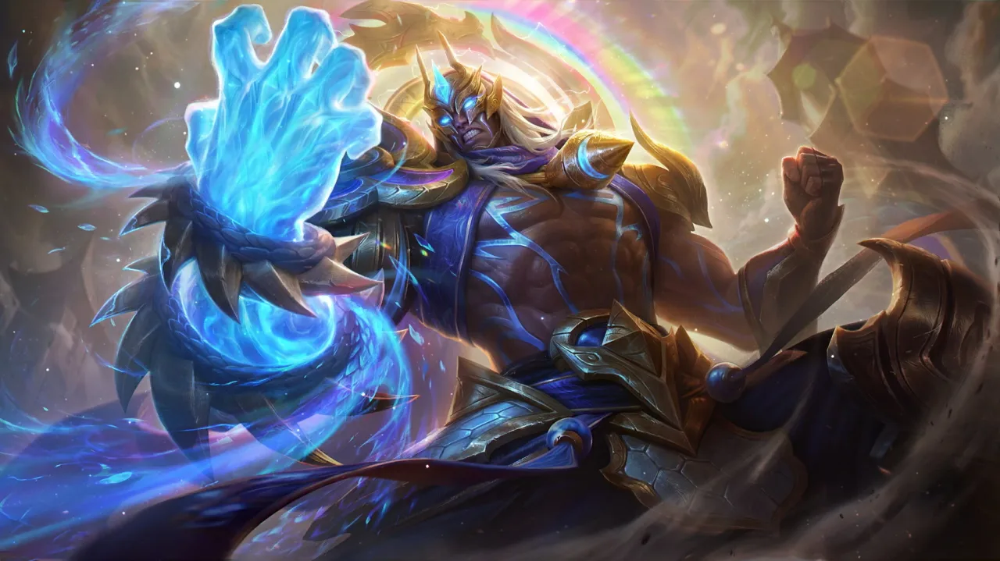

[Aldous skins](https://boostmlbb.ru/en/skins/aldous.html)

[Skins](https://boostmlbb.ru/en/skins/)/[Aldous](https://boostmlbb.ru/en/skins/aldous.html)/Realm Watcher

[Aldous skin](https://boostmlbb.ru/en/skins/aldous.html)

# Realm Watcher

ExquisiteCollectorLimited

How to get

The top prize of a Collector event draw, paid with diamonds. Limited skins come back in event draws from time to time.

Released

3 September 2021

## What the skin changes

-   New look
-   New skill effects
-   Skill sounds
-   Voice-over
-   Showcase animation
-   Showcase scene
-   Special actions
-   Attribute bonus

## All Aldous skins [10](https://boostmlbb.ru/en/skins/aldous.html)

[Fathom TerrorExceptional · 2025](https://boostmlbb.ru/en/skins/aldous/fathom-terror.html)[Mistbender AldousGrand · 2023](https://boostmlbb.ru/en/skins/aldous/mistbender-aldous.html)[StarscreamGrand · 2022](https://boostmlbb.ru/en/skins/aldous/starscream.html)[Realm WatcherExquisite · 2021](https://boostmlbb.ru/en/skins/aldous/realm-watcher.html)[Blazing ForceDeluxe · 2020](https://boostmlbb.ru/en/skins/aldous/blazing-force.html)[King of SupremacyDeluxe · 2019](https://boostmlbb.ru/en/skins/aldous/king-of-supremacy.html)[The InsentientExceptional · 2019](https://boostmlbb.ru/en/skins/aldous/the-insentient.html)[DeathCommon · 2019](https://boostmlbb.ru/en/skins/aldous/death.html)[Red MantleCommon · 2018](https://boostmlbb.ru/en/skins/aldous/red-mantle.html)[Contractor2018](https://boostmlbb.ru/en/skins/aldous/contractor.html)

## Collector series

[The PurifierBruno · 2026](https://boostmlbb.ru/en/skins/bruno/the-purifier.html)[Celestial RebelSun · 2026](https://boostmlbb.ru/en/skins/sun/celestial-rebel.html)[Kaiju of the DeepHelcurt · 2026](https://boostmlbb.ru/en/skins/helcurt/kaiju-of-the-deep.html)[Starbound SentryKimmy · 2026](https://boostmlbb.ru/en/skins/kimmy/starbound-sentry.html)[Dreaming MonarchAlice · 2026](https://boostmlbb.ru/en/skins/alice/dreaming-monarch.html)[Tremor of the DeepGrock · 2026](https://boostmlbb.ru/en/skins/grock/tremor-of-the-deep.html)[Celestial GeneralTigreal · 2026](https://boostmlbb.ru/en/skins/tigreal/celestial-general.html)[Sunborn MonarchXavier · 2026](https://boostmlbb.ru/en/skins/xavier/sunborn-monarch.html)

**How much is a rank boost on Aldous?**Choose your current and target ranks to see the price here.

[Calculate price](https://boostmlbb.ru/en/order.html?type=hero)

## Frequently asked questions

How to get the Realm Watcher skin for Aldous?

The top prize of a Collector event draw, paid with diamonds. Limited skins come back in event draws from time to time.

When was Realm Watcher released?

3 September 2021.

What class is Realm Watcher?

Exquisite, Collector series.
