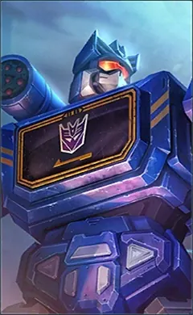

[Tier list](https://boostmlbb.ru/en/heroes/)[Items](https://boostmlbb.ru/en/items/)[Skins](https://boostmlbb.ru/en/skins/)[News & guides](https://boostmlbb.ru/en/news/)

[Skins](https://boostmlbb.ru/en/skins/)/[Aldous](https://boostmlbb.ru/en/skins/aldous.html)/Starscream

[Aldous skin](https://boostmlbb.ru/en/skins/aldous.html)

# Starscream

GrandTransformersLimited

How to get

Released in the MLBB × Transformers collaboration event. Limited skins come back in event draws from time to time.

Released

24 May 2022

## What the skin changes

-   New look
-   New skill effects
-   Skill sounds
-   Voice-over
-   Skill icons
-   Showcase animation
-   Showcase scene
-   Showcase music
-   Spawn animation
-   Special actions
-   Attribute bonus

## All Aldous skins [10](https://boostmlbb.ru/en/skins/aldous.html)

[Fathom TerrorExceptional · 2025](https://boostmlbb.ru/en/skins/aldous/fathom-terror.html)[Mistbender AldousGrand · 2023](https://boostmlbb.ru/en/skins/aldous/mistbender-aldous.html)[StarscreamGrand · 2022](https://boostmlbb.ru/en/skins/aldous/starscream.html)[Realm WatcherExquisite · 2021](https://boostmlbb.ru/en/skins/aldous/realm-watcher.html)[Blazing ForceDeluxe · 2020](https://boostmlbb.ru/en/skins/aldous/blazing-force.html)[King of SupremacyDeluxe · 2019](https://boostmlbb.ru/en/skins/aldous/king-of-supremacy.html)[The InsentientExceptional · 2019](https://boostmlbb.ru/en/skins/aldous/the-insentient.html)[DeathCommon · 2019](https://boostmlbb.ru/en/skins/aldous/death.html)[Red MantleCommon · 2018](https://boostmlbb.ru/en/skins/aldous/red-mantle.html)[Contractor2018](https://boostmlbb.ru/en/skins/aldous/contractor.html)

## Transformers series

[BumblebeeX.Borg · 2025](https://boostmlbb.ru/en/skins/x-borg/bumblebee.html)[Optimus PrimeJohnson · 2023](https://boostmlbb.ru/en/skins/johnson/optimus-prime.html)[MegatronGranger · 2023](https://boostmlbb.ru/en/skins/granger/megatron.html)[Soundwave & RavagePopol and Kupa · 2022](https://boostmlbb.ru/en/skins/popol-and-kupa/soundwave-ravage.html)[GrimlockRoger · 2022](https://boostmlbb.ru/en/skins/roger/grimlock.html)

**Rank up on Aldous**The calculator shows the price

[Calculate price](https://boostmlbb.ru/en/order.html?type=hero)

## Frequently asked questions

How to get the Starscream skin for Aldous?

Released in the MLBB × Transformers collaboration event. Limited skins come back in event draws from time to time.

When was Starscream released?

24 May 2022.

What class is Starscream?

Grand, Transformers series.
