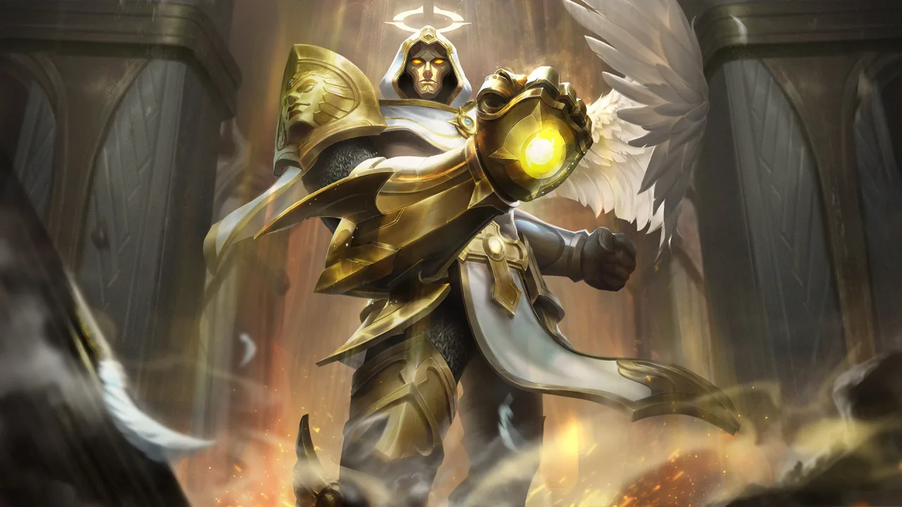

[Tier list](https://boostmlbb.ru/en/heroes/)[Items](https://boostmlbb.ru/en/items/)[Skins](https://boostmlbb.ru/en/skins/)[News & guides](https://boostmlbb.ru/en/news/)

[Skins](https://boostmlbb.ru/en/skins/)/[Aldous](https://boostmlbb.ru/en/skins/aldous.html)/The Insentient

[Aldous skin](https://boostmlbb.ru/en/skins/aldous.html)

# The Insentient

ExceptionalStarLightLimited

How to get

StarLight reward for July 2019.

Released

1 July 2019

## What the skin changes

-   New look
-   New skill effects
-   Showcase animation
-   Attribute bonus

## All Aldous skins [10](https://boostmlbb.ru/en/skins/aldous.html)

[Fathom TerrorExceptional · 2025](https://boostmlbb.ru/en/skins/aldous/fathom-terror.html)[Mistbender AldousGrand · 2023](https://boostmlbb.ru/en/skins/aldous/mistbender-aldous.html)[StarscreamGrand · 2022](https://boostmlbb.ru/en/skins/aldous/starscream.html)[Realm WatcherExquisite · 2021](https://boostmlbb.ru/en/skins/aldous/realm-watcher.html)[Blazing ForceDeluxe · 2020](https://boostmlbb.ru/en/skins/aldous/blazing-force.html)[King of SupremacyDeluxe · 2019](https://boostmlbb.ru/en/skins/aldous/king-of-supremacy.html)[The InsentientExceptional · 2019](https://boostmlbb.ru/en/skins/aldous/the-insentient.html)[DeathCommon · 2019](https://boostmlbb.ru/en/skins/aldous/death.html)[Red MantleCommon · 2018](https://boostmlbb.ru/en/skins/aldous/red-mantle.html)[Contractor2018](https://boostmlbb.ru/en/skins/aldous/contractor.html)

## StarLight series

[Tideborn SailorKalea · 2026](https://boostmlbb.ru/en/skins/kalea/tideborn-sailor.html)[Kitsune's ShadowHayabusa · 2026](https://boostmlbb.ru/en/skins/hayabusa/kitsune-s-shadow.html)[Fangs of SlaughterHanzo · 2026](https://boostmlbb.ru/en/skins/hanzo/fangs-of-slaughter.html)[Smoul­dering FortressBelerick · 2026](https://boostmlbb.ru/en/skins/belerick/smouldering-fortress.html)[Magitech WraithObsidia · 2026](https://boostmlbb.ru/en/skins/obsidia/magitech-wraith.html)[Elysian LuminanceZetian · 2026](https://boostmlbb.ru/en/skins/zetian/elysian-luminance.html)[Guardian BattalionHilda · 2026](https://boostmlbb.ru/en/skins/hilda/guardian-battalion.html)[Dreaming KoiHarley · 2026](https://boostmlbb.ru/en/skins/harley/dreaming-koi.html)

**Rank up on Aldous**The calculator shows the price

[Calculate price](https://boostmlbb.ru/en/order.html?type=hero)

## Frequently asked questions

How to get the The Insentient skin for Aldous?

StarLight reward for July 2019.

When was The Insentient released?

1 July 2019.

What class is The Insentient?

Exceptional, StarLight series.
