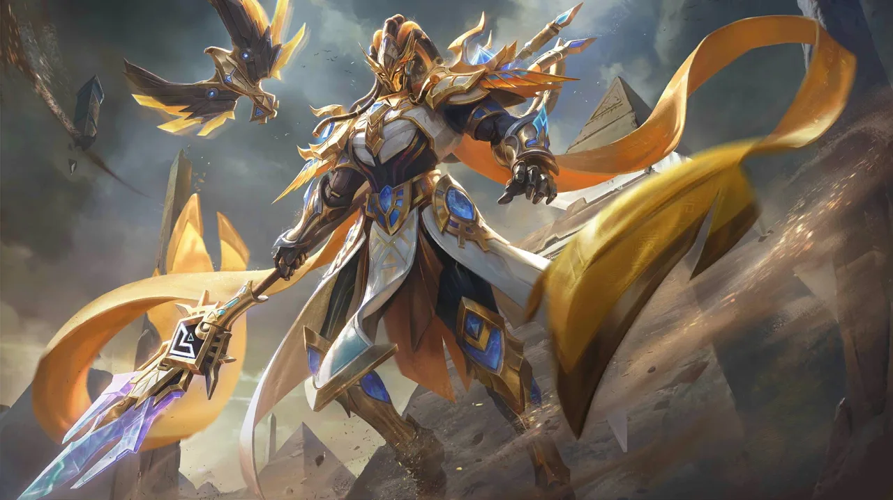

[Tier list](https://boostmlbb.ru/en/heroes/)[Items](https://boostmlbb.ru/en/items/)[Skins](https://boostmlbb.ru/en/skins/)[News & guides](https://boostmlbb.ru/en/news/)

[Skins](https://boostmlbb.ru/en/skins/)/[Alpha](https://boostmlbb.ru/en/skins/alpha.html)/Edict of the Sands

[Alpha skin](https://boostmlbb.ru/en/skins/alpha.html)

# Edict of the Sands

EpicIn the shop

How to get

Released in the skin shop during an event.

## All Alpha skins [9](https://boostmlbb.ru/en/skins/alpha.html)

[Revenant of RosesSupreme · 2025](https://boostmlbb.ru/en/skins/alpha/revenant-of-roses.html)[Mecha-King PerseusExquisite · 2024](https://boostmlbb.ru/en/skins/alpha/mecha-king-perseus.html)[General VoidGrand · 2023](https://boostmlbb.ru/en/skins/alpha/general-void.html)[Star EnforcerExceptional · 2023](https://boostmlbb.ru/en/skins/alpha/star-enforcer.html)[Crimson WarriorExceptional · 2020](https://boostmlbb.ru/en/skins/alpha/crimson-warrior.html)[Sea GladiatorCommon · 2018](https://boostmlbb.ru/en/skins/alpha/sea-gladiator.html)[Fierce DragonCommon · 2017](https://boostmlbb.ru/en/skins/alpha/fierce-dragon.html)[Onimusha CommanderExquisite · 2017](https://boostmlbb.ru/en/skins/alpha/onimusha-commander.html)[Edict of the Sands](https://boostmlbb.ru/en/skins/alpha/edict-of-the-sands.html)

## Epic series

[Nether OverseerMinotaur · 2026](https://boostmlbb.ru/en/skins/minotaur/nether-overseer.html)[Sunken CurseAtlas · 2026](https://boostmlbb.ru/en/skins/atlas/sunken-curse.html)[Eternal VowVexana · 2026](https://boostmlbb.ru/en/skins/vexana/eternal-vow.html)[Cursed ScrollKhufra · 2025](https://boostmlbb.ru/en/skins/khufra/cursed-scroll.html)[Soul HuntressNatalia · 2025](https://boostmlbb.ru/en/skins/natalia/soul-huntress.html)[Nightmare CountLeomord · 2025](https://boostmlbb.ru/en/skins/leomord/nightmare-count.html)[Arbiter of StarsBelerick · 2025](https://boostmlbb.ru/en/skins/belerick/arbiter-of-stars.html)[Keeper of the WindsVale · 2025](https://boostmlbb.ru/en/skins/vale/keeper-of-the-winds.html)

**Rank up on Alpha**The calculator shows the price

[Calculate price](https://boostmlbb.ru/en/order.html?type=hero)

## Frequently asked questions

How to get the Edict of the Sands skin for Alpha?

Released in the skin shop during an event.
