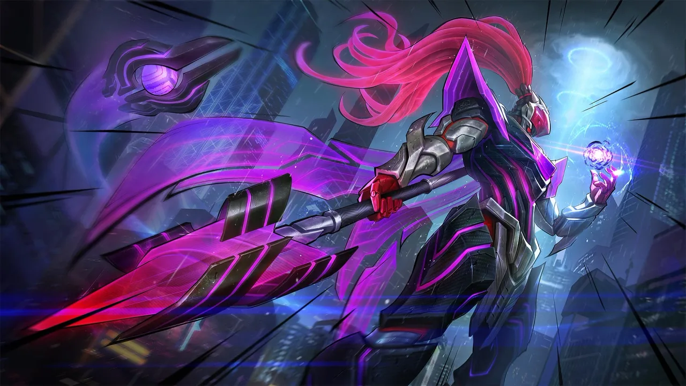

[Alpha skins](https://boostmlbb.ru/en/skins/alpha.html)

[Skins](https://boostmlbb.ru/en/skins/)/[Alpha](https://boostmlbb.ru/en/skins/alpha.html)/General Void

[Alpha skin](https://boostmlbb.ru/en/skins/alpha.html)

# General Void

GrandABYSSLimited

How to get

Released in the ABYSS event. Limited skins come back in event draws from time to time.

Released

7 October 2023

## What the skin changes

-   New look
-   New skill effects
-   Skill sounds
-   Voice-over
-   Showcase animation
-   Showcase scene
-   Attribute bonus

## All Alpha skins [9](https://boostmlbb.ru/en/skins/alpha.html)

[Revenant of RosesSupreme · 2025](https://boostmlbb.ru/en/skins/alpha/revenant-of-roses.html)[Mecha-King PerseusExquisite · 2024](https://boostmlbb.ru/en/skins/alpha/mecha-king-perseus.html)[General VoidGrand · 2023](https://boostmlbb.ru/en/skins/alpha/general-void.html)[Star EnforcerExceptional · 2023](https://boostmlbb.ru/en/skins/alpha/star-enforcer.html)[Crimson WarriorExceptional · 2020](https://boostmlbb.ru/en/skins/alpha/crimson-warrior.html)[Sea GladiatorCommon · 2018](https://boostmlbb.ru/en/skins/alpha/sea-gladiator.html)[Fierce DragonCommon · 2017](https://boostmlbb.ru/en/skins/alpha/fierce-dragon.html)[Onimusha CommanderExquisite · 2017](https://boostmlbb.ru/en/skins/alpha/onimusha-commander.html)[Edict of the Sands](https://boostmlbb.ru/en/skins/alpha/edict-of-the-sands.html)

## ABYSS series

[Doom IncarnateMoskov · 2023](https://boostmlbb.ru/en/skins/moskov/doom-incarnate.html)[Shadow KnightLeomord · 2023](https://boostmlbb.ru/en/skins/leomord/shadow-knight.html)[Lady VengeanceSelena · 2021](https://boostmlbb.ru/en/skins/selena/lady-vengeance.html)

**How much is a rank boost on Alpha?**Choose your current and target ranks to see the price here.

[Calculate price](https://boostmlbb.ru/en/order.html?type=hero)

## Frequently asked questions

How to get the General Void skin for Alpha?

Released in the ABYSS event. Limited skins come back in event draws from time to time.

When was General Void released?

7 October 2023.

What class is General Void?

Grand, ABYSS series.
