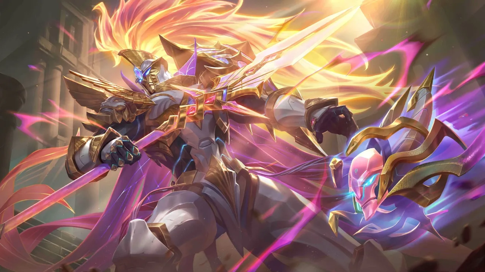

[Tier list](https://boostmlbb.ru/en/heroes/)[Items](https://boostmlbb.ru/en/items/)[Skins](https://boostmlbb.ru/en/skins/)[News & guides](https://boostmlbb.ru/en/news/)

[Skins](https://boostmlbb.ru/en/skins/)/[Alpha](https://boostmlbb.ru/en/skins/alpha.html)/Mecha-King Perseus

[Alpha skin](https://boostmlbb.ru/en/skins/alpha.html)

# Mecha-King Perseus

ExquisiteCollectorLimited

How to get

The top prize of a Collector event draw, paid with diamonds. Limited skins come back in event draws from time to time.

Released

May 2024

## What the skin changes

-   New look
-   New skill effects
-   Skill sounds
-   Voice-over
-   Showcase animation
-   Showcase scene
-   Showcase music
-   Special actions
-   Attribute bonus

## All Alpha skins [9](https://boostmlbb.ru/en/skins/alpha.html)

[Revenant of RosesSupreme · 2025](https://boostmlbb.ru/en/skins/alpha/revenant-of-roses.html)[Mecha-King PerseusExquisite · 2024](https://boostmlbb.ru/en/skins/alpha/mecha-king-perseus.html)[General VoidGrand · 2023](https://boostmlbb.ru/en/skins/alpha/general-void.html)[Star EnforcerExceptional · 2023](https://boostmlbb.ru/en/skins/alpha/star-enforcer.html)[Crimson WarriorExceptional · 2020](https://boostmlbb.ru/en/skins/alpha/crimson-warrior.html)[Sea GladiatorCommon · 2018](https://boostmlbb.ru/en/skins/alpha/sea-gladiator.html)[Fierce DragonCommon · 2017](https://boostmlbb.ru/en/skins/alpha/fierce-dragon.html)[Onimusha CommanderExquisite · 2017](https://boostmlbb.ru/en/skins/alpha/onimusha-commander.html)[Edict of the Sands](https://boostmlbb.ru/en/skins/alpha/edict-of-the-sands.html)

## Collector series

[The PurifierBruno · 2026](https://boostmlbb.ru/en/skins/bruno/the-purifier.html)[Celestial RebelSun · 2026](https://boostmlbb.ru/en/skins/sun/celestial-rebel.html)[Kaiju of the DeepHelcurt · 2026](https://boostmlbb.ru/en/skins/helcurt/kaiju-of-the-deep.html)[Starbound SentryKimmy · 2026](https://boostmlbb.ru/en/skins/kimmy/starbound-sentry.html)[Dreaming MonarchAlice · 2026](https://boostmlbb.ru/en/skins/alice/dreaming-monarch.html)[Tremor of the DeepGrock · 2026](https://boostmlbb.ru/en/skins/grock/tremor-of-the-deep.html)[Celestial GeneralTigreal · 2026](https://boostmlbb.ru/en/skins/tigreal/celestial-general.html)[Sunborn MonarchXavier · 2026](https://boostmlbb.ru/en/skins/xavier/sunborn-monarch.html)

**Rank up on Alpha**The calculator shows the price

[Calculate price](https://boostmlbb.ru/en/order.html?type=hero)

## Frequently asked questions

How to get the Mecha-King Perseus skin for Alpha?

The top prize of a Collector event draw, paid with diamonds. Limited skins come back in event draws from time to time.

When was Mecha-King Perseus released?

May 2024.

What class is Mecha-King Perseus?

Exquisite, Collector series.
