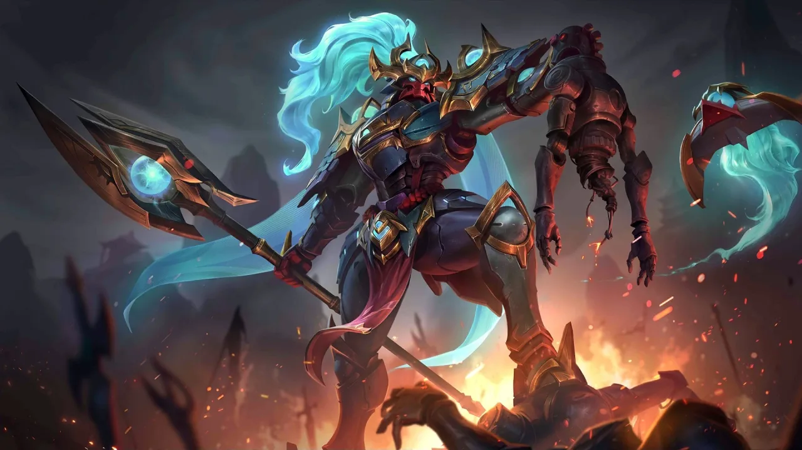
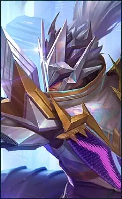

[Tier list](https://boostmlbb.ru/en/heroes/)[Items](https://boostmlbb.ru/en/items/)[Skins](https://boostmlbb.ru/en/skins/)[News & guides](https://boostmlbb.ru/en/news/)

[Skins](https://boostmlbb.ru/en/skins/)/[Alpha](https://boostmlbb.ru/en/skins/alpha.html)/Onimusha Commander

[Alpha skin](https://boostmlbb.ru/en/skins/alpha.html)

# Onimusha Commander

ExquisiteLuckyboxLimited

How to get

Came out of Lucky Boxes in events. Limited skins come back in event draws from time to time.

Released

2017

## What the skin changes

-   New look
-   New skill effects
-   Voice-over
-   Showcase animation
-   Showcase scene
-   Attribute bonus

## All Alpha skins [9](https://boostmlbb.ru/en/skins/alpha.html)

[Revenant of RosesSupreme · 2025](https://boostmlbb.ru/en/skins/alpha/revenant-of-roses.html)[Mecha-King PerseusExquisite · 2024](https://boostmlbb.ru/en/skins/alpha/mecha-king-perseus.html)[General VoidGrand · 2023](https://boostmlbb.ru/en/skins/alpha/general-void.html)[Star EnforcerExceptional · 2023](https://boostmlbb.ru/en/skins/alpha/star-enforcer.html)[Crimson WarriorExceptional · 2020](https://boostmlbb.ru/en/skins/alpha/crimson-warrior.html)[Sea GladiatorCommon · 2018](https://boostmlbb.ru/en/skins/alpha/sea-gladiator.html)[Fierce DragonCommon · 2017](https://boostmlbb.ru/en/skins/alpha/fierce-dragon.html)[Onimusha CommanderExquisite · 2017](https://boostmlbb.ru/en/skins/alpha/onimusha-commander.html)[Edict of the Sands](https://boostmlbb.ru/en/skins/alpha/edict-of-the-sands.html)

## Luckybox series

[Lady CraneGuinevere · 2025](https://boostmlbb.ru/en/skins/guinevere/lady-crane.html)[Butterfly SeraphimLunox · 2025](https://boostmlbb.ru/en/skins/lunox/butterfly-seraphim.html)[Mecha DragonClaude · 2025](https://boostmlbb.ru/en/skins/claude/mecha-dragon.html)[Lunar MagicChang'e · 2020](https://boostmlbb.ru/en/skins/change/lunar-magic.html)[Thunder FlashSelena · 2020](https://boostmlbb.ru/en/skins/selena/thunder-flash.html)[RaksheshaHanabi · 2020](https://boostmlbb.ru/en/skins/hanabi/rakshesha.html)[Video-Game DominatorUranus · 2020](https://boostmlbb.ru/en/skins/uranus/video-game-dominator.html)[God of WarMartis · 2020](https://boostmlbb.ru/en/skins/martis/god-of-war.html)

**Rank up on Alpha**The calculator shows the price

[Calculate price](https://boostmlbb.ru/en/order.html?type=hero)

## Frequently asked questions

How to get the Onimusha Commander skin for Alpha?

Came out of Lucky Boxes in events. Limited skins come back in event draws from time to time.

When was Onimusha Commander released?

2017.

What class is Onimusha Commander?

Exquisite, Luckybox series.
