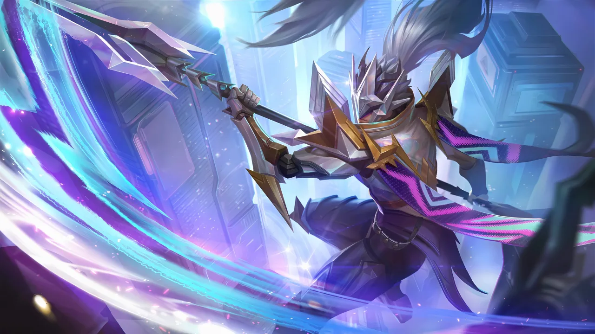
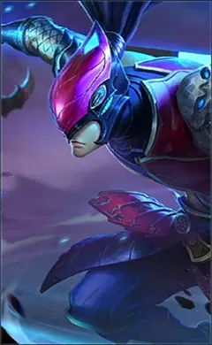
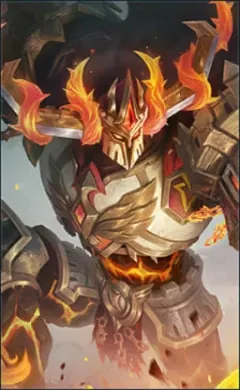

[Tier list](https://boostmlbb.ru/en/heroes/)[Items](https://boostmlbb.ru/en/items/)[Skins](https://boostmlbb.ru/en/skins/)[News & guides](https://boostmlbb.ru/en/news/)

[Skins](https://boostmlbb.ru/en/skins/)/[Alpha](https://boostmlbb.ru/en/skins/alpha.html)/Star Enforcer

[Alpha skin](https://boostmlbb.ru/en/skins/alpha.html)

# Star Enforcer

ExceptionalStarLightLimited

How to get

StarLight reward for September 2023.

Released

1 September 2023

## What the skin changes

-   New look
-   New skill effects
-   Showcase animation
-   Showcase scene
-   Attribute bonus

## All Alpha skins [9](https://boostmlbb.ru/en/skins/alpha.html)

[Revenant of RosesSupreme · 2025](https://boostmlbb.ru/en/skins/alpha/revenant-of-roses.html)[Mecha-King PerseusExquisite · 2024](https://boostmlbb.ru/en/skins/alpha/mecha-king-perseus.html)[General VoidGrand · 2023](https://boostmlbb.ru/en/skins/alpha/general-void.html)[Star EnforcerExceptional · 2023](https://boostmlbb.ru/en/skins/alpha/star-enforcer.html)[Crimson WarriorExceptional · 2020](https://boostmlbb.ru/en/skins/alpha/crimson-warrior.html)[Sea GladiatorCommon · 2018](https://boostmlbb.ru/en/skins/alpha/sea-gladiator.html)[Fierce DragonCommon · 2017](https://boostmlbb.ru/en/skins/alpha/fierce-dragon.html)[Onimusha CommanderExquisite · 2017](https://boostmlbb.ru/en/skins/alpha/onimusha-commander.html)[Edict of the Sands](https://boostmlbb.ru/en/skins/alpha/edict-of-the-sands.html)

## StarLight series

[Tideborn SailorKalea · 2026](https://boostmlbb.ru/en/skins/kalea/tideborn-sailor.html)[Kitsune's ShadowHayabusa · 2026](https://boostmlbb.ru/en/skins/hayabusa/kitsune-s-shadow.html)[Fangs of SlaughterHanzo · 2026](https://boostmlbb.ru/en/skins/hanzo/fangs-of-slaughter.html)[Smoul­dering FortressBelerick · 2026](https://boostmlbb.ru/en/skins/belerick/smouldering-fortress.html)[Magitech WraithObsidia · 2026](https://boostmlbb.ru/en/skins/obsidia/magitech-wraith.html)[Elysian LuminanceZetian · 2026](https://boostmlbb.ru/en/skins/zetian/elysian-luminance.html)[Guardian BattalionHilda · 2026](https://boostmlbb.ru/en/skins/hilda/guardian-battalion.html)[Dreaming KoiHarley · 2026](https://boostmlbb.ru/en/skins/harley/dreaming-koi.html)

**Rank up on Alpha**The calculator shows the price

[Calculate price](https://boostmlbb.ru/en/order.html?type=hero)

## Frequently asked questions

How to get the Star Enforcer skin for Alpha?

StarLight reward for September 2023.

When was Star Enforcer released?

1 September 2023.

What class is Star Enforcer?

Exceptional, StarLight series.
