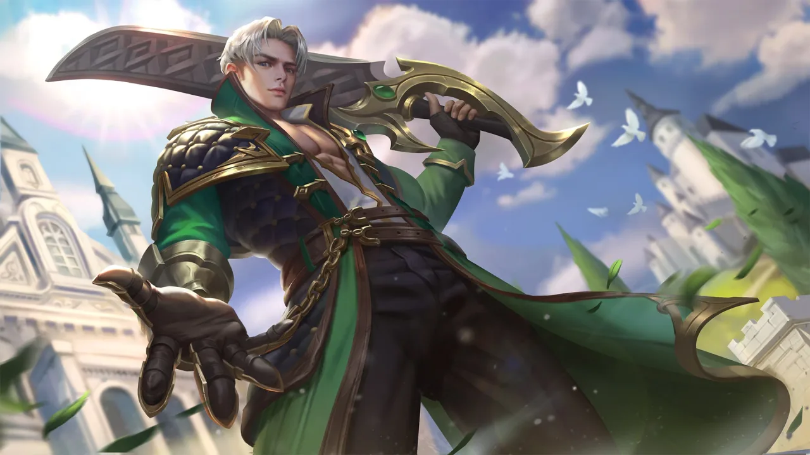

[Tier list](https://boostmlbb.ru/en/heroes/)[Items](https://boostmlbb.ru/en/items/)[Skins](https://boostmlbb.ru/en/skins/)[News & guides](https://boostmlbb.ru/en/news/)

[Skins](https://boostmlbb.ru/en/skins/)/[Alucard](https://boostmlbb.ru/en/skins/alucard.html)/Lone Hero

[Alucard skin](https://boostmlbb.ru/en/skins/alucard.html)

# Lone Hero

CommonIn the shop

How to get

Sold in the skin shop for 269 diamonds.

Price

269 diamonds

Released

2016

## What the skin changes

-   Attribute bonus

## All Alucard skins [10](https://boostmlbb.ru/en/skins/alucard.html)

[Demon's BaneExceptional · 2025](https://boostmlbb.ru/en/skins/alucard/demon-s-bane.html)[Obi-Wan KenobiGrand · 2021](https://boostmlbb.ru/en/skins/alucard/obi-wan-kenobi.html)[Lightborn - StrikerDeluxe · 2019](https://boostmlbb.ru/en/skins/alucard/lightborn-striker.html)[Empire AgentCommon · 2019](https://boostmlbb.ru/en/skins/alucard/empire-agent.html)[Obsidian BladeSupreme · 2019](https://boostmlbb.ru/en/skins/alucard/obsidian-blade.html)[Romantic FantasyExceptional · 2018](https://boostmlbb.ru/en/skins/alucard/romantic-fantasy.html)[ViscountExceptional · 2017](https://boostmlbb.ru/en/skins/alucard/viscount.html)[Child of the FallExquisite · 2017](https://boostmlbb.ru/en/skins/alucard/child-of-the-fall.html)[Fiery InfernoCommon · 2017](https://boostmlbb.ru/en/skins/alucard/fiery-inferno.html)[Lone HeroCommon · 2016](https://boostmlbb.ru/en/skins/alucard/lone-hero.html)

**Rank up on Alucard**The calculator shows the price

[Calculate price](https://boostmlbb.ru/en/order.html?type=hero)

## Frequently asked questions

How to get the Lone Hero skin for Alucard?

Sold in the skin shop for 269 diamonds.

When was Lone Hero released?

2016.

What class is Lone Hero?

Common.
