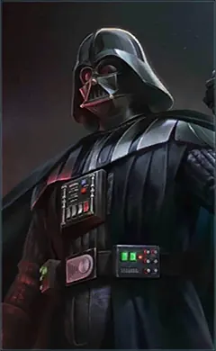

[Alucard skins](https://boostmlbb.ru/en/skins/alucard.html)

[Skins](https://boostmlbb.ru/en/skins/)/[Alucard](https://boostmlbb.ru/en/skins/alucard.html)/Obi-Wan Kenobi

[Alucard skin](https://boostmlbb.ru/en/skins/alucard.html)

# Obi-Wan Kenobi

GrandStar WarsLimited

How to get

Released in the MLBB × Star Wars collaboration event. Limited skins come back in event draws from time to time.

Released

2021

## What the skin changes

-   New look
-   New skill effects
-   Skill sounds
-   Voice-over
-   Skill icons
-   Showcase animation
-   Showcase scene
-   Showcase music
-   Attribute bonus

## All Alucard skins [10](https://boostmlbb.ru/en/skins/alucard.html)

[Demon's BaneExceptional · 2025](https://boostmlbb.ru/en/skins/alucard/demon-s-bane.html)[Obi-Wan KenobiGrand · 2021](https://boostmlbb.ru/en/skins/alucard/obi-wan-kenobi.html)[Lightborn - StrikerDeluxe · 2019](https://boostmlbb.ru/en/skins/alucard/lightborn-striker.html)[Empire AgentCommon · 2019](https://boostmlbb.ru/en/skins/alucard/empire-agent.html)[Obsidian BladeSupreme · 2019](https://boostmlbb.ru/en/skins/alucard/obsidian-blade.html)[Romantic FantasyExceptional · 2018](https://boostmlbb.ru/en/skins/alucard/romantic-fantasy.html)[ViscountExceptional · 2017](https://boostmlbb.ru/en/skins/alucard/viscount.html)[Child of the FallExquisite · 2017](https://boostmlbb.ru/en/skins/alucard/child-of-the-fall.html)[Fiery InfernoCommon · 2017](https://boostmlbb.ru/en/skins/alucard/fiery-inferno.html)[Lone HeroCommon · 2016](https://boostmlbb.ru/en/skins/alucard/lone-hero.html)

## Star Wars series

[First Order Jet TrooperKimmy · 2023](https://boostmlbb.ru/en/skins/kimmy/first-order-jet-trooper.html)[Darth VaderArgus · 2021](https://boostmlbb.ru/en/skins/argus/darth-vader.html)[Master YodaCyclops · 2021](https://boostmlbb.ru/en/skins/cyclops/master-yoda.html)

**How much is a rank boost on Alucard?**Choose your current and target ranks to see the price here.

[Calculate price](https://boostmlbb.ru/en/order.html?type=hero)

## Frequently asked questions

How to get the Obi-Wan Kenobi skin for Alucard?

Released in the MLBB × Star Wars collaboration event. Limited skins come back in event draws from time to time.

When was Obi-Wan Kenobi released?

2021.

What class is Obi-Wan Kenobi?

Grand, Star Wars series.
