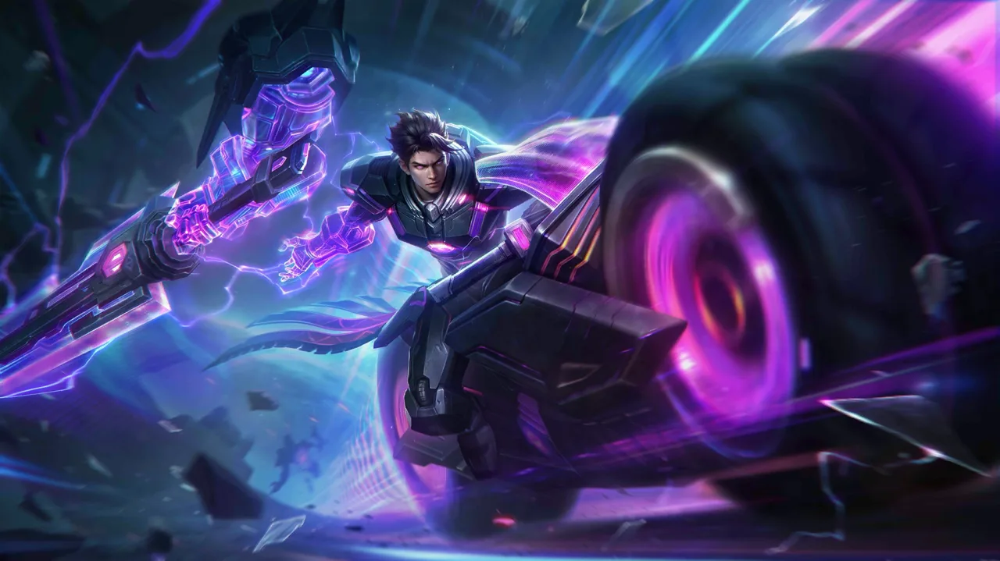

[Alucard skins](https://boostmlbb.ru/en/skins/alucard.html)

[Skins](https://boostmlbb.ru/en/skins/)/[Alucard](https://boostmlbb.ru/en/skins/alucard.html)/Obsidian Blade

[Alucard skin](https://boostmlbb.ru/en/skins/alucard.html)

# Obsidian Blade

SupremeLegendIn the shop

How to get

Exchanged for 200 Magic Crystals from the Magic Wheel.

Price

200 Magic Crystals

Released

2019

## What the skin changes

-   New look
-   New skill effects
-   Skill animations
-   Skill sounds
-   Voice-over
-   Skill icons
-   Showcase animation
-   Showcase scene
-   Recall effect
-   Special actions
-   Avatar border
-   Achievement
-   Attribute bonus

## All Alucard skins [10](https://boostmlbb.ru/en/skins/alucard.html)

[Demon's BaneExceptional · 2025](https://boostmlbb.ru/en/skins/alucard/demon-s-bane.html)[Obi-Wan KenobiGrand · 2021](https://boostmlbb.ru/en/skins/alucard/obi-wan-kenobi.html)[Lightborn - StrikerDeluxe · 2019](https://boostmlbb.ru/en/skins/alucard/lightborn-striker.html)[Empire AgentCommon · 2019](https://boostmlbb.ru/en/skins/alucard/empire-agent.html)[Obsidian BladeSupreme · 2019](https://boostmlbb.ru/en/skins/alucard/obsidian-blade.html)[Romantic FantasyExceptional · 2018](https://boostmlbb.ru/en/skins/alucard/romantic-fantasy.html)[ViscountExceptional · 2017](https://boostmlbb.ru/en/skins/alucard/viscount.html)[Child of the FallExquisite · 2017](https://boostmlbb.ru/en/skins/alucard/child-of-the-fall.html)[Fiery InfernoCommon · 2017](https://boostmlbb.ru/en/skins/alucard/fiery-inferno.html)[Lone HeroCommon · 2016](https://boostmlbb.ru/en/skins/alucard/lone-hero.html)

## Legend series

[Revenant of RosesAlpha · 2025](https://boostmlbb.ru/en/skins/alpha/revenant-of-roses.html)[Sovereign of RealmsJohnson · 2025](https://boostmlbb.ru/en/skins/johnson/sovereign-of-realms.html)[Galactic VanquisherFreya · 2024](https://boostmlbb.ru/en/skins/freya/galactic-vanquisher.html)[Divine GoddessLunox · 2023](https://boostmlbb.ru/en/skins/lunox/divine-goddess.html)[King of HellFranco · 2023](https://boostmlbb.ru/en/skins/franco/king-of-hell.html)[Psion of TomorrowGuinevere · 2022](https://boostmlbb.ru/en/skins/guinevere/psion-of-tomorrow.html)[Infernal BlazeValir · 2022](https://boostmlbb.ru/en/skins/valir/infernal-blaze.html)[Cosmic GleamGusion · 2022](https://boostmlbb.ru/en/skins/gusion/cosmic-gleam.html)

**How much is a rank boost on Alucard?**Choose your current and target ranks to see the price here.

[Calculate price](https://boostmlbb.ru/en/order.html?type=hero)

## Frequently asked questions

How to get the Obsidian Blade skin for Alucard?

Exchanged for 200 Magic Crystals from the Magic Wheel.

When was Obsidian Blade released?

2019.

What class is Obsidian Blade?

Supreme, Legend series.
