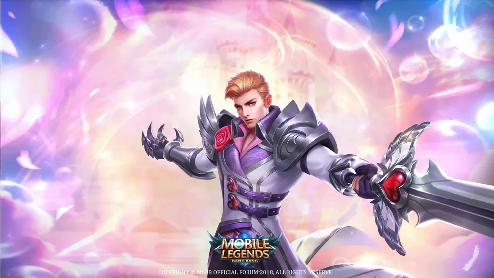

[Alucard skins](https://boostmlbb.ru/en/skins/alucard.html)

[Skins](https://boostmlbb.ru/en/skins/)/[Alucard](https://boostmlbb.ru/en/skins/alucard.html)/Romantic Fantasy

[Alucard skin](https://boostmlbb.ru/en/skins/alucard.html)

# Romantic Fantasy

ExceptionalValentineLimited

How to get

Released in the skin shop during an event. Limited skins come back in event draws from time to time.

Released

13 February 2018

## What the skin changes

-   New look
-   New skill effects
-   Showcase animation
-   Showcase scene
-   Attribute bonus

## All Alucard skins [10](https://boostmlbb.ru/en/skins/alucard.html)

[Demon's BaneExceptional · 2025](https://boostmlbb.ru/en/skins/alucard/demon-s-bane.html)[Obi-Wan KenobiGrand · 2021](https://boostmlbb.ru/en/skins/alucard/obi-wan-kenobi.html)[Lightborn - StrikerDeluxe · 2019](https://boostmlbb.ru/en/skins/alucard/lightborn-striker.html)[Empire AgentCommon · 2019](https://boostmlbb.ru/en/skins/alucard/empire-agent.html)[Obsidian BladeSupreme · 2019](https://boostmlbb.ru/en/skins/alucard/obsidian-blade.html)[Romantic FantasyExceptional · 2018](https://boostmlbb.ru/en/skins/alucard/romantic-fantasy.html)[ViscountExceptional · 2017](https://boostmlbb.ru/en/skins/alucard/viscount.html)[Child of the FallExquisite · 2017](https://boostmlbb.ru/en/skins/alucard/child-of-the-fall.html)[Fiery InfernoCommon · 2017](https://boostmlbb.ru/en/skins/alucard/fiery-inferno.html)[Lone HeroCommon · 2016](https://boostmlbb.ru/en/skins/alucard/lone-hero.html)

## Valentine series

[Heart AflameClaude · 2024](https://boostmlbb.ru/en/skins/claude/heart-aflame.html)[Alluring EnigmaGranger · 2024](https://boostmlbb.ru/en/skins/granger/alluring-enigma.html)[Alluring MystiqueSilvanna · 2024](https://boostmlbb.ru/en/skins/silvanna/alluring-mystique.html)[Gentleman ThiefKhufra · 2023](https://boostmlbb.ru/en/skins/khufra/gentleman-thief.html)[Heart AfloatFanny · 2022](https://boostmlbb.ru/en/skins/fanny/heart-afloat.html)[Phantom CountessCarmilla · 2021](https://boostmlbb.ru/en/skins/carmilla/phantom-countess.html)[Phantom CountCecilion · 2021](https://boostmlbb.ru/en/skins/cecilion/phantom-count.html)[Lady ThiefEsmeralda · 2020](https://boostmlbb.ru/en/skins/esmeralda/lady-thief.html)

**How much is a rank boost on Alucard?**Choose your current and target ranks to see the price here.

[Calculate price](https://boostmlbb.ru/en/order.html?type=hero)

## Frequently asked questions

How to get the Romantic Fantasy skin for Alucard?

Released in the skin shop during an event. Limited skins come back in event draws from time to time.

When was Romantic Fantasy released?

13 February 2018.

What class is Romantic Fantasy?

Exceptional, Valentine series.
