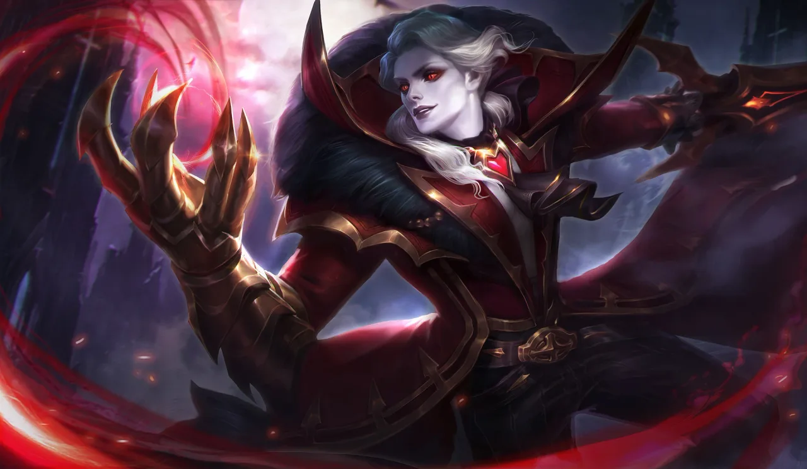

[Tier list](https://boostmlbb.ru/en/heroes/)[Items](https://boostmlbb.ru/en/items/)[Skins](https://boostmlbb.ru/en/skins/)[News & guides](https://boostmlbb.ru/en/news/)

[Skins](https://boostmlbb.ru/en/skins/)/[Alucard](https://boostmlbb.ru/en/skins/alucard.html)/Viscount

[Alucard skin](https://boostmlbb.ru/en/skins/alucard.html)

# Viscount

ExceptionalStarLightLimited

How to get

StarLight reward for December 2017.

Released

1 December 2017

## What the skin changes

-   New look
-   New skill effects
-   Showcase animation
-   Attribute bonus

## All Alucard skins [10](https://boostmlbb.ru/en/skins/alucard.html)

[Demon's BaneExceptional · 2025](https://boostmlbb.ru/en/skins/alucard/demon-s-bane.html)[Obi-Wan KenobiGrand · 2021](https://boostmlbb.ru/en/skins/alucard/obi-wan-kenobi.html)[Lightborn - StrikerDeluxe · 2019](https://boostmlbb.ru/en/skins/alucard/lightborn-striker.html)[Empire AgentCommon · 2019](https://boostmlbb.ru/en/skins/alucard/empire-agent.html)[Obsidian BladeSupreme · 2019](https://boostmlbb.ru/en/skins/alucard/obsidian-blade.html)[Romantic FantasyExceptional · 2018](https://boostmlbb.ru/en/skins/alucard/romantic-fantasy.html)[ViscountExceptional · 2017](https://boostmlbb.ru/en/skins/alucard/viscount.html)[Child of the FallExquisite · 2017](https://boostmlbb.ru/en/skins/alucard/child-of-the-fall.html)[Fiery InfernoCommon · 2017](https://boostmlbb.ru/en/skins/alucard/fiery-inferno.html)[Lone HeroCommon · 2016](https://boostmlbb.ru/en/skins/alucard/lone-hero.html)

## StarLight series

[Tideborn SailorKalea · 2026](https://boostmlbb.ru/en/skins/kalea/tideborn-sailor.html)[Kitsune's ShadowHayabusa · 2026](https://boostmlbb.ru/en/skins/hayabusa/kitsune-s-shadow.html)[Fangs of SlaughterHanzo · 2026](https://boostmlbb.ru/en/skins/hanzo/fangs-of-slaughter.html)[Smoul­dering FortressBelerick · 2026](https://boostmlbb.ru/en/skins/belerick/smouldering-fortress.html)[Magitech WraithObsidia · 2026](https://boostmlbb.ru/en/skins/obsidia/magitech-wraith.html)[Elysian LuminanceZetian · 2026](https://boostmlbb.ru/en/skins/zetian/elysian-luminance.html)[Guardian BattalionHilda · 2026](https://boostmlbb.ru/en/skins/hilda/guardian-battalion.html)[Dreaming KoiHarley · 2026](https://boostmlbb.ru/en/skins/harley/dreaming-koi.html)

**Rank up on Alucard**The calculator shows the price

[Calculate price](https://boostmlbb.ru/en/order.html?type=hero)

## Frequently asked questions

How to get the Viscount skin for Alucard?

StarLight reward for December 2017.

When was Viscount released?

1 December 2017.

What class is Viscount?

Exceptional, StarLight series.
