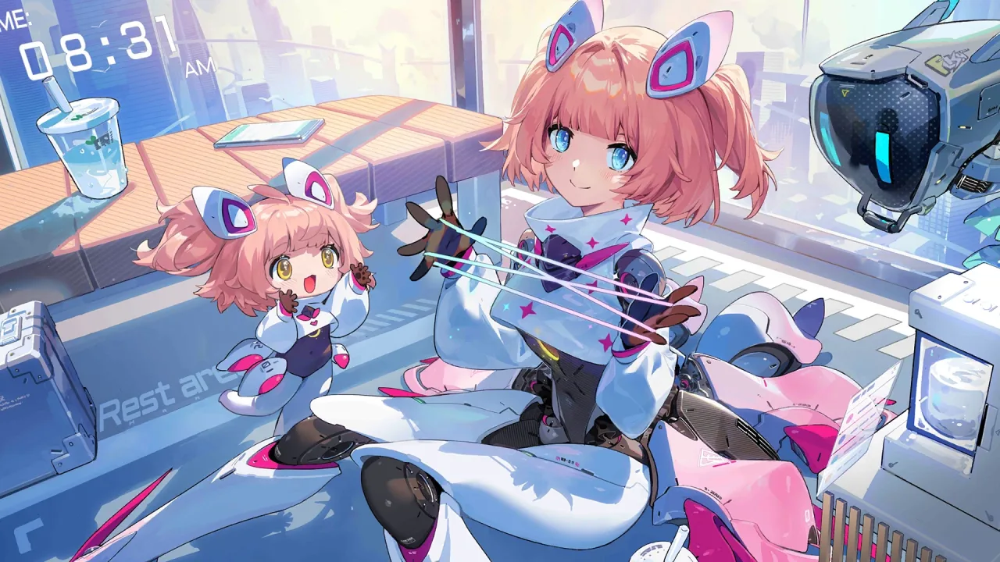

[Angela skins](https://boostmlbb.ru/en/skins/angela.html)

[Skins](https://boostmlbb.ru/en/skins/)/[Angela](https://boostmlbb.ru/en/skins/angela.html)/Cyber Cherubin

[Angela skin](https://boostmlbb.ru/en/skins/angela.html)

# Cyber Cherubin

GrandThe AspirantsLimited

How to get

Released in the The Aspirants event. Limited skins come back in event draws from time to time.

Released

3 January 2020

## What the skin changes

-   New look
-   New skill effects
-   Skill sounds
-   Voice-over
-   Skill icons
-   Showcase animation
-   Showcase scene
-   Showcase music
-   Spawn animation
-   Special actions
-   Attribute bonus

## All Angela skins [11](https://boostmlbb.ru/en/skins/angela.html)

[Strings of FateGrand · 2025](https://boostmlbb.ru/en/skins/angela/strings-of-fate.html)[Avatar of TimeExquisite · 2023](https://boostmlbb.ru/en/skins/angela/avatar-of-time.html)[HeartstringGrand · 2022](https://boostmlbb.ru/en/skins/angela/heartstring.html)[Floral ElfExquisite · 2021](https://boostmlbb.ru/en/skins/angela/floral-elf.html)[Cyber CherubinGrand · 2020](https://boostmlbb.ru/en/skins/angela/cyber-cherubin.html)[Scream DollExceptional · 2019](https://boostmlbb.ru/en/skins/angela/scream-doll.html)[V.E.N.O.M. VespidDeluxe · 2019](https://boostmlbb.ru/en/skins/angela/v-e-n-o-m-vespid.html)[Summer VibesExceptional · 2019](https://boostmlbb.ru/en/skins/angela/summer-vibes.html)[Shanghai MaidenExceptional · 2018](https://boostmlbb.ru/en/skins/angela/shanghai-maiden.html)[Dove&LoveCommon · 2018](https://boostmlbb.ru/en/skins/angela/dove-love.html)[Wind-up Courier](https://boostmlbb.ru/en/skins/angela/wind-up-courier.html)

## The Aspirants series

[Silverbolt RaikoSelena · 2026](https://boostmlbb.ru/en/skins/selena/silverbolt-raiko.html)[Imperatrix ArashiObsidia · 2026](https://boostmlbb.ru/en/skins/obsidia/imperatrix-arashi.html)[Daybreak HaloGuinevere · 2025](https://boostmlbb.ru/en/skins/guinevere/daybreak-halo.html)[Twilight StarVexana · 2025](https://boostmlbb.ru/en/skins/vexana/twilight-star.html)[Tech TensaiChang'e · 2024](https://boostmlbb.ru/en/skins/change/tech-tensai.html)[Deadeye SpectreLesley · 2024](https://boostmlbb.ru/en/skins/lesley/deadeye-spectre.html)[Mecha MaidenRuby · 2023](https://boostmlbb.ru/en/skins/ruby/mecha-maiden.html)[Blade of KibouFanny · 2022](https://boostmlbb.ru/en/skins/fanny/blade-of-kibou.html)

**How much is a rank boost on Angela?**Choose your current and target ranks to see the price here.

[Calculate price](https://boostmlbb.ru/en/order.html?type=hero)

## Frequently asked questions

How to get the Cyber Cherubin skin for Angela?

Released in the The Aspirants event. Limited skins come back in event draws from time to time.

When was Cyber Cherubin released?

3 January 2020.

What class is Cyber Cherubin?

Grand, The Aspirants series.
