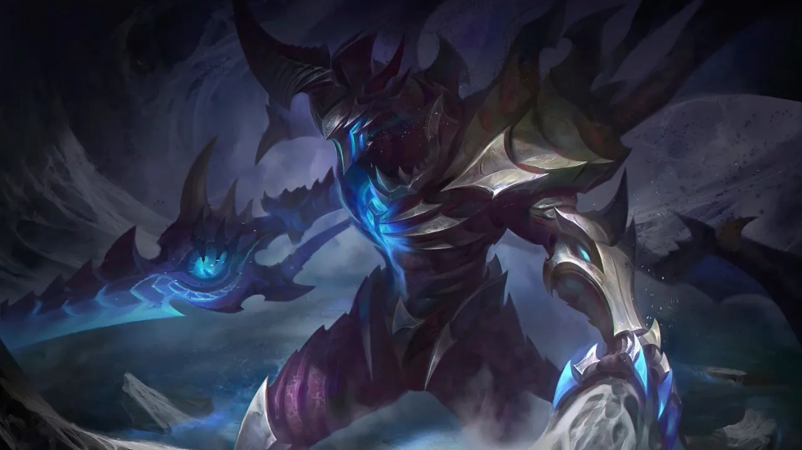

[Argus skins](https://boostmlbb.ru/en/skins/argus.html)

[Skins](https://boostmlbb.ru/en/skins/)/[Argus](https://boostmlbb.ru/en/skins/argus.html)/Dark Draconic

[Argus skin](https://boostmlbb.ru/en/skins/argus.html)

# Dark Draconic

ExceptionalStarLightLimited

How to get

StarLight reward for November 2017.

Released

1 November 2017

## What the skin changes

-   New look
-   New skill effects
-   Showcase animation
-   Attribute bonus

## All Argus skins [6](https://boostmlbb.ru/en/skins/argus.html)

[Raiden MaruExquisite · 2026](https://boostmlbb.ru/en/skins/argus/raiden-maru.html)[Darth VaderGrand · 2021](https://boostmlbb.ru/en/skins/argus/darth-vader.html)[Winged NightmareCommon · 2019](https://boostmlbb.ru/en/skins/argus/winged-nightmare.html)[CatastropheCommon · 2018](https://boostmlbb.ru/en/skins/argus/catastrophe.html)[Dark DraconicExceptional · 2017](https://boostmlbb.ru/en/skins/argus/dark-draconic.html)[Light of DawnCommon · 2017](https://boostmlbb.ru/en/skins/argus/light-of-dawn.html)

## StarLight series

[Tideborn SailorKalea · 2026](https://boostmlbb.ru/en/skins/kalea/tideborn-sailor.html)[Kitsune's ShadowHayabusa · 2026](https://boostmlbb.ru/en/skins/hayabusa/kitsune-s-shadow.html)[Fangs of SlaughterHanzo · 2026](https://boostmlbb.ru/en/skins/hanzo/fangs-of-slaughter.html)[Smoul­dering FortressBelerick · 2026](https://boostmlbb.ru/en/skins/belerick/smouldering-fortress.html)[Magitech WraithObsidia · 2026](https://boostmlbb.ru/en/skins/obsidia/magitech-wraith.html)[Elysian LuminanceZetian · 2026](https://boostmlbb.ru/en/skins/zetian/elysian-luminance.html)[Guardian BattalionHilda · 2026](https://boostmlbb.ru/en/skins/hilda/guardian-battalion.html)[Dreaming KoiHarley · 2026](https://boostmlbb.ru/en/skins/harley/dreaming-koi.html)

**How much is a rank boost on Argus?**Choose your current and target ranks to see the price here.

[Calculate price](https://boostmlbb.ru/en/order.html?type=hero)

## Frequently asked questions

How to get the Dark Draconic skin for Argus?

StarLight reward for November 2017.

When was Dark Draconic released?

1 November 2017.

What class is Dark Draconic?

Exceptional, StarLight series.
