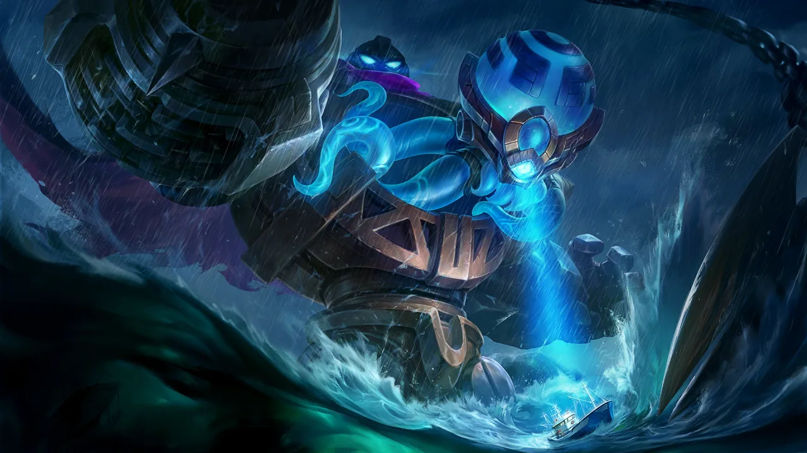

[All skins](https://boostmlbb.ru/en/skins/)

[Skins](https://boostmlbb.ru/en/skins/)/Atlas

# Atlas skins

Skins

7

In the shop

2

Latest

[Sunken Curse](https://boostmlbb.ru/en/skins/atlas/sunken-curse.html)2026

[Hero profile→](https://boostmlbb.ru/en/heroes/atlas.html)

## All skins

AllExquisiteDeluxeExceptionalCommon

[Sunken CurseDeluxe · 2026](https://boostmlbb.ru/en/skins/atlas/sunken-curse.html)[Mecha InfernusExquisite · 2024](https://boostmlbb.ru/en/skins/atlas/mecha-infernus.html)[Rune of SentinelDeluxe · 2023](https://boostmlbb.ru/en/skins/atlas/rune-of-sentinel.html)[Space MechExceptional · 2022](https://boostmlbb.ru/en/skins/atlas/space-mech.html)[Fuel TurbineCommon · 2020](https://boostmlbb.ru/en/skins/atlas/fuel-turbine.html)[Reactor CoreCommon · 2020](https://boostmlbb.ru/en/skins/atlas/reactor-core.html)[Maelstrom Lurker](https://boostmlbb.ru/en/skins/atlas/maelstrom-lurker.html)

**How much is a rank boost on Atlas?**Choose your current and target ranks to see the price here.

[Calculate price](https://boostmlbb.ru/en/order.html?type=hero)

## Frequently asked questions

How many skins does Atlas have?

7 skins, the default look not counted. The newest is Sunken Curse (9 February 2026).

Which Atlas skins can you buy now?

Fuel Turbine (599 diamonds), Reactor Core (269 diamonds). The other skins were limited and come back only in events.

What is the rarest Atlas skin?

Mecha Infernus, Exquisite class, Collector series. The top prize of a Collector event draw, paid with diamonds. Limited skins come back in event draws from time to time.
