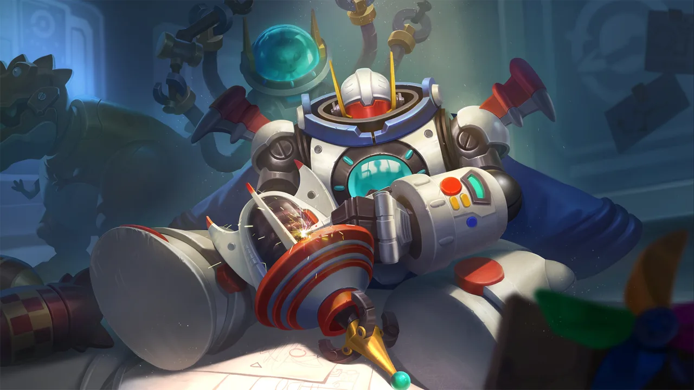

[Atlas skins](https://boostmlbb.ru/en/skins/atlas.html)

[Skins](https://boostmlbb.ru/en/skins/)/[Atlas](https://boostmlbb.ru/en/skins/atlas.html)/Space Mech

[Atlas skin](https://boostmlbb.ru/en/skins/atlas.html)

# Space Mech

ExceptionalStarLightLimited

How to get

StarLight reward for September 2022.

Released

1 September 2022

## What the skin changes

-   New look
-   New skill effects
-   Showcase animation
-   Showcase scene
-   Attribute bonus

## All Atlas skins [7](https://boostmlbb.ru/en/skins/atlas.html)

[Sunken CurseDeluxe · 2026](https://boostmlbb.ru/en/skins/atlas/sunken-curse.html)[Mecha InfernusExquisite · 2024](https://boostmlbb.ru/en/skins/atlas/mecha-infernus.html)[Rune of SentinelDeluxe · 2023](https://boostmlbb.ru/en/skins/atlas/rune-of-sentinel.html)[Space MechExceptional · 2022](https://boostmlbb.ru/en/skins/atlas/space-mech.html)[Fuel TurbineCommon · 2020](https://boostmlbb.ru/en/skins/atlas/fuel-turbine.html)[Reactor CoreCommon · 2020](https://boostmlbb.ru/en/skins/atlas/reactor-core.html)[Maelstrom Lurker](https://boostmlbb.ru/en/skins/atlas/maelstrom-lurker.html)

## StarLight series

[Tideborn SailorKalea · 2026](https://boostmlbb.ru/en/skins/kalea/tideborn-sailor.html)[Kitsune's ShadowHayabusa · 2026](https://boostmlbb.ru/en/skins/hayabusa/kitsune-s-shadow.html)[Fangs of SlaughterHanzo · 2026](https://boostmlbb.ru/en/skins/hanzo/fangs-of-slaughter.html)[Smoul­dering FortressBelerick · 2026](https://boostmlbb.ru/en/skins/belerick/smouldering-fortress.html)[Magitech WraithObsidia · 2026](https://boostmlbb.ru/en/skins/obsidia/magitech-wraith.html)[Elysian LuminanceZetian · 2026](https://boostmlbb.ru/en/skins/zetian/elysian-luminance.html)[Guardian BattalionHilda · 2026](https://boostmlbb.ru/en/skins/hilda/guardian-battalion.html)[Dreaming KoiHarley · 2026](https://boostmlbb.ru/en/skins/harley/dreaming-koi.html)

**How much is a rank boost on Atlas?**Choose your current and target ranks to see the price here.

[Calculate price](https://boostmlbb.ru/en/order.html?type=hero)

## Frequently asked questions

How to get the Space Mech skin for Atlas?

StarLight reward for September 2022.

When was Space Mech released?

1 September 2022.

What class is Space Mech?

Exceptional, StarLight series.
