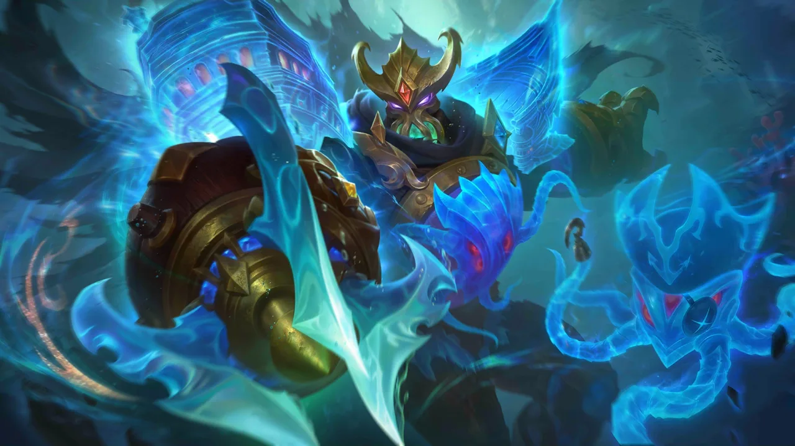

[Tier list](https://boostmlbb.ru/en/heroes/)[Items](https://boostmlbb.ru/en/items/)[Skins](https://boostmlbb.ru/en/skins/)[News & guides](https://boostmlbb.ru/en/news/)

[Skins](https://boostmlbb.ru/en/skins/)/[Atlas](https://boostmlbb.ru/en/skins/atlas.html)/Sunken Curse

[Atlas skin](https://boostmlbb.ru/en/skins/atlas.html)

# Sunken Curse

DeluxeEpicLimited

How to get

Released in the skin shop during an event. Limited skins come back in event draws from time to time.

Released

9 February 2026

## What the skin changes

-   New look
-   New skill effects
-   Showcase animation
-   Showcase scene
-   Attribute bonus

## All Atlas skins [7](https://boostmlbb.ru/en/skins/atlas.html)

[Sunken CurseDeluxe · 2026](https://boostmlbb.ru/en/skins/atlas/sunken-curse.html)[Mecha InfernusExquisite · 2024](https://boostmlbb.ru/en/skins/atlas/mecha-infernus.html)[Rune of SentinelDeluxe · 2023](https://boostmlbb.ru/en/skins/atlas/rune-of-sentinel.html)[Space MechExceptional · 2022](https://boostmlbb.ru/en/skins/atlas/space-mech.html)[Fuel TurbineCommon · 2020](https://boostmlbb.ru/en/skins/atlas/fuel-turbine.html)[Reactor CoreCommon · 2020](https://boostmlbb.ru/en/skins/atlas/reactor-core.html)[Maelstrom Lurker](https://boostmlbb.ru/en/skins/atlas/maelstrom-lurker.html)

## Epic series

[Nether OverseerMinotaur · 2026](https://boostmlbb.ru/en/skins/minotaur/nether-overseer.html)[Eternal VowVexana · 2026](https://boostmlbb.ru/en/skins/vexana/eternal-vow.html)[Cursed ScrollKhufra · 2025](https://boostmlbb.ru/en/skins/khufra/cursed-scroll.html)[Soul HuntressNatalia · 2025](https://boostmlbb.ru/en/skins/natalia/soul-huntress.html)[Nightmare CountLeomord · 2025](https://boostmlbb.ru/en/skins/leomord/nightmare-count.html)[Arbiter of StarsBelerick · 2025](https://boostmlbb.ru/en/skins/belerick/arbiter-of-stars.html)[Keeper of the WindsVale · 2025](https://boostmlbb.ru/en/skins/vale/keeper-of-the-winds.html)[Dreambound PixieMathilda · 2025](https://boostmlbb.ru/en/skins/mathilda/dreambound-pixie.html)

**Rank up on Atlas**The calculator shows the price

[Calculate price](https://boostmlbb.ru/en/order.html?type=hero)

## Frequently asked questions

How to get the Sunken Curse skin for Atlas?

Released in the skin shop during an event. Limited skins come back in event draws from time to time.

When was Sunken Curse released?

9 February 2026.

What class is Sunken Curse?

Deluxe, Epic series.
