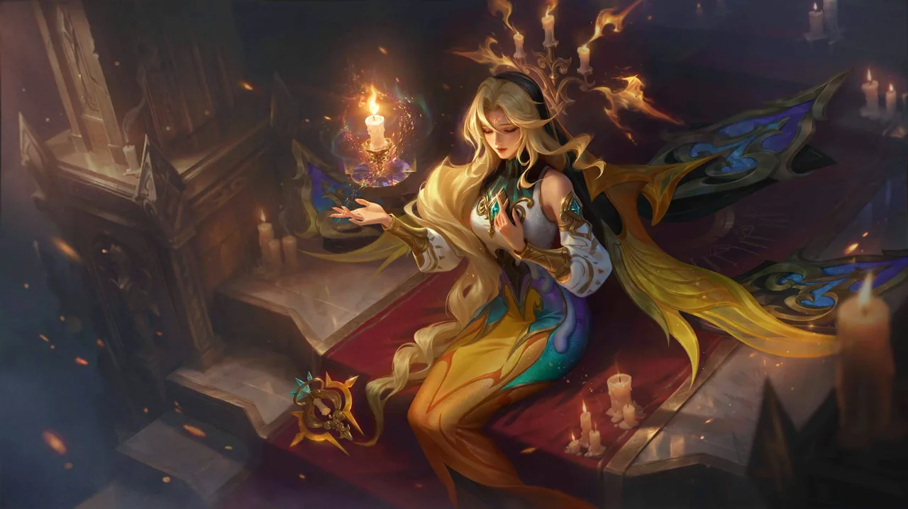

[Tier list](https://boostmlbb.ru/en/heroes/)[Items](https://boostmlbb.ru/en/items/)[Skins](https://boostmlbb.ru/en/skins/)[News & guides](https://boostmlbb.ru/en/news/)

[Skins](https://boostmlbb.ru/en/skins/)/[Aurora](https://boostmlbb.ru/en/skins/aurora.html)/Candle's Vigil

[Aurora skin](https://boostmlbb.ru/en/skins/aurora.html)

# Candle's Vigil

EpicIn the shop

How to get

Released in the skin shop during an event.

## All Aurora skins [7](https://boostmlbb.ru/en/skins/aurora.html)

[Veil of the CelestialsExquisite · 2025](https://boostmlbb.ru/en/skins/aurora/veil-of-the-celestials.html)[Kula DiamondGrand · 2019](https://boostmlbb.ru/en/skins/aurora/kula-diamond.html)[AquariusDeluxe · 2019](https://boostmlbb.ru/en/skins/aurora/aquarius.html)[Foxy LadyExceptional · 2018](https://boostmlbb.ru/en/skins/aurora/foxy-lady.html)[Heartbreak EmpressExceptional · 2017](https://boostmlbb.ru/en/skins/aurora/heartbreak-empress.html)[Nature's ThroneCommon · 2017](https://boostmlbb.ru/en/skins/aurora/nature-s-throne.html)[Candle's Vigil](https://boostmlbb.ru/en/skins/aurora/candle-s-vigil.html)

## Epic series

[Nether OverseerMinotaur · 2026](https://boostmlbb.ru/en/skins/minotaur/nether-overseer.html)[Sunken CurseAtlas · 2026](https://boostmlbb.ru/en/skins/atlas/sunken-curse.html)[Eternal VowVexana · 2026](https://boostmlbb.ru/en/skins/vexana/eternal-vow.html)[Cursed ScrollKhufra · 2025](https://boostmlbb.ru/en/skins/khufra/cursed-scroll.html)[Soul HuntressNatalia · 2025](https://boostmlbb.ru/en/skins/natalia/soul-huntress.html)[Nightmare CountLeomord · 2025](https://boostmlbb.ru/en/skins/leomord/nightmare-count.html)[Arbiter of StarsBelerick · 2025](https://boostmlbb.ru/en/skins/belerick/arbiter-of-stars.html)[Keeper of the WindsVale · 2025](https://boostmlbb.ru/en/skins/vale/keeper-of-the-winds.html)

**Rank up on Aurora**The calculator shows the price

[Calculate price](https://boostmlbb.ru/en/order.html?type=hero)

## Frequently asked questions

How to get the Candle's Vigil skin for Aurora?

Released in the skin shop during an event.
