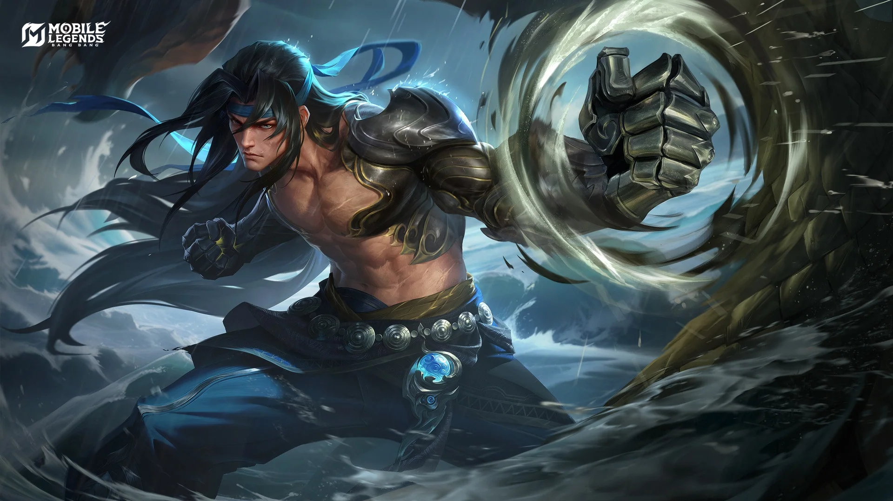
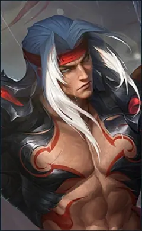
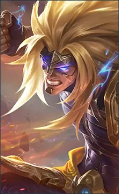

[Tier list](https://boostmlbb.ru/en/heroes/)[Items](https://boostmlbb.ru/en/items/)[Skins](https://boostmlbb.ru/en/skins/)[News & guides](https://boostmlbb.ru/en/news/)

[Skins](https://boostmlbb.ru/en/skins/)/Badang

# Badang skins

Skins

8

In the shop

3

Latest

[Quantum Commando](https://boostmlbb.ru/en/skins/badang/quantum-commando.html)2026

[Hero profile→](https://boostmlbb.ru/en/heroes/badang.html)

## All skins

AllGrandExquisiteDeluxeExceptionalCommon

[Quantum CommandoExceptional · 2026](https://boostmlbb.ru/en/skins/badang/quantum-commando.html)[Steel ArmsExceptional · 2025](https://boostmlbb.ru/en/skins/badang/steel-arms.html)[Sagit­tarius SeiyaGrand · 2022](https://boostmlbb.ru/en/skins/badang/sagittarius-seiya.html)[Pegasus SeiyaDeluxe · 2022](https://boostmlbb.ru/en/skins/badang/pegasus-seiya.html)[IronfistsCommon · 2022](https://boostmlbb.ru/en/skins/badang/ironfists.html)[Fist of ZenExquisite · 2020](https://boostmlbb.ru/en/skins/badang/fist-of-zen.html)[LeoDeluxe · 2019](https://boostmlbb.ru/en/skins/badang/leo.html)[SusanooExceptional · 2018](https://boostmlbb.ru/en/skins/badang/susanoo.html)

**Rank up on Badang**The calculator shows the price

[Calculate price](https://boostmlbb.ru/en/order.html?type=hero)

## Frequently asked questions

How many skins does Badang have?

8 skins, the default look not counted. The newest is Quantum Commando (6 September 2026).

Which Badang skins can you buy now?

Quantum Commando (749 diamonds), Ironfists (269 diamonds), Susanoo (749 diamonds). The other skins were limited and come back only in events.

What is the rarest Badang skin?

Sagittarius Seiya, Grand class, Saint Seiya series. Released in the MLBB × Saint Seiya event.
