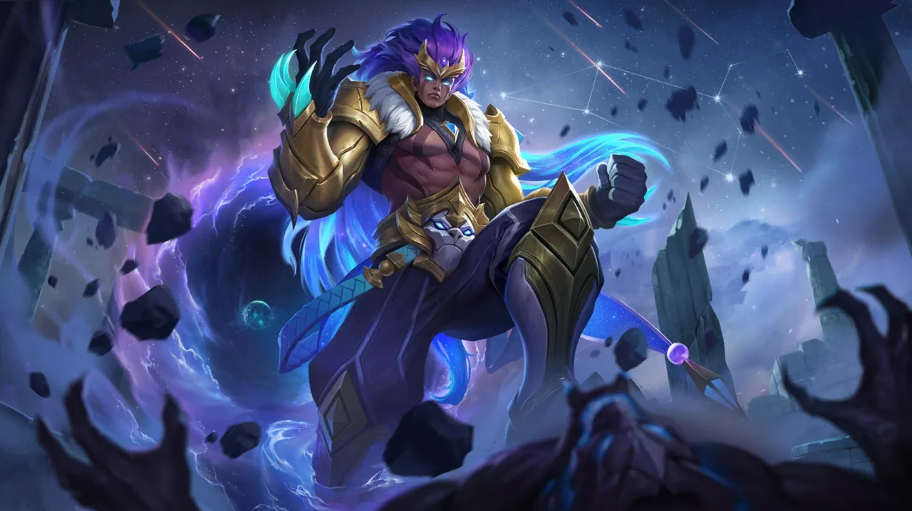

[Tier list](https://boostmlbb.ru/en/heroes/)[Items](https://boostmlbb.ru/en/items/)[Skins](https://boostmlbb.ru/en/skins/)[News & guides](https://boostmlbb.ru/en/news/)

[Skins](https://boostmlbb.ru/en/skins/)/[Badang](https://boostmlbb.ru/en/skins/badang.html)/Leo

[Badang skin](https://boostmlbb.ru/en/skins/badang.html)

# Leo

DeluxeZodiacLimited

How to get

Drawn in the Zodiac Summon.

Released

23 July 2019

## What the skin changes

-   New look
-   New skill effects
-   Skill sounds
-   Voice-over
-   Showcase animation
-   Showcase scene
-   Attribute bonus

## All Badang skins [8](https://boostmlbb.ru/en/skins/badang.html)

[Quantum CommandoExceptional · 2026](https://boostmlbb.ru/en/skins/badang/quantum-commando.html)[Steel ArmsExceptional · 2025](https://boostmlbb.ru/en/skins/badang/steel-arms.html)[Sagit­tarius SeiyaGrand · 2022](https://boostmlbb.ru/en/skins/badang/sagittarius-seiya.html)[Pegasus SeiyaDeluxe · 2022](https://boostmlbb.ru/en/skins/badang/pegasus-seiya.html)[IronfistsCommon · 2022](https://boostmlbb.ru/en/skins/badang/ironfists.html)[Fist of ZenExquisite · 2020](https://boostmlbb.ru/en/skins/badang/fist-of-zen.html)[LeoDeluxe · 2019](https://boostmlbb.ru/en/skins/badang/leo.html)[SusanooExceptional · 2018](https://boostmlbb.ru/en/skins/badang/susanoo.html)

## Zodiac series

[CapricornMartis · 2022](https://boostmlbb.ru/en/skins/martis/capricorn.html)[ScorpioHelcurt · 2019](https://boostmlbb.ru/en/skins/helcurt/scorpio.html)[LibraLunox · 2019](https://boostmlbb.ru/en/skins/lunox/libra.html)[CancerZhask · 2019](https://boostmlbb.ru/en/skins/zhask/cancer.html)[Gemini - ShadowSelena · 2019](https://boostmlbb.ru/en/skins/selena/gemini-shadow.html)[Gemini - HaloKarina · 2019](https://boostmlbb.ru/en/skins/karina/gemini-halo.html)[TaurusMinotaur · 2019](https://boostmlbb.ru/en/skins/minotaur/taurus.html)[AriesHilda · 2019](https://boostmlbb.ru/en/skins/hilda/aries.html)

**Rank up on Badang**The calculator shows the price

[Calculate price](https://boostmlbb.ru/en/order.html?type=hero)

## Frequently asked questions

How to get the Leo skin for Badang?

Drawn in the Zodiac Summon.

When was Leo released?

23 July 2019.

What class is Leo?

Deluxe, Zodiac series.
